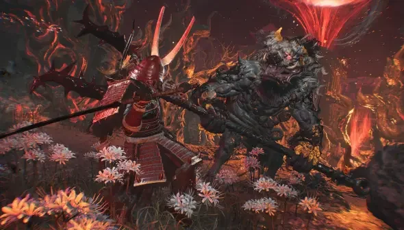

Ngồi xuống uống miếng nước rồi nghe nè. Nioh 3 **không có chế độ dễ**, không chỉnh được độ khó, ai vào cũng phải nếm đủ vị như nhau. Nhưng không có nút "Easy" thì mình tự chế một cái bằng build.

Tiêu chí của build hôm nay: **không cần phản xạ thần sầu, không cần nhớ combo dài, không cần tính toán hiệu ứng rối rắm**. Đánh tới đâu hồi máu tới đó, đứng xa vẫn đánh tới, đỡ đòn mà Ki vẫn hồi. Vũ khí chính là **Spear (thương)**, món mà Game8 xếp build hạng **SS** chính vì "dễ tiếp cận với người chơi ở mọi trình độ".

<strong>Vì sao không phải Ninja?</strong> Game8 nói Ninja dễ hơn với đa số người chơi, nhưng Ninja cần né đúng nhịp. Ai phản xạ chậm, hay bị ngợp khi boss ra đòn liên tục, thì đứng Mid Stance giữ đỡ và chọc thương từ xa lại dễ thở hơn nhiều. Cái này khó nha, khó nói thiệt chớ, mỗi người hợp một kiểu, nên cuối bài Cenix vẫn để sẵn món Ninja đi kèm.

## Ba trụ cột của build

1.  **Tầm xa**: thương đâm được từ khoảng cách mà đa số quái chưa với tới, quét được cả đám.
    
2.  **Hút máu bằng Amrita**: mỗi lần đánh trúng rơi Amrita, mà Amrita thì hồi máu nhờ hiệu ứng **Life Recovery (Amrita Absorption)** chồng từ nhiều nguồn.
    
3.  **Mid Stance giữ đỡ**: ở thế giữa, **vừa đỡ vừa hồi Ki**. Không biết né lúc nào thì cứ giơ thương lên đỡ.
    

## Chỉ số: lì là chính

Thương scale **Constitution, Heart, Skill**.

| Chỉ số | Mục tiêu | Lý do |
|---|---|---|
| **Heart** | Cao nhất | Vừa tăng sát thương thương vừa thêm Ki và tốc độ hồi Ki |
| **Constitution** | 20–25 rồi tăng dần | Máu dày, lại là chỉ số scale của thương |
| **Stamina** | Vừa đủ | Mặc giáp nặng mà vẫn giữ Agility màu xanh |
| **Magic** | **17** | Mốc kích hoạt Soul Core Nuppeppo (xem bên dưới), dư ra 3 ô bùa |
| **Skill** | Phần còn lại | Tăng sức mạnh Arts |

## Món chủ lực: Soul Core Nuppeppo

Đây là linh hồn của cả build. Soul Core **Nuppeppo** đặt ở ô **Yang** cho **+100 máu** và **Life Recovery (Amrita Absorption) 12**, tức mỗi lần hút Amrita là hồi máu. Ở ô Yin nó cho 5 **Rejuvenation Talisman**. Cần **17 Magic** để kích hoạt.

Cái hay là lấy được **rất sớm**: Nuppeppo xuất hiện trong nhiệm vụ phụ **Headaches** ở Hamamatsu (mở sau khi xong *Fated Land*), ngay thời Warring States.

Cộng thêm **Gaki Chief** Soul Core ở ô Yin để có **Extraction Talisman**: dán lên vũ khí là mỗi đòn trúng hút ra Amrita, mà Amrita lại kích hoạt hồi máu của Nuppeppo. Vòng lặp đánh là sống khép kín từ đây.

Ô Yin còn lại: **Mezuki** hoặc **Mermaid**.

## Martial Arts: ít mà chất

Tiêu điểm Samurai theo thứ tự: **High Stance** → **Low Stance** → **Deflect**. Sau đó lấy các chiêu thương:

-   **Spear Bash**: nối đẹp sau đòn mạnh.
    
-   **Spear Flourish**: biến **Ki Pulse thành một đòn đánh**, vừa hồi Ki vừa gây sát thương. Chiêu đáng lấy nhất.
    
-   **Spear Shove**: bước tới quét ngang, sát thương Ki tốt.
    
-   **Windmill Wind** (High/Mid): xoay thương quét vòng có gió, dọn đám đông.
    
-   **Fatal Thrust**: đâm liên hoàn khi địch trong tầm.
    

**Chỉ cần thuộc đúng hai combo:**

-   **Một boss**: ở Mid Stance, đòn mạnh → **Spear Bash** → **Spear Flourish** để hồi Ki. Lặp lại, chờ sơ hở mới vào.
    
-   **Một đám**: Mid Stance, đòn mạnh → **Windmill Wind** → **Spear Flourish**.
    

**Kỹ năng bí truyền:** **Oppressive Strength** (không bị khựng khi dùng đòn mạnh và Martial Arts lúc Arts Proficiency bật), **Resilient Arts** (+**8%** sát thương đòn mạnh và Martial Arts), **Ki Pulse: Man** (Ki Pulse hoàn hảo ở Mid Stance thì lần đỡ kế tiếp không mất Ki), **Defense Mastery I và II** (+6 và +14 phòng thủ).

*Thương dài, giáp dày, đứng Mid Stance mà đỡ: phong cách "chậm mà chắc" cho anh em không thích lăn lộn.*

## Guardian Spirit, giáp, phụ kiện

### Guardian Spirit

-   **Guhin** (có ngay đầu game): giảm **8,4%** Ki của Martial Arts, giảm **4,2%** sát thương nhận vào, tăng phá thế đỡ bằng đòn mạnh.
    
-   **Shin-Roku** (xong màn Escape From Hitokoto Slope): **hút máu 4% từ đòn mạnh**, thêm kháng sét và kháng hiệu ứng. Đúng chất "đánh là hồi", nhưng cần phá **13** Crucible Spike mới mở hết hiệu ứng.
    
-   **Oh** (cuối thời Heian): **Life Recovery (Amrita Absorption) 11** chồng thẳng lên Nuppeppo, giảm Ki khi đỡ, tăng tỉ lệ rơi đồ. Có con này là build "bất tử" thật sự.
    

### Giáp và phụ kiện

-   **Giáp**: mặc nặng nhưng giữ **Agility màu xanh**. Đầu game dùng bộ **Crimson General**, về sau là **Tatenashi** (thủ rất chắc), **Eccentric** (tăng đòn mạnh) hoặc **Wayfarer**.
    
-   Hiệu ứng ưu tiên: **Life Recovery (Amrita Absorption)**, **Auto Life Recovery (Deflect)**, giảm Ki đòn mạnh, Defense, Toughness.
    
-   **Phụ kiện**: **Prayer Beads** (sẵn Life Recovery Amrita Absorption), **Omamori** (thêm máu), **Fan** (hồi Ki). Hiệu ứng **Untouched Elixirs** (có tỉ lệ uống Elixir mà không mất bình) cũng rất đáng.
    
-   **Clan**: **Kato** (giảm **15%** sát thương nhận vào khi đang tấn công, giảm thêm **10%** khi máu thấp, Game8 khen đặc biệt hợp người mới) hoặc **Uesugi** (+5 Toughness, hút **300** máu mỗi khi hạ địch bằng cận chiến, đi khám phá bản đồ đỡ tốn Elixir).
    

## Món Ninja đi kèm và mẹo chống ngộp

Cần một vũ khí Ninja đi kèm thì chọn **Kusarigama**: chung **Constitution và Skill** với thương, tầm cũng dài, kéo được quái nhỏ lại gần. Guardian Spirit phe Ninja là **Kusanagi (Ninja)**, sang mid-game đổi **Kurama Tengu** để có Enemy Sensor biết trước địch nằm đâu.

**Mẹo chống ngộp cho mọi build:**

-   **Gọi người giúp**: Benevolent Grave (mộ xanh) cạnh hầu hết phòng boss cho gọi NPC đánh phụ, tốn Ochoko Cup. Có thằng giữ aggro là boss dễ hơn hẳn.
    
-   **Dùng Summoning Seal** từ Soul Core Yang: Nuppeppo có sẵn 3 lần gọi, lao vào xoay quét quanh địch.
    
-   **Cày cấp không có gì xấu hổ**: đánh quái quanh Shrine rồi ngồi Shrine cho chúng hồi lại, hoặc chơi lại Crucible qua Battle Scroll.
    
-   **Bùa buff trước trận**: Power Talisman, Power Pill, kháng nguyên tố (Firestop, Windstop...) nếu boss đánh nguyên tố.
    
-   **Living Artifact**: bật lúc boss cạn Ki là bạn không chết, Ki vô hạn, dập cho tới khi hết giờ.
    
-   **Co-op**: kẹt quá thì gọi bạn vào chơi chung qua Shrine.
    

Build không có gì hoa mỹ, nhưng anh em sẽ thấy mình đứng vững trước những con boss từng hành mình lên bờ xuống ruộng. Anh em thích kiểu "chậm mà chắc" này hay vẫn phải lướt như gió mới chịu? Ai đang kẹt boss nào thì để lại tên dưới phần bình luận, Cenix chỉ cách cho.

*Nguồn tham khảo: [Game8 - Best Spear Build](https://game8.co/games/Nioh-3/archives/579399), [Game8 - Easy Mode](https://game8.co/games/Nioh-3/archives/576098), [Game8 - Best Builds Tier List](https://game8.co/games/Nioh-3/archives/576622), [Game8 - Best Clans](https://game8.co/games/Nioh-3/archives/579768), [Game8 - Level Up Fast](https://game8.co/games/Nioh-3/archives/576689), [OPBoostBuilds - Ultimate Immortal Samurai & Ninja](https://opboostbuilds.com/builds/nioh-3-ultimate-immortal-samurai-ninja), [eGamersWorld](https://egamersworld.com/blog/nioh-3-best-builds-for-ninja-samurai-complete-guid-jxtlCImOAW)*
