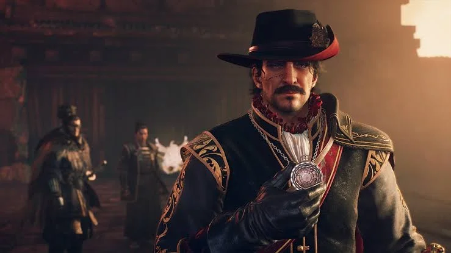
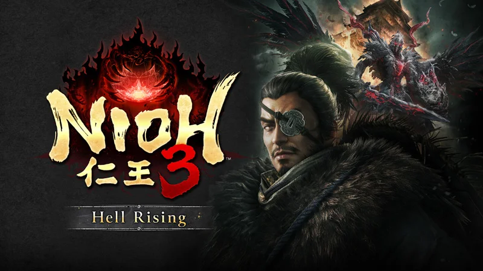
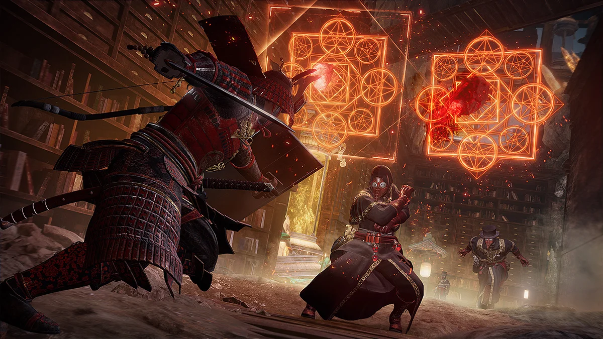
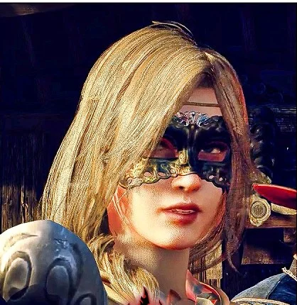
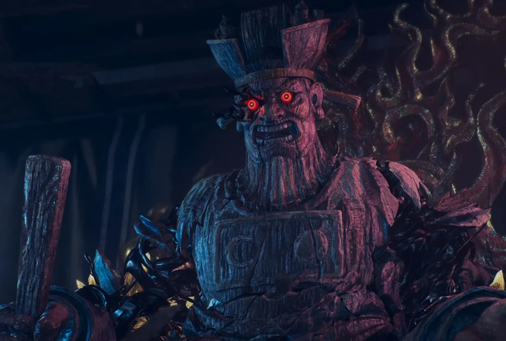
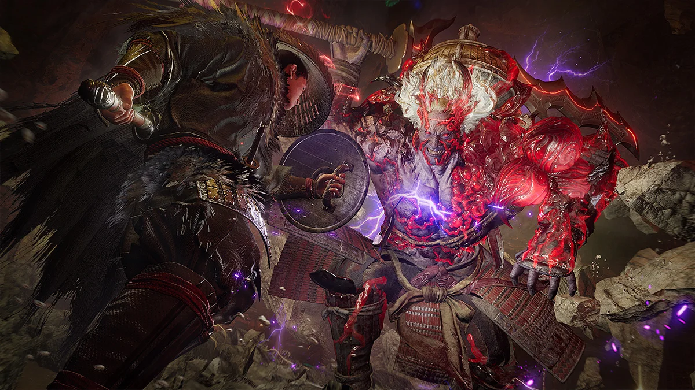
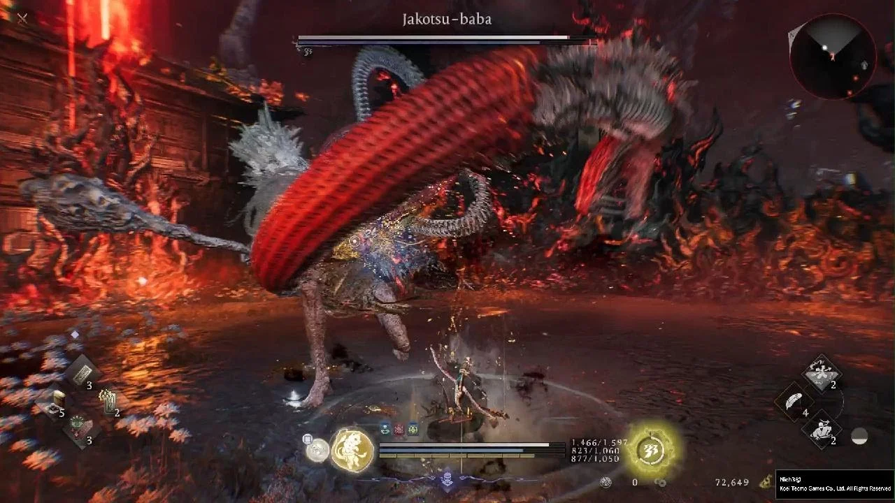
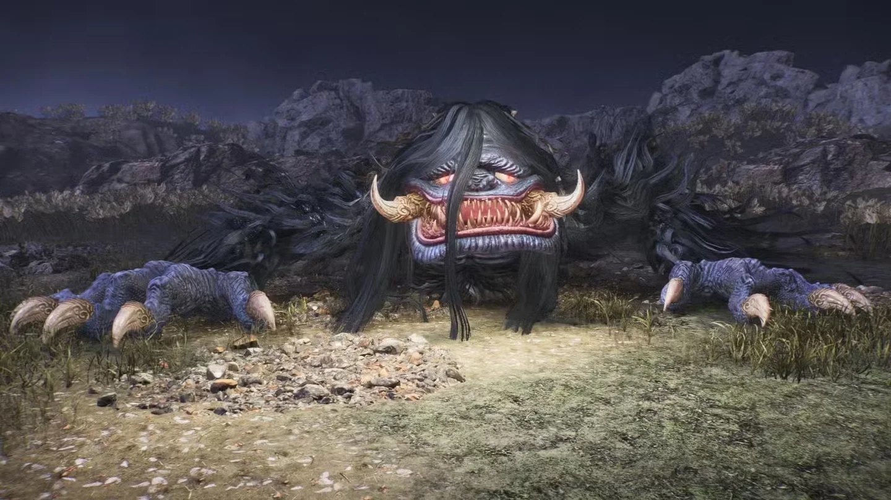

Hội anh em cuồng game ơi, Edo năm 1651 không dành cho người yếu tim. **Hell Rising** đưa Takechiyo tới một tương lai nơi chính anh đã chết, thành Edo thành bãi hoang, và một cuộc nổi loạn đang gọi yêu quái tràn vào thành. Boss người ở đây đánh **nhanh ngang hoặc nhanh hơn người chơi**, còn yêu quái quen mặt thì quay lại kèm thêm cả bầy lâu la.

Bài này là bản đồ đi trọn DLC: **3 màn chính, 10 Myth, 2 nhiệm vụ phụ ẩn**, hồ sơ từng boss theo đúng thứ tự gặp, cách hạ, phần thưởng, và những món dễ bỏ lỡ. Anh em nào cần build để vào DLC thì xem bài [Build Tonfa Gun cho Hell Rising](/huong-dan/nioh-3-hell-rising-build-tonfa-gun/) trước, còn boss bản gốc nằm ở bài [Walkthrough và cách hạ boss](/huong-dan/nioh-3-walkthrough-va-cach-ha-boss/).

## Edo 1651: chuyện gì đang xảy ra

Năm **1651**, thời **Keian**. Trong lịch sử thật, Shogun Tokugawa Iemitsu (chính là Takechiyo) qua đời đúng năm này, và chỉ vài tháng sau, nhà binh pháp **Yui Shosetsu** cùng nhóm lãng nhân âm mưu đốt Edo, chiếm thành. Sử Nhật gọi là **biến Keian**.

Hell Rising lấy đúng sự kiện đó làm nền. Takechiyo bị một yêu quái từng gặp trong giấc mơ kéo tới tương lai, nơi Takechiyo của thời này đã chết. Phe nổi loạn của Shosetsu dùng **Spirit Stone** gọi yêu quái tấn công thành Edo, đi cùng là một nhóm **giả kim thuật sĩ ngoại quốc**.

Phe ta có kiếm khách một mắt **Yagyu Jubei** và **Rodrigo**, sứ thần Tây Ban Nha. Bên cạnh còn cả dàn nhân vật lịch sử: **Matsudaira Nobutsuna** (vị lão trung nổi tiếng mưu trí, biệt danh "Chie Izu"), **Tokugawa Mitsukuni** (Mito Komon, "phó Shogun" của dòng Mito), **Araki Mataemon**, **Maeda Mitsutaka**...

**Bản đồ** là một vùng mở lớn, cỡ phần Heian của bản gốc: Kanda, Ueno, Koishikawa, thành Edo đổ nát, cống ngầm, một vùng núi lửa. Phần cốt truyện dài khoảng **8–10 tiếng**, chơi cả nội dung lặp lại thì trên **30 tiếng**.

<strong>Trước khi vào:</strong> phải <strong>phá đảo cốt truyện chính</strong> mới mở được DLC. Review của Analog Stick Gaming khuyên tối thiểu <strong>cấp 140</strong>, dưới mức này đa số boss đánh một phát là chết. Một số boss trong DLC là boss phụ, đi thẳng cốt truyện là <strong>lỡ mất</strong>, nên bám theo bảng nhiệm vụ bên dưới.

## Bảng nhiệm vụ: 3 màn chính, 10 Myth, 2 nhiệm vụ ẩn

### Ba màn chính

| # | Màn | Mở khi | Boss |
|---|---|---|---|
| 1 | **Crucible Once Again** | Màn mở đầu DLC | **Yagyu Jubei** |
| 2 | **Menace Lurking within Chokodo** | Xong màn 1 | **Kanai Hanbei** |
| 3 | **Carnage of Hell Wind** | Xong màn 2 | **Alchemists**, **Fabricated Warrior**, **Berenguela**, **Yui Shosetsu** (trận cuối) |

### Mười Myth

| Myth | Mở khi | Nơi | Boss | Phần thưởng chính |
|---|---|---|---|---|
| **Way of the Yagyu** | Xong màn 1 | Võ đường Yagyu Munenori | **Giant Toad** | Miike Denta & Straw Hat, **Ki Pulse Mastery Kai** |
| **Left Behind** | Xong màn 1 | Bến tàu | **Kasha** | Scampuss Hat |
| **Stagnant Shogunate** | Xong màn 1 | Gặp Matsudaira Nobutsuna | **Kawara Jurobei**, **Enenra** | Chieizu's Cloak, **mở Picture Scroll** |
| **Flames of Vengeance** | Xong màn 1 | Võ đường | **Marubashi Chuya** | Ichigen Koji's Spear, Ichigen Koji's Shoes |
| **Agony of the Mito Tokugawa** | Xong màn 1 | Chokodo | **Magatsu Warrior**, **Tesso** | Vice Shogun's Cestuses / Waistguard |
| **Keian Noble Bouts** | Xong màn 2 | Marubashi Dojo, phía đông Koishikawa | **Anazawa Morihide**, **Mori Gentatsu**, **Yamada Shinryuken**, **Bloodedge Demon** | Hokkyo Rai Kinmichi & Uda Kunimitsu, Mataemon's Robe, Master Axe-Thrower's Hatchets |
| **Savior's Light** | Xong màn 2 và *Agony of the Mito Tokugawa* | Ba thời đại | Một bầy yêu quái | Vice Shogun's Pill Box |
| **Light of a Million Koku** | Tới dinh Kaga Maeda trong màn 3 | Dinh Kaga Maeda | **Robust Spear Samurai** | Million Koku Long Spear / Gauntlets, **Purify Yokai Realm: Spirit Kai** |
| **Yagyu Principles** | Đi tiếp màn 3 | Ravine Training Ground, Kanda | **Yagyu Jubei** (tái đấu) | One-Eyed Master's Hat, Mysticite Shard, Composure Handbook |
| **Waterside Temptation** | Tới Path of Divine trong màn 3 | Path of Divine, đền, Ueno | **Jakotsu-baba** | **Supreme Parry Kai**, Two Leaves |

Myth thưởng thêm **Ninja's Locks** hoặc **Samurai's Locks** (mở rộng cây kỹ năng). Hai nhiệm vụ phụ ẩn **Ghost of Hirakawa Gate** và **Keian Dreams** nằm ở phần cuối bài.

## Boss màn chính

### Yagyu Jubei

Yagyu Jubei Mitsuyoshi là kiếm khách huyền thoại của phái **Yagyu Shinkage-ryu**, con trai Yagyu Munenori, người dạy kiếm cho chính Shogun. Giai thoại kể ông mất một mắt khi luyện kiếm, và thanh kiếm của ông là nỗi sợ của cả Edo. Sử chép ông mất năm 1650, nhưng Hell Rising cho ông đứng chặn đường Takechiyo ngay màn mở đầu, như một bài kiểm tra tay nghề, trước khi trở thành đồng minh.

**Điểm mạnh**

-   **Hai pha, hai vũ khí**: mở trận bằng **katana**, tới khoảng **nửa máu** thì đổi sang **Hoko & khiên**.
-   Chuỗi katana dồn dập, kết bằng **cú nhảy chém dọc**.
-   Về sau bay lên không và bắn **đạn nước** từ xa.
-   **Né được Ninjutsu**: ném bừa là phí lượt.

**Điểm yếu**

-   Mỗi chuỗi đòn đều có **khoảng hồi** sau cú kết, đủ cho một nhịp phạt ngắn.
-   Pha Hoko & khiên chậm hơn pha katana, dễ đọc hơn nếu không lao thẳng vào khiên.

**Cách hạ gục**

1.  **Giữ tầm trung**, chờ ông ra hẳn một chuỗi đòn rõ ràng.
2.  **Né hết cả chuỗi**, rồi phạt **đúng một nhịp ngắn** lúc ông hồi chiêu. Đừng tham thêm nhịp thứ hai.
3.  Ông bay lên hoặc bắn đạn nước thì **lùi về thế trung lập**, đừng đuổi.
4.  Pha Hoko & khiên: **đừng đánh dài vào mặt khiên**, vòng sang hông hoặc chờ ông vung đòn.
5.  Ninjutsu chỉ ném khi ông đang kẹt trong đòn, lúc rảnh tay ông né sạch.

### Kanai Hanbei

Trong lịch sử, Kanai Hanbei là một trong những **đồng mưu chính** của Yui Shosetsu trong biến Keian. Ở Hell Rising, hắn trấn giữ căn cứ của phe nổi loạn ở **Chokodo**. Màn 2 là màn chiếm lại căn cứ đó, và Hanbei là cửa ải cuối.

**Điểm mạnh:** boss người của DLC đều đánh nhanh, nhiều chuỗi đòn trộn nhịp. Hanbei có cả lâu la phe nổi loạn quanh căn cứ, dọn không sạch là bị đánh hội đồng.

**Điểm yếu:** như mọi boss người trong Nioh, Hanbei **dính Confusion** và bị **tóm** khi cạn Ki. Đòn đỏ là cửa Burst Break.

**Cách hạ gục:** dọn sạch lâu la trong căn cứ trước khi vào phòng boss. Mở trận bằng nguyên tố thứ nhất từ xa, áp sát chồng nguyên tố thứ hai cho dính Confusion, rồi dồn Ki và tóm. Thấy chuỗi đòn dài thì né hết rồi mới phạt.

### Alchemists và Fabricated Warrior

Phe nổi loạn không đánh một mình. Sau lưng Shosetsu là một nhóm **giả kim thuật sĩ ngoại quốc**, đeo mặt nạ mỏ chim, dùng thuật luyện kim và vòng pháp trận. Màn 3 bắt anh em tìm **nguồn của kết giới** che chắn Edo, và kết giới đó do chính bọn giả kim dựng.

**Fabricated Warrior** là chiến binh **được chế tạo**, sản phẩm của thuật giả kim, đứng chặn đường tiếp theo của màn 3.

**Điểm mạnh:** bọn Alchemists đánh theo nhóm, có **phép tầm xa** và pháp trận khoá vị trí. Fabricated Warrior to, khoẻ, chịu đòn tốt.

**Điểm yếu:** Alchemists là người, máu mỏng hơn boss chính, gom lại được là xử nhanh. Fabricated Warrior chậm, sau đòn nặng hồi chiêu lâu.

**Cách hạ gục:** với Alchemists, **ưu tiên hạ từng tên** đang niệm phép, đừng đứng giữa pháp trận. Ninja lướt vào sau lưng đánh lén cực hiệu quả. Với Fabricated Warrior, né đòn nặng rồi phạt vào lưng, đòn đỏ thì Burst Break.

### Berenguela the Whimsical

Tên gọi đầy đủ là **Berenguela the Whimsical**, "Berenguela thất thường". Cô nàng đeo mặt nạ dạ hội kiểu châu Âu là gương mặt nổi bật của nhóm giả kim ngoại quốc, và là một trong những boss mới đáng nhớ nhất DLC.

**Điểm mạnh**

-   **Moveset lạ**, không giống bất kỳ boss nào trong bản gốc.
-   Đánh **nhanh ngang hoặc nhanh hơn người chơi**, phản xạ chậm là dính cả chuỗi.

**Điểm yếu**

-   Là boss người: dính trạng thái, dính Confusion, bị tóm khi cạn Ki.
-   Đòn lạ nhưng vẫn có nhịp. Thuộc nhịp rồi thì cửa phạt rất rõ.

**Cách hạ gục**

1.  **Mấy lần đầu chỉ né và quan sát**, đừng vội đánh. Đòn lạ phải nhìn mới thuộc.
2.  Giữ **Ki luôn đầy**: cô đánh nhanh, cạn Ki giữa chuỗi là mất mạng.
3.  Phạt ngắn sau mỗi chuỗi, ném nguyên tố khi cô đang kẹt đòn.
4.  Thấy cửa Confusion là xả hết sát thương, vì cô ít khi đứng yên lâu.

### Yui Shosetsu (trùm cuối)

**Yui Shosetsu** là nhà binh pháp mở trường dạy học ở Edo, quy tụ đông đảo lãng nhân mất chủ sau khi Mạc phủ phế bỏ hàng loạt lãnh địa. Năm 1651, ông lên kế hoạch đốt Edo, chiếm thành, nhưng bị lộ. Sử chép ông **tự sát ở Sunpu**. Trong Hell Rising, mối hận với Mạc phủ đẩy ông dùng Spirit Stone gọi yêu quái tấn công thành Edo. Đây là trận cuối của **Carnage of Hell Wind**, tới bằng lối **Dokanyama**.

**Điểm mạnh**

-   Trận cuối của DLC: chuỗi đòn dài, cam kết, phạt sai là mất nửa máu.
-   Cộng đồng gắn ông với Smithing Text **Aggrieved Sword & Shield**: kiếm cộng khiên, đánh kiểu vừa thủ vừa công.

**Điểm yếu**

-   Có cửa **Burst Break** rõ ràng để mở trận.
-   Sau mỗi chuỗi đòn cam kết đều có khoảng hồi.

**Cách hạ gục**

1.  **Giữ tầm trung**, chờ cửa **Burst Break** chứ đừng ép chuỗi dài.
2.  Phạt bằng **đòn nhỏ nhất mà vũ khí kết thúc an toàn**, rồi lùi về tầm trung trước khi thử nhịp tiếp.
3.  Một lỗi mất gần hết máu thì **hạ Stone of Penance** trước, kiểm tra cấp cộng (+) của đồ có theo kịp không.
4.  Mang đủ bùa hồi máu và Ki. Đây không phải trận để tiết kiệm.

<strong>Về điểm yếu nguyên tố của boss người DLC:</strong> hiện chưa có bảng kháng nguyên tố chính thức cho Yagyu Jubei, Kanai Hanbei, Berenguela hay Yui Shosetsu. Cenix không đoán bừa. Cách chắc ăn nhất là mang hai nguyên tố khác nhau để kích <strong>Confusion</strong>, cách này dùng được cho mọi boss người.

## Boss trong Myth

### Giant Toad

Cóc khổng lồ là yêu quái quen mặt trong truyện dân gian Nhật, gắn với những ninja dùng phép cóc. Trong Myth **Way of the Yagyu**, anh em cùng Jubei lùng sục võ đường của Yagyu Munenori và đụng con cóc này. Đây là yêu quái quay lại từ bản gốc.

**Điểm mạnh:** to xác, đòn đè và quét rộng, có lâu la đi kèm.

**Điểm yếu:** chậm, sau đòn đè hồi chiêu lâu, đứng sau lưng an toàn hơn đứng trước mặt.

**Cách hạ gục:** đánh vòng sau lưng, dọn lâu la trước. Hạ xong nhớ dùng **bàn thờ** trong võ đường để hoàn thành Myth và nhận **Ki Pulse Mastery Kai** (Ki Pulse hồi thêm **15%**), kỹ năng cực đáng cho mọi build Samurai.

### Kasha

Kasha là **yêu quái mèo** chuyên cướp xác người chết trong đám tang, đặc biệt là xác kẻ có tội. Myth **Left Behind** bắt đầu từ cái chết của một ngư dân ở bến tàu, lần theo manh mối sẽ dẫn tới thủ phạm là Kasha.

**Điểm mạnh:** mèo yêu quái thì nhanh, vồ xa, đổi hướng đột ngột.

**Điểm yếu:** sau cú vồ thường hở lưng.

**Cách hạ gục:** đừng chạy lùi thẳng vì dễ bị vồ trúng, **né ngang**. Phạt sau cú vồ. Ninja đánh từ sau lưng ăn thêm sát thương.

### Kawara Jurobei và Enenra

Myth **Stagnant Shogunate** bắt đầu khi anh em gặp **Matsudaira Nobutsuna**, vị lão trung đang dẹp loạn. Hai đối thủ của Myth là **Kawara Jurobei**, một đối thủ người, và **Enenra**, yêu quái sinh ra từ khói lửa trại. Đây là Myth **quan trọng nhất** với dân cày đồ: xong nó mới mở được **Hundred Demon Realms Picture Scroll**.

**Enenra: điểm mạnh**

-   Chuỗi cào và đá **trộn nhịp** để đánh lừa, phạt sớm là dính.
-   **Nhảy giậm hai chân** và **vòng lửa** vẫn trúng khi bạn ở sau lưng.
-   Cạn Ki hoặc tóm xong thì cuộn mình trong **lốc xoáy**.

**Enenra: điểm yếu**

-   Ở bản gốc, Enenra yếu **nước** và **gió**, kháng lửa, sét, độc, tê liệt.
-   Đứng sau lưng thì né được hầu hết đòn cào và đá.
-   Đòn đỏ lốc xoáy đi chậm, dễ phản.

**Cách hạ gục**

1.  **Kawara Jurobei** trước: giữ tầm trung, né chuỗi rồi phạt, đòn đỏ thì Burst Break.
2.  **Enenra**: dán **bùa nước**, đi vòng quanh, luôn đứng sau lưng mà phản đòn. Chờ hắn đánh hết chuỗi rồi mới vào.
3.  Enenra cạn Ki hoặc vừa tóm xong thì **lùi ngay** tránh lốc xoáy.

### Marubashi Chuya

Marubashi Chuya là **bậc thầy thương** và là cánh tay phải của Yui Shosetsu trong biến Keian. Theo sử, ông được giao cánh Edo của cuộc nổi loạn và bị bắt ngay tại Edo khi âm mưu bại lộ. Myth **Flames of Vengeance** đưa anh em tới võ đường của ông, hạ xong thì nói chuyện với **Okumura Hachizaemon** để kết thúc.

**Điểm mạnh:** thương dài, **tầm với xa**, đâm thẳng rất nhanh.

**Điểm yếu:** thương mạnh ở tầm xa nhưng **yếu khi bị áp sát**. Sau cú đâm dài hồi chiêu rõ.

**Cách hạ gục:** đừng đứng ở tầm trung để bị chọc. **Né chéo vào trong** tầm thương rồi đánh. Ninja vũ khí ngắn như Tonfa, song đao chơi trận này cực sướng.

### Magatsu Warrior và Tesso

Myth **Agony of the Mito Tokugawa** là chuyện của dòng **Mito Tokugawa**, nhà của Tokugawa Mitsukuni. Anh em phải tìm lại **lá thư nhuốm máu** (Bloodstained Letter) ở Chokodo. Chặn đường là **Magatsu Warrior**, chiến binh bị tà khí nuốt chửng, và **Tesso**, **yêu quái chuột sắt**. Truyền thuyết kể Tesso là oan hồn của nhà sư Raigo thời Heian, hoá thành đàn chuột khổng lồ gặm nát kinh sách của chùa.

**Điểm mạnh:** Magatsu Warrior đánh nặng, chịu đòn tốt. Tesso đi kèm **đàn chuột**, dồn từ nhiều hướng.

**Điểm yếu:** Magatsu Warrior chậm, hồi chiêu lâu. Đàn chuột máu mỏng.

**Cách hạ gục:** Magatsu Warrior thì né đòn nặng rồi phạt lưng. Với Tesso, **dọn đàn chuột bằng đòn diện rộng** trước (Mountain Breaker của Tonfa, Ninjutsu nổ), đừng để chúng bu quanh rồi mới đánh con chính. Xong Myth nhận bộ **Vice Shogun's Cestuses** và **Waistguard**, đồng thời mở tiếp Myth ẩn *Savior's Light*.

### Keian Noble Bouts: bốn trận liên tiếp ở Marubashi Dojo

Đây là Myth "võ đài" của DLC, mở sau màn 2, đặt ở **Marubashi Dojo** phía đông Koishikawa. Anh em đánh liền **ba trận người**, **một trận yêu quái**, và kết bằng **Bloodedge Demon**.

**Đối thủ và vũ khí** (suy từ Smithing Text họ gắn với):

| Đối thủ | Vũ khí | Ghi chú |
|---|---|---|
| **Anazawa Morihide** | **Switchglaive** | Tầm với dài, đổi thế linh hoạt |
| **Mori Gentatsu** | **Rìu ném** (Master Axe-Thrower's Hatchets) | Đánh xa, ép khoảng cách |
| **Yamada Shinryuken** | **Kusarigama** (liềm xích) | Xích quét xa, khó đoán quỹ đạo |
| **Bloodedge Demon** | Đa nguyên tố | Trận cuối gauntlet |

**Điểm mạnh:** đánh liền nhiều trận, **không có nghỉ dài** giữa các vòng. Mỗi đối thủ một kiểu vũ khí nên phải đổi cách chơi liên tục. Bloodedge Demon đổi nguyên tố liên tục, đỡ vẫn ăn sát thương dồn.

**Điểm yếu:** ba đối thủ người đều có tầm đánh xa hoặc trung, **áp sát được là thắng**. Bloodedge Demon đứng yên khi ra đòn đỏ, rất dễ Burst Break.

**Cách hạ gục**

1.  Với **Anazawa** và **Mori Gentatsu**: rút ngắn khoảng cách thật nhanh, đừng đứng xa cho họ phát huy.
2.  Với **Yamada Shinryuken**: canh lúc xích vừa quét hết đà rồi mới lao vào. Liềm xích hồi chậm khi trượt.
3.  **Bloodedge Demon**: đánh rồi rút, **né thay vì đỡ**, mang bùa kháng nguyên tố. Đòn đỏ thì Burst Break.
4.  Phần thưởng có **Mataemon's Robe**, gắn với kiếm khách huyền thoại **Araki Mataemon**.

### Robust Spear Samurai

Myth **Light of a Million Koku** mở khi anh em tới **dinh Kaga Maeda** trong màn 3. "Một triệu koku" là cách người Nhật gọi lãnh địa **Kaga** của dòng Maeda, lãnh địa giàu nhất thời Edo, và người dựng nên nó là **Maeda Toshiie**, một danh tướng dùng thương. Anh em phải lấy **Chìa khoá vàng** (Golden Key), mở **Rương giả** (Mimic Chest), rồi đối đầu **Robust Spear Samurai**.

**Điểm mạnh:** theo review của GamingBolt, trận này có **hai ninja phối hợp** cùng **Samurai thương**, đánh trong **đấu trường chật**. Ba đánh một, lại không có chỗ chạy.

**Điểm yếu:** Samurai thương **đánh tất cả mọi người**, kể cả hai ninja phe hắn.

**Cách hạ gục:** **dụ Samurai thương vung đòn vào hai ninja**. Giữ vị trí sao cho ninja đứng giữa mình và Samurai. Hạ hai ninja máu mỏng trước, rồi mới đấu tay đôi. Phần thưởng có **Purify Yokai Realm: Spirit Kai** (Ki Pulse đúng nhịp xoá Yokai Realm cộng **10** Spirit Force).

### Yagyu Jubei (tái đấu)

Myth **Yagyu Principles** mở khi đi tiếp màn 3, đặt ở **Ravine Training Ground, Kanda**. Lần này Jubei đấu thật để kiểm chứng "nguyên tắc Yagyu" của anh em.

**Cách hạ gục:** áp dụng y hệt trận đầu: giữ tầm trung, né trọn chuỗi, phạt một nhịp. Lần này anh em mạnh hơn, đồ tốt hơn, nên tận dụng Confusion để rút ngắn trận. Phần thưởng là **One-Eyed Master's Hat** (mũ của chính Jubei), **Mysticite Shard** và **Composure Handbook**.

### Jakotsu-baba

"Bà già rắn" quay lại. Myth **Waterside Temptation** mở khi anh em tới **Path of Divine** trong màn 3: tìm cô con gái mất tích và lần theo manh mối qua một ngôi đền tới **Ueno**. Lần này mụ không đánh một mình mà có thêm **lâu la** đi kèm.

**Điểm mạnh**

-   Đánh nhanh, **quét rộng** bằng chuỳ và hai đầu rắn.
-   Đứng xa thì dùng **đòn tóm không đỡ được**.
-   Bốn đòn đỏ: Crush, Snake Slam, Ice Shards, Lunge.

**Điểm yếu**

-   Ở bản gốc, mụ yếu **sét** và **gió**, kháng lửa, nước, độc.
-   Vào Dark Realm, đầu mụ mọc **tinh thể Amrita**, đập vỡ là rút một mảng Ki lớn.

**Cách hạ gục**

1.  **Dọn lâu la trước**, đừng để bị kẹp.
2.  Mang sét hoặc gió. Canh bốn đòn đỏ để Burst Break.
3.  Vào Dark Realm, đánh tinh thể trên đầu lúc mụ cúi xuống.
4.  Phần thưởng **Supreme Parry Kai** (Burst Break thành công hồi **400** máu) là kỹ năng nên học ngay.

## Boss trên bản đồ: Otoroshi

Ngoài nhiệm vụ, Edo 1651 còn giấu boss ngay trên bản đồ. **Otoroshi**, yêu quái lông lá hay ngồi trên cổng đền chực vồ kẻ bất kính, chờ anh em ở một **bệ đá** trong vùng DLC.

**Điểm mạnh:** to xác, hai tay quét rộng. Có đòn mảnh băng và cú xoay hai cây băng đánh được cả sau lưng. Trong Dark Realm phóng chim làm đạn.

**Điểm yếu:** ở bản gốc yếu **lửa**. Khi phóng chim thì **hở ngực** lộ mấy quả **trứng**, đánh vỡ là rút mảng Ki lớn.

**Cách hạ gục:** Ninja lướt ra sau lưng mà đánh, coi chừng hai đòn băng. Phóng chim thì ném kunai, shuriken vào trứng. Hạ xong, nhặt kỹ năng **Spirit Channeler** ngay tại bệ đá: dùng skill Guardian Spirit trong Yokai Realm sẽ xoá realm và tăng sức mạnh skill Guardian.

Ngoài ra GamingBolt còn nhắc tới **Onmoraki**, yêu quái chim, trong số boss quay lại. Đa số boss mới của DLC là boss người, yêu quái mới không nhiều.

## Nhiệm vụ ẩn: đừng bỏ lỡ

### Savior's Light: đi ba thời đại nấu một món

Myth vui nhất DLC. Mở sau màn 2 **và** Myth *Agony of the Mito Tokugawa*. Tokugawa Mitsukuni nhờ anh em gom nguyên liệu để cùng nấu một món, và nguyên liệu nằm rải rác ở **ba thời đại**:

-   **Lươn**
-   **Nhang**
-   **Rượu trái cây ngoại quốc**

Anh em phải quay về **Warring States**, **Heian** và **Bakumatsu** để gom đủ, rồi về nấu với Mitsukuni, sau đó dẹp một bầy yêu quái. Không có boss riêng, nhưng phần thưởng là **Vice Shogun's Pill Box** để hoàn thiện bộ đồ Phó Shogun.

### Light of a Million Koku: chìa khoá vàng và rương giả

Tới **dinh Kaga Maeda** trong màn 3 thì để ý. Tìm **Golden Key**, mở **Mimic Chest**, rồi đánh Robust Spear Samurai như ở trên. Nhiều anh em chạy thẳng cốt truyện bỏ qua dinh Maeda là mất luôn bộ **Million Koku**.

### Ghost of Hirakawa Gate: gom 40 tờ ghi chép

Nhiệm vụ phụ mở khi đi tiếp **Carnage of Hell Wind** và đã nhặt đủ **40 Notes** (thư, ghi chép rải trên bản đồ). Các ghi chép này còn kể lại phần cốt truyện nền của DLC, đọc rất cuốn. Gặp thư là nhặt, đừng bỏ.

### Keian Dreams: sau khi phá đảo DLC

Nhiệm vụ phụ chỉ mở sau khi **xong cốt truyện Hell Rising**. Ai tắt máy ngay sau trận Yui Shosetsu là lỡ.

### Kỹ năng bí truyền giấu trên bản đồ

| Kỹ năng | Hiệu ứng | Chỗ giấu |
|---|---|---|
| **Sublime Impetus** | Đòn Summoning Seal **+30%** | Rương lớn **đầu tiên** của vùng DLC |
| **Divine Burst** | Burst Break thành công **+15 Spirit Force** | Rương lớn phía nam **Wisteria Shrine Hall** |
| **Ethereal Sway** | Burst Break thành công cộng Summoning Seal | Xác ở cuối **bến tàu gãy**, tây nam Kanda |
| **Polished Persistence** | Kéo dài Arts Proficiency | Xác Amrita trên **mái nhà đổ**, bắc Kanda |
| **Rigorous Focus** | Martial Arts **+7%** | Xác Amrita dưới đáy **Vast Cavern**, Koishikawa |
| **Spirit Channeler** | Skill Guardian xoá Yokai Realm | **Bệ đá** chỗ đánh Otoroshi |
| **Attack Mastery III** | Công **+20** | Mua bằng **3 Yokai Teardrop** ở Sudama Koishikawa |

Bản đồ còn có **Crucible Spike** và **Wraith**, **Hot Spring**, **Six Jizo** và **Secret Skill Text** để gom. Hai món đáng đổi công sức nhất là **Hundred Demon Realms Picture Scroll** (mở sau *Stagnant Shogunate*) và độ khó **Enlightened One's Journey** (mở sau khi xong Shogun's Journey), nơi rơi đồ Divine mang Grace mới.

<strong>Thứ tự đi gợi ý:</strong> màn 1 → <strong>Way of the Yagyu</strong> (lấy Ki Pulse Mastery Kai) → <strong>Stagnant Shogunate</strong> (mở Picture Scroll) → Left Behind, Flames of Vengeance, Agony of the Mito Tokugawa → màn 2 → <strong>Keian Noble Bouts</strong> và <strong>Savior's Light</strong> → màn 3, rẽ vào dinh Maeda, Path of Divine, Ravine Training Ground trước khi lên Dokanyama → trùm cuối → <strong>Keian Dreams</strong>.

Chà, quyết định khó quá... Berenguela với cái moveset khó đoán, hay Keian Noble Bouts đánh liền bốn trận không nghỉ, cái nào khiến anh em ngồi đó lâu hơn? Ai hạ Yui Shosetsu ở NG++ rồi thì vào chia sẻ build dưới phần bình luận cho anh em học hỏi nhé.

*Nguồn tham khảo: [Nioh3Guide - Hell Rising Bosses](https://nioh3guide.com/hell-rising-bosses), [Nioh3Guide - Missions, Myths & Rewards](https://nioh3guide.com/hell-rising-missions-myths-rewards), [Nioh3Guide - Yagyu Jubei](https://nioh3guide.com/hell-rising-yagyu-jubei-boss-guide), [Nioh3Guide - Yui Shosetsu](https://nioh3guide.com/yui-shosetsu-boss-guide), [Nioh3Guide - Carnage of Hell Wind](https://nioh3guide.com/carnage-of-hell-wind-walkthrough), [Nioh3Guide - Keian Noble Bouts](https://nioh3guide.com/keian-noble-bouts-walkthrough), [Nioh3Guide - Armor Sets](https://nioh3guide.com/hell-rising-armor-sets), [GamingBolt - Hell Rising Review](https://gamingbolt.com/nioh-3-hell-rising-review-half-hearted), [Analog Stick Gaming - Hell Rising Review](https://www.analogstickgaming.com/game-reviews/nioh-3-hell-rising-dlc), [Game Informer - Hell Rising Interview](https://gameinformer.com/interview/2026/08/18/team-ninja-answers-our-burning-questions-about-nioh-3s-first-story-expansion), [Fextralife - Hell Rising](https://nioh3.wiki.fextralife.com/Hell_Rising), [All Things How - Hell Rising New Skills](https://allthings.how/nioh-3-hell-rising-all-new-skills-passive-buffs-and-masteries/), [Koei Tecmo America - Hell Rising](https://www.koeitecmoamerica.com/news/travel-to-the-keian-era-with-hell-rising-the-first-dlc-for-nioh-3-coming-aug-19-2026/)*
