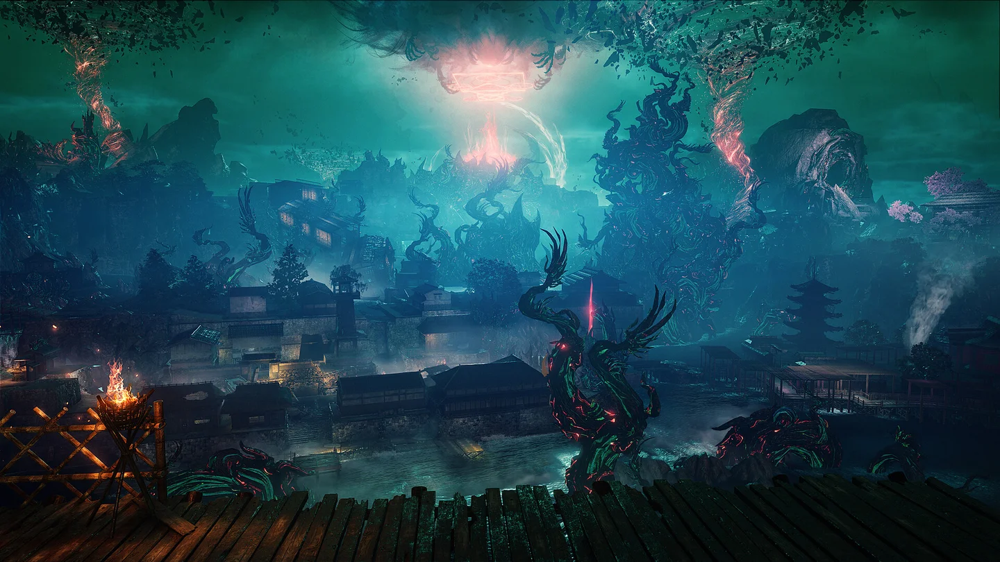
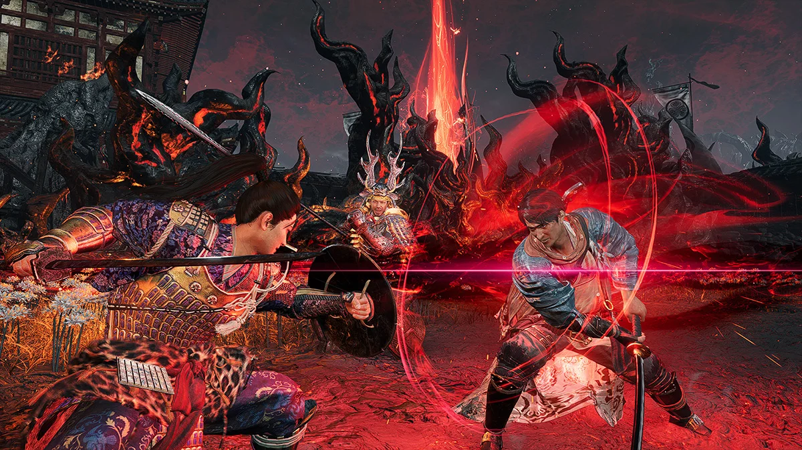

Hôm nay không chơi hôm nào chơi? DLC đầu tiên của Nioh 3 là **Hell Rising** đã mở cửa Edo năm 1651, và dân Tonfa có một lý do cực lớn để quay lại: **Tonfa Gun**. Thay vì chỉ đấm Ki cho boss đứng thở, giờ mỗi vòng **Devastation** còn kết bằng một phát **nổ** ngay mặt boss.

Nhưng Tonfa Gun không tự rơi vào tay. Anh em phải có đúng món, đúng phụ kiện, và đủ cấp để sống sót ở Edo thời Keian. Bài này chia làm hai chặng cho dễ theo:

-   **Chặng 1**: vào DLC bằng Tonfa thường, lúc chưa mở được Tonfa Gun.
-   **Chặng 2**: đủ đồ thì chuyển hẳn sang **Tonfa Gun chí mạng** với đồ thần **Grace of Inari**.

Kèm theo là cấp chuẩn để vào DLC, cách đồ thần Divine hoạt động, bảng cộng điểm từ cấp 140 tới 250, Ninjutsu và Onmyo nên mang, combo, và vũ khí Samurai cầm kèm. Bản Tonfa gốc từ mid-game nằm ở bài [Build Tonfa nguyên tố](/huong-dan/nioh-3-build-tonfa-nguyen-to-mid-game/), bài này nối tiếp từ đó.

## Vào Hell Rising: cần gì và cấp bao nhiêu

**Hell Rising** ra ngày **19/8/2026** trên PS5 và Steam, giá **20 USD**, có sẵn trong Season Pass của bản Digital Deluxe. Takechiyo bị kéo tới **Edo năm 1651** (thời Keian), lúc vị Shogun tương lai đã chết, thành Edo hoang tàn và Crucible quay lại. Đồng hành là kiếm khách một mắt **Yagyu Jubei** và sứ thần Tây Ban Nha **Rodrigo**.

**Điều kiện mở:**

-   Cài DLC, cập nhật game, rồi **phá đảo cốt truyện chính** trên save đó và xem hết đoạn kết.
-   Load lại save, chọn thời đại **Keian** trên bản đồ khi điểm đánh dấu Hell Rising hiện ra. Không thấy thì về màn hình tiêu đề rồi load lại.
-   Độ khó mới **Enlightened One's Journey** (NG++) mở sau khi xong **Shogun's Journey** (NG+).

**Cấp bao nhiêu thì không thọt?**

| Mốc | Cấp nhân vật | Cảm giác |
|---|---|---|
| Tối thiểu | **140** | Theo review của Analog Stick Gaming, dưới mức này đa số boss **đánh một phát là chết** |
| Thoải mái | **150–170** | Đủ máu để ăn lỗi, đủ điểm cho Magic 25–40 |
| Mức đồ của build Tonfa Gun mẫu | **170** | OPBoostBuilds tính chỉ số đồ ở cấp 170 |
| NG++ | **200+** | Có kẻ địch mang **Curse**, mạnh hơn hẳn |

Koei Tecmo không công bố cấp khuyến nghị chính thức. Bảng trên là mốc từ review và build cộng đồng, nên trước mỗi màn anh em vẫn xem cấp khuyến nghị hiện trên bản đồ của chính mình.

<strong>Curse ở NG++:</strong> ở Enlightened One's Journey, một số kẻ địch ngẫu nhiên được buff <strong>Curse</strong>, mạnh lên rõ rệt. Bù lại, hạ chúng rơi đồ Divine. Muốn tắt Curse tạm thời thì <strong>Burst Break</strong>, đập vỡ điểm yếu, hoặc <strong>tóm (Grapple)</strong>. Tonfa phá Ki nhanh, tóm nhiều, nên xử lý Curse cực sướng.

**Dọn đồ trước khi đi:** khoá vũ khí và giáp chính để khỏi lỡ tay bán, dọn túi chừa chỗ cho đồ mới, mua đủ đạn, bùa, thuốc giải trạng thái.

## Tonfa Gun là gì, mở bằng cách nào

Đừng tìm Tonfa Gun trong danh sách vũ khí. Theo OPBoostBuilds, **Tonfa Gun là hiệu ứng set bonus**, gắn thêm một **phát nổ** vào chiêu **Devastation** (đâm đôi Tonfa).

Công thức mở:

1.  **Overseer's Tonfa**: cây Tonfa thuộc set **Chief of Imperial Secrets**, rơi trong nội dung **Hell Rising**.
2.  **Yasakani Magatama**: phụ kiện **giảm 1 mảnh yêu cầu của mọi set**. Lấy bằng cách phá đảo cốt truyện, hạ trùm cuối, rồi đánh nhiệm vụ **A Sinister End** trong **Battle Scroll**.
3.  Cầm Overseer's Tonfa ở **ô vũ khí cận chiến đầu tiên**, đeo Yasakani Magatama. Một cây Tonfa cộng phụ kiện là đủ **mốc 2/7** của Chief of Imperial Secrets, và mốc này chính là Tonfa Gun.

<strong>Lưu ý quan trọng:</strong> thiếu Yasakani Magatama thì một cây Overseer's Tonfa <strong>không cho gì cả</strong>, không có Tonfa Gun. Chưa có phụ kiện thì cứ cầm Tonfa thường theo Chặng 1 bên dưới.

**Cách bắn:** Devastation không bấm "nguội" được. Phải mở bằng **một đòn nhẹ**, rồi **△** vào Devastation, rồi **△ lần nữa** trong lúc Devastation để bắn Tonfa Gun.

## Chặng 1: Tonfa thường trong lúc chưa có Tonfa Gun

Mới vào DLC, chưa có Overseer's Tonfa hoặc chưa có Yasakani thì chơi bản Tonfa nguyên tố quen thuộc: **dồn Strength** cho sát thương Ki, chồng hai nguyên tố cho boss dính **Confusion**, rồi phá Ki và tóm.

### Vũ khí và nguyên tố

-   **Quaking Tonfa**: sẵn giảm Ki đòn cận chiến, rơi từ **Onryoki** ở hồ Sanaru (nhiệm vụ phụ *The Great Shogun of the Heian Era*).
-   **White Bone Spirit Tonfa**: sẵn **Imbue Water**, chồng Saturated rất nhanh.
-   Nguyên tố: **sét** làm nền (địch chậm cả di chuyển lẫn ra đòn), cặp với **nước** hoặc **gió** tuỳ boss.

### Giáp và phụ kiện

-   **Iga Jonin** là set chủ lực: mốc 4 mảnh cho **chạy nhanh hơn khi Ninjutsu trúng**, 5 mảnh **15%** ném Ninjutsu không tốn lượt.
-   Có Yasakani Magatama rồi thì chỉ cần **3 mảnh Iga Jonin** là ăn bonus 4 mảnh. Ba ô còn lại để dành cho **đồ thần Divine** mang Grace (xem phần sau).
-   Chưa có Yasakani thì mặc đủ 4–5 mảnh Iga Jonin, mảnh còn lại lấy **Flying Kato** hoặc **Heizo**.

### Bảng điểm cấp 140–155

Tổng điểm luôn bằng **cấp + 34** (khởi điểm mỗi chỉ số 5). Strength chạm **55** thì dừng vì từ đây hiệu quả giảm rõ (số liệu thử nghiệm của cộng đồng). Magic giữ **25** để có 5 ô Yin.

| Chỉ số | Cấp 140 | Cấp 155 | Vai trò |
|---|---|---|---|
| Constitution | 26 | 28 | Máu, scale Tonfa |
| Heart | 18 | 19 | Ki cho chuỗi đòn dài |
| Stamina | 14 | 14 | Đủ mặc giáp nhẹ đến vừa |
| Strength | **55** | **55** | Sát thương Ki, đã chạm mốc |
| Skill | 31 | 35 | Scale Tonfa và sức mạnh Ninjutsu |
| Intellect | 5 | 5 | Giữ gốc |
| Magic | 25 | 33 | 25 là 5 ô Yin, đang đi tiếp lên 40 |
| **Tổng** | **174** | **189** | |

**140 → 155**: Magic +8 → Skill +4 → Constitution +2 → Heart +1. Magic đi trước vì chặng 2 cần đúng **40 Magic**.

Đang ở cấp thấp hơn 140 thì cứ theo bảng của bài Tonfa gốc, dồn Strength lên 55 trước rồi mới chuyển điểm.

## Đồ thần Divine và set Grace: hiểu cho đúng

Đây là phần nhiều anh em hay rối nhất, nên Cenix gỡ từng nút.

**Đồ Divine xuất hiện khi nào?** Hạ trùm cuối và phá đảo cốt truyện thì bắt đầu rơi những món **Divine** (bậc trên Exotic) đầu tiên. Vào **Shogun's Journey** (NG+) và chơi DLC thì Divine rơi đều tay.

**Set Grace từ đâu ra?** Món Divine **không thuộc set nào** sẽ được gắn **ngẫu nhiên một Grace** (Inari, Jurojin, Vaisravana...). Món đó ở bậc thấp hơn Divine thì **không có Grace**. Còn món vốn đã thuộc set (như Heizo, Iga Jonin) lên Divine vẫn **giữ set cũ**, không nhận Grace.

Nghĩa là set **Grace of Inari** không phải một bộ giáp cố định. Anh em gom **nhiều món Divine khác nhau**, miễn món nào cũng mang dòng Grace of Inari, là cộng dồn thành set: vũ khí, giáp, phụ kiện, cả tranh **Picture Scroll** đều tính.

### Grace of Inari: set thần cho Tonfa nguyên tố

| Số món | Hiệu ứng |
|---|---|
| 2 | Tăng **máu** |
| 3 | **Kéo dài** thời gian hiệu ứng |
| 4 | **Giảm sát thương** nhận vào |
| 5 | Tăng **sát thương vũ khí nguyên tố** |
| 6 | **Hồi Ki nhanh hơn** khi dùng Onmyo |
| 7 | Tăng **sát thương vũ khí nguyên tố** lần nữa |

Hai mốc 5 và 7 đều nhân sát thương vũ khí nguyên tố, cực hợp Tonfa dán bùa. Mốc 6 hồi Ki khi niệm Onmyo, hợp lối vừa đánh vừa buff. OPBoostBuilds gọi Inari 7/7 là **hệ số nhân sát thương lớn nhất** của cả build Tonfa Gun.

<strong>Mẹo gom Inari 7/7:</strong> tranh <strong>Hundred Demon Realms Picture Scroll</strong> là loại trang bị mới của DLC. Bản <strong>Divine</strong> của tranh cho <strong>thêm một bậc</strong> set Grace. Tranh mở sau Myth <strong>Stagnant Shogunate</strong>, rơi từ kẻ địch cấp cao và từ Expedition. Muốn đeo tranh phải thắng trận chiến của chính tranh đó, đánh lại trận còn đổi ngẫu nhiên một dòng hiệu ứng.

### Các Grace mới ở NG++ đáng để ý

Hell Rising thêm loạt Grace mới gắn với **Enlightened One's Journey**. Vài set đáng săn cho Tonfa:

| Grace | Mốc đáng giá | Hợp với |
|---|---|---|
| **Takemikazuchi** | 4: Ki Damage lên địch Electrified **+15%**. 6: sát thương sét **+30%**. 7: sát thương cận chiến lên địch Electrified **+35%** | Tonfa sét |
| **Owatatsumi** | Như trên nhưng cho **nước / Saturated** | Tonfa nước |
| **Shinatsuhiko** | Như trên nhưng cho **gió / Blustered** | Tonfa gió |
| **Susano** | 4: Martial Art Ki Damage **+6%**. 5: Ki Recovery Speed **+15%** | Tonfa đập Martial Arts |
| **Tsukuyomi** | 4: Onmyo Magic Power **+70**. 5: Onmyo Magic Damage **+40%** khi chưa mất máu | Ngả Onmyo |

Chà, quyết định khó quá... Inari là lựa chọn an toàn vì ăn mọi nguyên tố. Takemikazuchi 7 món mạnh hơn hẳn nếu anh em chơi sét tới cùng, nhưng khó gom hơn.

## Chặng 2: build Tonfa Gun chí mạng hoàn chỉnh

Đây là build OPBoostBuilds ghi nhận phá boss ở **NG++** cấp **Stone of Penance 7**, với **3.124** công Tonfa, **+40,8%** sát thương nguyên tố, **+37,6%** sát thương chí mạng cận chiến, **4.509** máu.

### Trang bị

| Ô | Món | Vai trò |
|---|---|---|
| Vũ khí chính | **Overseer's Tonfa** | Mốc 2/7 Chief of Imperial Secrets, mở Tonfa Gun |
| Mũ | **Flying Kato's Mask** | Master of Illusion, giảm Ki đòn cận chiến |
| Tay, chân | **Flying Kato's Gauntlets**, **Flying Kato's Greaves** | Đẩy Master of Illusion lên 5/6 |
| Thân, quần | Đồ Divine mang **Grace of Inari** | Gom Inari |
| Phụ kiện | **Yasakani Magatama** | Giảm 1 mảnh mọi set. Bản mẫu còn có Grace of Inari, hút máu khi đánh xa trúng |
| Picture Scroll | **Hundred Demon Realms**, bản Divine mang Inari | Thêm một bậc Grace |
| Đánh xa | **Swift Hawk**, **Negoro Rifle** | Kéo quái, gọt máu |

**Master of Illusion (Flying Kato)** đạt **5/6** nhờ Yasakani: mốc 5 cho **sát thương nguyên tố**. Mốc 6 (hút máu khi Ninjutsu trúng) phải bỏ một món Inari mới với tới, nên build bỏ qua. Mũ Flying Kato rơi từ **Mezuki, Ryomen Sukuna, Nuribotoke, Hijikata Toshizo, Kondo Isami, Nagakura Shinpachi**.

### Dòng hiệu ứng nên reforge

| Ưu tiên | Dòng | Ghi chú |
|---|---|---|
| 1 | **Imbue** nguyên tố (sét / nước) trên Tonfa | Nền cho Inari và Confusion |
| 2 | **Melee Attack Ki Consumption (Critical)** | Bản mẫu có **-19%** trên Tonfa, **-13,4%** trên mũ |
| 3 | **Melee Damage (Critical)** | Bản mẫu **+11,3%** |
| 4 | **Ki Recovery Speed (Critical)** | Hồi Ki để không đứt chuỗi |
| 5 | **Life Recovery (Amrita Absorption)** | Nguồn hồi máu chính, bản mẫu gom **38** điểm trên 5 món |
| 6 | Damage Taken (Critical), Dodge Ki Consumption | Lót thêm cho an toàn |

Các dòng có đuôi **(Critical)** chỉ chạy trong điều kiện Critical. Rê vào dòng hiệu ứng trong game để xem mô tả chính xác. Dòng **Onmyo Magic Ki Damage** trên Overseer's Tonfa là dòng nên **đổi đầu tiên**.

### Guardian Spirit, Soul Core, clan

-   **Kurama Tengu**: Martial Art Ki Damage, giảm sát thương gió, Enemy Sensor. **Kurama's Tempest** (60 Spirit Force) là skill chính, **Kurama's Slicer** (30 Spirit Force) làm phụ.
-   **Sunakake-baba** ở ô Yang: **Ki Pulse Bonus +50** và **gây mù khi Onmyo trúng**. Hai dòng này **khoá ở mốc 40 Magic**, nên build phải có Magic 40.
-   **Nuppeppo**: Soul Core thứ hai.
-   **Clan Honda**, vị trí Foot Soldier: **giảm một nửa sát thương nhận vào khi chưa mất máu** ở cả hai thế. Bên Samurai cộng thêm sát thương Martial Arts.

## Bảng cộng điểm Tonfa Gun cấp 170–250

Mục tiêu của chặng này là chia đều cho ba nguồn sát thương: **Strength** cho Tonfa, **Skill** cho Tonfa và Ninjutsu, **Magic** cho Onmyo và các dòng khoá ở mốc 40.

| Chỉ số | Cấp 170 | Cấp 200 | Cấp 250 (max) | Vai trò |
|---|---|---|---|---|
| Constitution | 30 | 34 | 42 | Máu cho NG++ |
| Heart | 20 | 22 | 28 | Ki cho vòng Devastation |
| Stamina | 14 | 15 | 18 | Giữ hạng nhanh nhẹn cao khi mặc giáp |
| Strength | 55 | 58 | 62 | Sát thương Tonfa, nhích chậm sau 55 |
| Skill | 40 | 50 | 60 | Tonfa và **sức mạnh Ninjutsu** |
| Intellect | 5 | 7 | 14 | Kéo dài hiệu ứng ở cuối |
| Magic | **40** | 48 | 60 | **Mốc 40 mở Sunakake-baba**, sức mạnh Onmyo |
| **Tổng** | **204** | **234** | **284** | |

**Cộng theo thứ tự:**

-   **155 → 170**: Magic +7 (chạm **40**) → Skill +5 → Constitution +2 → Heart +1.
-   **170 → 200**: Skill +10 → Magic +8 → Constitution +4 → Strength +3 → Heart +2 → Intellect +2 → Stamina +1.
-   **200 → 250**: Magic +12 → Skill +10 → Constitution +8 → Intellect +7 → Heart +6 → Strength +4 → Stamina +3.

<strong>Vì sao không dồn hết vào Strength?</strong> Game8 cũng khuyên Tonfa cộng <strong>Strength, Magic và Stamina</strong>. Strength qua 55 thì mỗi điểm cho ít đi, trong khi Skill làm Ninjutsu đau hơn và Magic làm bùa mạnh hơn. Ba nguồn sát thương cùng chạy thì boss dính Confusion nhanh hơn, mà Confusion mới là lúc Tonfa Gun rút máu không phanh. Respec ở Shrine miễn phí, anh em cứ thử rồi chỉnh.

## Ninjutsu, Onmyo và kỹ năng mới của DLC

### Ninjutsu và Onmyo mang theo

| Loại | Mang theo | Dùng để |
|---|---|---|
| Ninjutsu | **Uncanny Bolt** / **Uncanny Bubble** | Chồng sét hoặc nước từ xa trước khi áp sát |
| Ninjutsu | **Thundering Calamity** | Dồn sét diện rộng |
| Ninjutsu | **Cicada Shell** | Phân thân hứng đòn khi bị dồn |
| Onmyo | **Thunderstorm Shot**, **Water Talisman** | Nguyên tố thứ hai để kích Confusion |
| Onmyo | **Carnage Talisman** | Buff sát thương trước trận |
| Onmyo | **Sloth**, **Impurity Transfer Doll** | Làm chậm boss, chuyển hiệu ứng xấu |

Bản mẫu của OPBoostBuilds chia vòng vật phẩm nhanh thành hai trang: trang 1 là **Carnage, Last Stand, Water**, trang 2 là **Sloth, Thunderstorm Shot, Impurity Transfer Doll**.

### Kỹ năng bí truyền mới trong Hell Rising

| Kỹ năng | Loại | Hiệu ứng | Lấy ở đâu |
|---|---|---|---|
| **Rigor of the Gods** | Ninja, 6 điểm | Sát thương nguyên tố **+10%** | Trong DLC |
| **Wrathful Dragon** | Ninja, 5 điểm | Ninjutsu trúng thì địch **nhận thêm sát thương nguyên tố** | Trong DLC |
| **Patience of the Gods** | Ninja, 4 điểm | Tích trạng thái **+24%** | Trong DLC |
| **Rigorous Focus** | Ninja, 5 điểm | Sát thương Martial Arts **+7%** | Xác Amrita dưới đáy **Vast Cavern**, Koishikawa |
| **Sublime Impetus** | Chung, 6 điểm | Sát thương đòn Summoning Seal **+30%** | Rương lớn đầu tiên của DLC |
| **Divine Burst** | Chung, 5 điểm | Burst Break thành công **+15 Spirit Force** | Rương lớn phía nam **Wisteria Shrine Hall** |
| **Supreme Parry Kai** | Chung, 6 điểm | Burst Break thành công hồi **400 máu** | Thưởng Myth *Waterside Temptation* |
| **Ethereal Sway** | Chung, 10 điểm | Burst Break thành công cộng Summoning Seal | Xác cuối bến tàu gãy, tây nam **Kanda** |
| **Attack Mastery III** | Chung, 5 điểm | Công **+20** | Mua bằng 3 Yokai Teardrop ở Sudama Koishikawa |

Bộ ba **Rigor of the Gods + Wrathful Dragon + Patience of the Gods** là may đo cho Tonfa nguyên tố: Ninjutsu trúng là boss nhận thêm sát thương nguyên tố, trạng thái lên nhanh hơn, Tonfa dán bùa đánh đau hơn.

## Combo: vòng Devastation và Tonfa Gun

### Chuẩn bị trước trận

-   Dán **bùa nguyên tố** lên Tonfa, niệm **Carnage**.
-   Kiểm tra Overseer's Tonfa ở **ô cận chiến đầu tiên**, Yasakani Magatama đang đeo.
-   Giữ tải trọng giáp dưới ngưỡng để còn hạng **nhanh nhẹn** cao.

### Vòng lặp chính

1.  **Mở trận**: đứng xa ném **Uncanny Bolt** hoặc **Thunderstorm Shot** cho boss dính nguyên tố đầu tiên.
2.  **Áp sát**: một **đòn nhẹ** để mở chuỗi.
3.  **△** vào **Devastation**: đâm đôi Tonfa liên tục, phá Ki.
4.  **△ lần nữa** trong Devastation: **bắn Tonfa Gun**, phát nổ cuối chuỗi.
5.  **Lặp lại không nghỉ**. Các dòng giảm Ki giúp vòng này gần như không đứt.
6.  Boss dính nguyên tố thứ hai (Water Talisman hoặc Uncanny Bubble) là vào **Confusion**: đây là lúc xả Devastation và Tonfa Gun liên tục.
7.  Boss cạn Ki (Winded): **tóm**. Nếu là kẻ địch mang **Curse** ở NG++ thì tóm còn tắt Curse tạm thời.

### Giữ mạng

-   **Né thay vì đỡ**. Kỹ năng Evasion Expert nới rộng cửa né thành công.
-   Cố **không mất máu** để clan Honda giảm nửa sát thương.
-   Hồi máu chủ yếu bằng **Amrita Absorption**, phụ thêm hút máu từ Dragon Whistle khi đòn nguyên tố trúng và từ Yasakani khi đánh xa trúng.
-   **Đòn đỏ**: Style Shift để Burst Break. Có **Divine Burst** và **Supreme Parry Kai** thì mỗi cú Burst Break vừa cho Spirit Force vừa hồi 400 máu.

## Samurai cầm gì đi với Tonfa Ninja?

Nguyên tắc vẫn như mọi build hai thế: chọn vũ khí Samurai **dùng chung chỉ số** với bên Ninja để khỏi phải chia điểm. Tonfa scale **Constitution, Strength, Skill**, build này còn dồn thêm **Magic**.

| Vũ khí Samurai | Scale | Vì sao hợp |
|---|---|---|
| **Odachi** (lựa chọn số 1) | Stamina, Strength, **Magic** | Ăn cả Strength lẫn **Magic 40–60** của build. Tầm với dài, quét rộng, bù đúng điểm yếu tầm ngắn của Tonfa |
| **Axe** | **Constitution**, Stamina, **Strength** | Dùng chung hai chỉ số với Tonfa. Đòn to, sát thương nặng, nhưng tốn Ki |
| **Hoko & Shield** (mới trong DLC) | Xem trong game | Bản Samurai vừa **đỡ vừa phản đòn**, có cú Shield Rush húc xuyên đám đông. Hợp người muốn chơi an toàn ở NG++ |

Odachi đứng đầu vì nó tận dụng gần như trọn bảng điểm của build. Bản Samurai của Hoko & Shield là vũ khí mới nên chưa có nhiều số liệu, anh em thử ở một trận dễ trước khi đổ vật liệu nâng cấp.

**Khi nào đổi sang Samurai?** Đòn đỏ liên hoàn khó né, hoặc khi cần **Ki Pulse** xoá Yokai Realm. Đổi thế đúng nhịp (Style Shift) còn Burst Break được đòn đỏ.

Một khi đã máu thì đừng hỏi bố cháu là ai nữa! Anh em đã nã được phát Tonfa Gun đầu tiên ở Edo 1651 chưa, hay vẫn đang cày Yasakani Magatama ở A Sinister End? Gom được Inari mấy món rồi thì vào khoe dưới phần bình luận nhé.

*Nguồn tham khảo: [OPBoostBuilds - Tonfa Gun Critical Ninja](https://opboostbuilds.com/builds/nioh-3-tonfa-gun-critical-ninja), [OPBoostBuilds - Best Nioh 3 Builds](https://opboostbuilds.com/games/nioh-3), [Game8 - List of Graces](https://game8.co/games/Nioh-3/archives/580739), [Game8 - DLC Roadmap](https://game8.co/games/Nioh-3/archives/576081), [Game8 - Tonfas](https://game8.co/games/Nioh-3/archives/576208), [Game8 - Best Tonfa Build](https://game8.co/games/Nioh-3/archives/579384), [Game8 - Odachi](https://game8.co/games/Nioh-3/archives/576201), [Game8 - Axes](https://game8.co/games/Nioh-3/archives/576200), [Nioh3Guide - Hell Rising Graces](https://nioh3guide.com/hell-rising-new-graces), [Nioh3Guide - Recommended Level](https://nioh3guide.com/hell-rising-recommended-level), [Analog Stick Gaming - Hell Rising Review](https://www.analogstickgaming.com/game-reviews/nioh-3-hell-rising-dlc), [Game Informer - Hell Rising Interview](https://gameinformer.com/interview/2026/08/18/team-ninja-answers-our-burning-questions-about-nioh-3s-first-story-expansion), [Game Truth - Hell Rising Start Guide](https://www.gametruth.com/guides/nioh-3-hell-rising-start-prep-guide/), [All Things How - Hell Rising New Skills](https://allthings.how/nioh-3-hell-rising-all-new-skills-passive-buffs-and-masteries/), [Koei Tecmo America - Hell Rising](https://www.koeitecmoamerica.com/news/travel-to-the-keian-era-with-hell-rising-the-first-dlc-for-nioh-3-coming-aug-19-2026/)*
