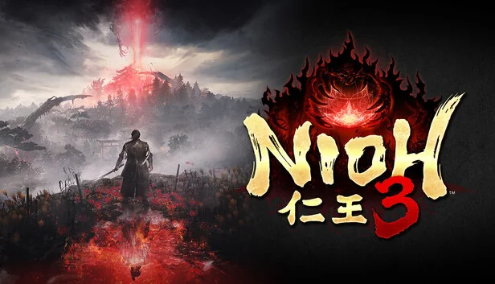

Hội anh em mê souls-like ơi, Nioh 3 ra mắt trên PS5 và PC từ **6/2/2026**, tới giờ vẫn là một trong những game hành động khó nhằn nhất năm. Cái khó của Nioh không chỉ nằm ở boss, mà ở chỗ game ném vào mặt người chơi mới **cả chục hệ thống** cùng lúc: hai phong cách chiến đấu, ba thế đứng, Ki Pulse, Burst Break, Guardian Spirit, Living Artifact, Soul Core...

Bài này là bài mở màn cho loạt hướng dẫn Nioh 3 của Cenix. Đọc xong anh em sẽ hiểu game vận hành ra sao, cái gì cần học trước, cái gì để sau cũng được. Các bài sau sẽ đi sâu vào vũ khí, build và walkthrough từng màn.

<strong>Ba điều cần biết trước tiên:</strong> (1) Nioh 3 <strong>không có chế độ dễ</strong>, không chỉnh được độ khó. (2) Một lượt chơi mất khoảng <strong>50–60 tiếng</strong>, chơi kiểu vét sạch thì hơn 70 tiếng. (3) <strong>Mọi thứ đều respec miễn phí</strong> ở Shrine (nhấn R3 trên tay cầm hoặc phím R trong menu Level Up), nên cứ mạnh dạn thử, cộng sai điểm cũng chả sao.

## Năm thời đại, ba bản đồ mở

Nhân vật chính là **Tokugawa Takechiyo**, bị cuốn khỏi Edo năm 1622 và lưu lạc qua các thời đại của Nhật Bản. Game chia làm năm thời đại, trong đó ba thời đại là **bản đồ mở** (open field) đầy căn cứ địch, Kodama, Shrine và nhiệm vụ phụ, hai thời đại còn lại đi theo tuyến cốt truyện.

| Thời đại | Năm | Kiểu bản đồ |
|---|---|---|
| **Edo** | 1622 | Tuyến tính (mở màn và đoạn cuối) |
| **Warring States** (Chiến Quốc) | 1572 | Bản đồ mở |
| **Heian** | 1190 | Bản đồ mở, phủ băng tuyết |
| **Antiquity** (Cổ đại) | 247 | Tuyến tính |
| **Bakumatsu** (Mạc mạt) | 1864 | Bản đồ mở |

*Bỉ ngạn đỏ, cổng torii và một thanh katana. Nioh 3 dựng không khí từ những thứ quen thuộc mà đẹp nhức nách.*

## Samurai hay Ninja? Câu trả lời là... cả hai

Điểm mới lớn nhất của Nioh 3 là bạn có **hai phong cách chiến đấu** và đổi qua lại bất cứ lúc nào bằng nút **Style Shift**. Mỗi phong cách có cây kỹ năng, bộ vũ khí và trang bị riêng.

| | Samurai | Ninja |
|---|---|---|
| Vũ khí | Sword, Dual Swords, Spear, Odachi, Axe, Switchglaive, Cestuses | Ninja Sword, Dual Ninja Swords, Tonfa, Kusarigama, Hatchets, Splitstaves, Talons |
| Hồi Ki | **Ki Pulse** sau mỗi đòn | **Mist** (để lại phân thân đánh lừa địch) và **Evade** |
| Phòng thủ | Đỡ đòn và **Deflect** (parry) | Né, nhảy qua đầu địch bằng **Footstool Jump** |
| Thế mạnh riêng | **3 thế đứng** (High, Mid, Low), **Flux**, thanh **Arts Proficiency** tăng sát thương | **Ninjutsu** (shuriken, bom...), **đánh lén từ sau lưng mạnh hơn** |

Nói gọn: **Ninja dễ chơi hơn với đa số người chơi** vì tốn ít Ki, cơ động, đánh xong biến. Samurai chậm và chắc tay hơn, bù lại parry ngon và đánh rất đau. Game8 khuyên build cả hai thay vì bỏ hẳn một bên, vì có những boss mà đổi phong cách đúng lúc là thắng.

### Ki là mạng sống thứ hai

Ki là thanh thể lực: đánh, né, đỡ đều tốn Ki. Cạn Ki là đứng thở, và trong Nioh đứng thở nghĩa là chết.

-   **Samurai**: sau mỗi chuỗi đòn, nhấn **Ki Pulse** đúng nhịp để lấy lại phần Ki vừa tiêu. Học thêm **Flux / Flux II** để đổi thế đứng ngay sau Ki Pulse, hồi được nhiều Ki hơn nữa.
    
-   **Ninja**: không có Ki Pulse. Thay vào đó, **né hoàn hảo bằng Evade** sẽ hồi Ki, nạp lại Ninjutsu và cho né tiếp ngay.
    

### Yokai Realm: vũng lầy hút Ki

Yokai mạnh sẽ thả những **vũng Yokai Realm** đen sì dưới đất, đứng trong đó Ki hồi cực chậm. Samurai xoá vũng bằng **Ki Pulse**. Ninja phải học kỹ năng bí truyền **Evil-Dispelling Evade** (Evade thành công là xoá vũng) hoặc về sau là **Yokai Banisher**. Đây là kỹ năng phải lấy sớm nếu chơi Ninja.

Khi boss mất nửa máu, nhiều con sẽ kéo cả đấu trường vào **Dark Realm**. Ki hồi chậm hẳn, boss hung hơn. Lời khuyên chung từ hầu hết hướng dẫn boss: **giai đoạn Dark Realm thì ưu tiên sống sót**, né nhiều, đánh ít.

## Burst Break: đòn đỏ là cơ hội vàng

Khi địch vung một đòn có **ánh đỏ**, đó là Burst Attack. Bấm **Burst Break** (R2 trên PS5, RT trên tay cầm PC) hoặc **Style Shift** đúng khoảnh khắc đòn sắp trúng để phản đòn, rút một mảng lớn Ki của địch và mở ra khoảng trống để dập.

-   Với boss, Burst Break là cách phá Ki nhanh nhất. Hầu như hướng dẫn boss nào trên Game8 cũng có mục "exploit red attacks".
    
-   Về sau có kỹ năng cho phép **dùng skill Guardian Spirit để ngắt đòn đỏ**, dễ canh nhịp hơn nhiều so với Style Shift.
    

## Guardian Spirit và Living Artifact

**Guardian Spirit** là linh thú hộ mệnh. Mỗi phong cách gắn một con, đổi ở Shrine. Mỗi con cho chỉ số bị động và **hai kỹ năng chủ động** dùng thanh **Spirit Force** màu vàng (nạp bằng cách đánh trúng địch). Kỹ năng Guardian **không tốn Ki**, nên khi cạn Ki mà bị dí thì đây là nút cứu mạng.

-   Bấm L1 + □ / △ trên PS5, LB + X / Y trên tay cầm PC, F + chuột trái / phải trên bàn phím.
    
-   Spirit Force mở khoá khi anh em dọn **Lesser Crucible** đầu tiên trên đường tới thành Hamamatsu.
    

**Living Artifact** là "tuyệt chiêu" biến hình, dùng vòng tròn lớn bên trái thanh máu (nạp bằng Amrita và Soul Stone). Khi biến hình bạn **không chết**, **Ki vô hạn**, sát thương tăng mạnh, nhưng bị đánh trúng thì thời gian biến hình bị rút ngắn. Mẹo của dân chơi lâu năm: **để dành Living Artifact cho boss**, đợi boss cạn Ki rồi mới bật để dập cho trọn.

## Bảy chỉ số, cộng sao cho khỏi tiếc

| Chỉ số | Tác dụng chính |
|---|---|
| **Constitution** | Tăng máu nhiều nhất |
| **Heart** | Tăng lượng Ki và tốc độ hồi Ki |
| **Stamina** | Tăng máu và sức mang (đồ nặng hơn) |
| **Strength** | Tăng sát thương cận chiến lên máu và Ki |
| **Skill** | Tăng sức mạnh Arts và Ninjutsu |
| **Intellect** | Kéo dài hiệu ứng, tăng hồi Ki |
| **Magic** | Tăng Onmyo Magic, mở thêm ô Soul Core Yin |

-   **Mỗi loại vũ khí scale theo đúng 3 chỉ số.** Ưu tiên cộng vào 3 chỉ số của vũ khí chính. Bài sau Cenix có bảng đầy đủ cho cả 14 loại.
    
-   **Constitution và Heart** nên có khoảng **20–25 điểm** mỗi thứ dù không scale vũ khí, để đủ trâu và đủ hơi.
    
-   Magic mở thêm ô Soul Core Yin ở các mốc **7, 10, 15, 25 và 40** điểm. Build nào dùng bùa chú thì nhớ chạm mốc.
    
-   Giáp và phụ kiện có **yêu cầu chỉ số tối thiểu** để kích hoạt hiệu ứng. Xem mục Activation của món đồ trước khi mặc.
    

## Amrita và nấm mồ của chính mình

Amrita là "tiền kinh nghiệm" để lên cấp. Chết thì Amrita nằm lại ở **mộ của bạn**. Chạy ra nhặt lại là xong, nhưng **chết thêm lần nữa trước khi nhặt là mất trắng**. Vì vậy:

-   Có đủ Amrita là **về Shrine lên cấp ngay**, đừng ôm tiền đi đánh boss.
    
-   Kỹ năng bí truyền **Lingering Spirit** giúp lấy lại **30%** Amrita còn ở mộ khi bạn chết.
    
-   Đồ dư thì vào Shrine, chọn **Make an Offering** để đổi lấy Amrita.
    

## Nguyên tố và trạng thái Confusion

Nioh 3 thưởng rất đậm cho việc **chồng hai nguyên tố lên cùng một con địch**. Mỗi nguyên tố gây một trạng thái riêng, dính từ hai trạng thái trở lên là địch bị **Confusion**: ăn thêm sát thương, chậm đi và hồi Ki chậm. Càng chồng thêm nguyên tố, nhân sát thương càng lớn.

| Nguyên tố | Trạng thái | Hiệu ứng |
|---|---|---|
| Nước | **Saturated** | Nhận thêm sát thương lên máu và Ki |
| Lửa | **Scorched** | Mất máu theo thời gian |
| Sét | **Electrified** | Chậm di chuyển và ra đòn |
| Gió | **Blustered** | Giảm sát thương vật lý của địch, ăn thêm sát thương Ki |

Nguồn nguyên tố có ở khắp nơi: vũ khí có sẵn Imbue, bùa (Talisman) của Onmyo Magic, Ninjutsu như Uncanny Flame / Bubble / Bolt, và kỹ năng của Guardian Spirit. Nhìn điểm yếu của boss rồi chọn cặp nguyên tố là thắng nửa trận.

## Mười mẹo nhỏ đỡ đau đầu

1.  **Ở vùng đầu tiên cứ bật Auto-Equip** cho nhanh, tới cuối thời Warring States mới tự chọn đồ.
    
2.  **Khoá ít nhất một món của mỗi bộ giáp** để khỏi lỡ tay phân rã, vì game không có bộ lọc loại trừ đồ theo bộ.
    
3.  Mở **Skill Management** ở Shrine thường xuyên. Skill Text nhặt trên bản đồ và Memorandum mua của Sudama sẽ tăng điểm kỹ năng.
    
4.  Hầu hết khu vực sẽ mở **Exploration Level 4**, lúc đó bản đồ đánh dấu Skill Text, Kodama, tượng Jizo còn sót. Quay lại vét một lượt.
    
5.  **Spirit Vein có biểu tượng ổ khoá** thì chưa mở được đâu, đừng cố. Cần đúng Guardian Spirit, mà các con đó lấy từ boss cốt truyện.
    
6.  **Battle Scroll** ở Shrine cho chơi lại Crucible và nhiệm vụ đã qua, rất tiện để cày Amrita khi kẹt boss.
    
7.  **Benevolent Grave** (mộ xanh) cho gọi NPC hỗ trợ, tốn **Ochoko Cup**. Cup kiếm từ việc hạ Revenant ở mộ đỏ.
    
8.  Vào menu **Titles**: mở danh hiệu sẽ có điểm để mua các buff nhỏ, cộng dồn lại rất đáng.
    
9.  Ninja nên mở **Footstool Jump** sớm để nhảy qua đầu địch, ra sau lưng mà đánh lén.
    
10.  Kẹt boss quá thì cứ **bật co-op** ở Shrine, không ai cười đâu.
    

Rồi đó, nắm mấy cái này là đủ vốn để bước vào Warring States mà không bị ngợp. Anh em đang chọn phe nào, Samurai chắc tay hay Ninja lướt gió? Ai đã bị con boss đầu tiên Yamagata Masakage cho ăn hành bao nhiêu lần, khai thật với Cenix dưới phần bình luận nghe.

*Nguồn tham khảo: [Game8 - Beginner's Guide](https://game8.co/games/Nioh-3/archives/576169), [Game8 - Ninja hay Samurai](https://game8.co/games/Nioh-3/archives/578476), [Game8 - Best Stats](https://game8.co/games/Nioh-3/archives/578187), [Game8 - Spirit Force](https://game8.co/games/Nioh-3/archives/579415), [Game8 - Các thời đại](https://game8.co/games/Nioh-3/archives/580412), [eGamersWorld](https://egamersworld.com/blog/nioh-3-best-builds-for-ninja-samurai-complete-guid-jxtlCImOAW), [VGC - 10 Nioh 3 tips](https://www.videogameschronicle.com/guide/nioh-3-tips-tricks-10-things-before-starting/), [All Things How](https://allthings.how/elemental-ninja-build-dominates-nioh-3-setup-and-mechanics/)*
