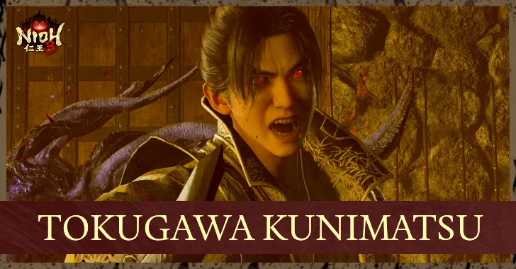

Chà, quyết định khó quá, làm sao để tốt cho cả hai? Đó là câu mà hội Ninja Nioh 3 hỏi nhau nhiều nhất từ đầu năm tới giờ. Bảng xếp hạng build của Game8 chỉ có đúng **hai build Ninja hạng SS**: **Tonfa** và **Dual Ninja Swords** (song đao). Cả hai đều mạnh, cả hai đều có fan cứng, và chọn sai thì cũng không chết ai, chỉ là hơi phí vài chục tiếng.

Bài này làm hai việc. Đầu tiên là **tier list build** đầy đủ cả Samurai lẫn Ninja để anh em có cái nhìn toàn cảnh. Sau đó Cenix cho Tonfa và song đao lên sàn **đấu bốn hiệp**: dễ chơi, sức mạnh, cảm giác đánh, và sức bền tới NG+. Cuối bài có lời khuyên theo từng kiểu người chơi, cùng một lộ trình "lai" để ăn cả hai.

## Tier list build Nioh 3

Bảng dưới xếp hạng **build hoàn chỉnh** (vũ khí, đồ, bùa, chỉ số đi kèm) theo Game8, tiêu chí là sát thương, độ cơ động, độ dễ dùng và độ khó để thuần.

| Hạng | Samurai | Ninja |
|---|---|---|
| **SS** | **Cestuses** (găng đấm), **Spear** (thương) | **Tonfa**, **Dual Ninja Swords** (song đao) |
| **S** | Odachi, Axe (rìu) | Ninja Sword |
| **A** | Katana, Switchglaive | Splitstaff (côn nhị khúc) |
| **B** | Dual Swords (song kiếm Samurai) | |
| Không ghi hạng | | Talons (đứng thứ 3 phe Ninja), Hatchets, Kusarigama (cuối bảng) |

### Bốn build hạng SS trong một câu

-   **Cestuses**: máy phá Ki phe Samurai, đấm liên hoàn và hồi máu bằng Extraction Talisman cộng hiệu ứng hút Amrita.
    
-   **Spear**: dễ tiếp cận nhất game, đứng tầm trung mà chọc, quét được cả đám. Đây cũng là nền của build Thương "bất tử" Cenix đã viết cho anh em thích chơi nhàn.
    
-   **Tonfa**: sát thương Ki cao nhất phe Ninja, kết hợp sét và gió để địch đứng thở liên tục.
    
-   **Song đao**: chém liên hoàn, scale Magic, chồng lửa và gió kích Confusion, hồi máu bằng bùa.
    

<strong>Đừng nhầm hai bảng:</strong> Game8 còn một bảng xếp hạng <strong>vũ khí</strong> riêng, chỉ tính độ mạnh của bản thân vũ khí. Ở bảng đó <strong>Switchglaive</strong> đứng số 1 phe Samurai và <strong>Talons</strong> đứng số 1 phe Ninja. Bảng build ở trên tính cả đồ và bùa đi kèm nên sát thực tế chơi hơn. Cũng đừng nhầm song đao Ninja (hạng SS) với song kiếm Samurai (hạng B), hai món khác hẳn nhau.

## Hồ sơ hai đấu thủ

| | Tonfa | Song đao |
|---|---|---|
| Chỉ số scale | Constitution, Strength, Skill | Heart, Intellect, Magic |
| Nguyên tố chủ lực | Sét + gió (hoặc sét + nước) | Lửa + gió |
| Guardian Spirit đầu game | Nekomata | Enko |
| Guardian Spirit mid / late | Kurama Tengu | Kurama Tengu |
| Set giáp chủ lực | Iga Jonin | Heizo + Iga Jonin |
| Chuỗi đánh chính | Storm of Strikes → Demon Dance → Demon Dash | Spam đánh nhẹ ra Abscission Combo |
| Nguồn hồi máu | Extraction Talisman, hiệu ứng trên đồ | Extraction + **Life Leech Talisman**, thiêu đốt của Enko |
| Tầm đánh | Cực ngắn | Ngắn |
| Lượt bình chọn của độc giả Game8 | **103** | 36 |

Để ý hai dòng Guardian Spirit và set giáp: cả hai cùng xài **Kurama Tengu** từ giữa game và cùng mặc được **Iga Jonin**. Chi tiết này sẽ quay lại ở phần cuối bài.

## Hiệp 1: Dễ chơi

**Song đao** thắng hiệp này khá thuyết phục. Chuỗi đánh chính chỉ là **spam đánh nhẹ** để ra Abscission Combo, gần cạn Ki thì Mist hoặc Cicada Shell thoát ra. Build lại có tới hai lớp hồi máu là Extraction (hút Amrita kích hoạt các dòng hồi máu) và **Life Leech** (mỗi nhát chém rút máu địch), mà song đao lại toàn chém nhiều nhát liên tiếp. Đánh hụt nhịp một chút vẫn trụ được.

**Tonfa** thì chính Game8 cũng thừa nhận ba nhược điểm: **tầm cực ngắn** nên phải dí sát mặt boss, **hơi dễ bị phạt** nếu ra đòn sai thời điểm, và cần **thuần moveset** với kỹ thuật huỷ chiêu để chuỗi đòn trơn tru. Cái hay của Tonfa nằm ở Demon Dance (Mist né ngắn nhưng bất tử lâu), mà canh được nhịp Demon Dance thì cần tập.

**Người thắng: Song đao.**

## Hiệp 2: Sức mạnh

Ở hiệp này **Tonfa** lấy lại thế trận. Đây là vũ khí có **sát thương Ki cao nhất phe Ninja**, mỗi đòn tốn rất ít Ki, đánh người là khựng liên tục. Thêm sét làm địch chậm cả di chuyển lẫn ra đòn, thêm gió làm địch ăn thêm sát thương Ki, cộng clan Kakizaki tăng **15%** sát thương lên địch đang Winded, boss gần như không có cửa thở.

**Song đao** cũng phá Ki tốt, nhưng bằng **nhiều nhát nhỏ** thay vì từng cú nặng. Sức mạnh thật của nó đến từ **Confusion** và thiêu đốt: khi boss dính cả lửa lẫn gió, mỗi nhát chém đều được nhân thêm. Nói cách khác, song đao mạnh **có điều kiện**.

Điểm trừ chung của cả hai là gặp boss có **hyper armor** (Tokugawa Kunimatsu, Kajiwara Kagetoki, Okita Soji). Những con này không khựng, cái lợi stun-lock của Tonfa bị giảm đáng kể.

**Người thắng: Tonfa.**

## Hiệp 3: Cảm giác đánh

Hiệp này phụ thuộc gu từng người, nên chấm hoà là công bằng nhất.

-   **Tonfa** cho cảm giác **lực**: đấm như máy khâu, Storm of Strikes dội liên hoàn, boss to xác cũng bị đẩy khựng. Ai mê kiểu đánh tay đôi áp sát, đứng trong vùng nguy hiểm mà vẫn né được nhờ Demon Dance, thì Tonfa là thuốc phiện.
    
-   **Song đao** cho cảm giác **điện ảnh**: chém xoáy liên tục, hất địch lên rồi múa **Divine Flight** trên không, Enko đá ra cột lốc lửa. Ai thích combo bay lượn, nhìn màn hình rực lửa thì song đao đã mắt hơn hẳn.
    

Nếu phải nhìn vào số đông thì cộng đồng nghiêng hẳn về Tonfa: **103 phiếu** so với 36 phiếu của song đao trong bình chọn vũ khí yêu thích của Game8.

**Kết quả: Hoà**, Tonfa nhỉnh về độ phổ biến.

## Hiệp 4: Đường dài tới NG+

Đây là hiệp quyết định, và lý do nằm ở bảng boss cuối game dưới đây:

| Boss | Màn | Điểm yếu nguyên tố |
|---|---|---|
| Kajiwara Kagetoki | Heian Befouled | **Không có** |
| Hiruko (lần đầu) | Ill Omen | **Không có** |
| Tokugawa Kunimatsu | To the Beginning | **Không có** (vẫn dính nước, lửa) |
| Takasugi Shinsaku | A New Era | **Không có** |
| Okita Soji | Final Hope | **Không có** |
| Tokugawa Yoshinobu | Final Hope | Sét |
| Hiruko (boss cuối) | What Makes a Shogun | **Không có**, kháng mọi trạng thái |

Từ giữa game trở đi, **phần lớn boss khó nhất không có điểm yếu nguyên tố**, nhiều con còn kháng gần hết trạng thái. Song đao dựa vào Confusion và thiêu đốt, nên trước những con này nó **mất phần lớn sức mạnh**. Tonfa thì khác: sát thương Ki là sát thương Ki, boss kháng nguyên tố vẫn bị phá Ki như thường.

Thêm nữa, Tonfa có **lộ trình endgame được ghi chép rõ**:

-   **Tonfa Gun chí mạng**: dùng Overseer's Tonfa từ DLC Hell Rising, được ghi nhận phá boss ở **NG++** cấp Stone of Penance 7.
    
-   **Ninja Onmyo**: không cần DLC, Remodel Quaking Tonfa sang scale Magic, nã bùa Hellshock.
    

Song đao về cuối game chuyển dần sang dồn Magic và đi hướng Onmyo, nhưng hiện chưa có build endgame nào được cộng đồng kiểm chứng kỹ như hai hướng của Tonfa.

**Người thắng: Tonfa.**

## Tổng kết bốn hiệp

| Hiệp | Tonfa | Song đao |
|---|---|---|
| Dễ chơi | ★★★ | ★★★★★ |
| Sức mạnh | ★★★★★ | ★★★★ |
| Cảm giác đánh | ★★★★★ | ★★★★★ |
| Đường dài NG+ | ★★★★★ | ★★★ |
| **Kết quả** | **Thắng 2, hoà 1** | **Thắng 1, hoà 1** |

<strong>Phán quyết của Cenix:</strong> chỉ được chọn một build để chơi một mạch tới NG+ thì chọn <strong>Tonfa</strong>. Sát thương Ki của Tonfa không quan tâm boss có điểm yếu gì, và Tonfa có sẵn hai hướng đi endgame. Song đao là lựa chọn tốt hơn cho <strong>lượt chơi đầu</strong>, khi anh em còn đang học game.

*Số sao là đánh giá của Cenix dựa trên tổng hợp các nguồn, không phải điểm số chính thức.*

## Anh em thuộc kiểu nào?

-   **Mới chơi souls-like, sợ chết**: song đao. Combo dễ, hai lớp hồi máu, đánh hụt vẫn sống.
    
-   **Đã phá đảo Nioh 1, 2, thích áp sát**: Tonfa. Cái tầm ngắn sẽ không làm khó mấy ông.
    
-   **Mê hiệu ứng, thích combo trên không**: song đao, cứ thả Enko ra đốt.
    
-   **Muốn cày NG+, Stone of Penance**: Tonfa, và chuẩn bị tinh thần cho DLC Hell Rising.
    
-   **Muốn chơi nhàn nhất có thể**: không phải hai món này, mà là build Thương "bất tử" phe Samurai.
    

## Lộ trình lai: ăn cả hai

Ai không muốn chọn thì không cần chọn. Nioh 3 cho **respec miễn phí** ở Shrine (nhấn R3 trên tay cầm hoặc phím R trong menu Level Up), nên có thể đi theo lộ trình sau:

1.  **Warring States tới hết Heian (tới khoảng cấp 90)**: chơi **song đao**. Học game, học né, học chồng nguyên tố trong lúc boss còn có điểm yếu rõ ràng: Great Tengu và Otoroshi yếu lửa, Ibaraki Doji yếu nước.
    
2.  **Từ Antiquity, Bakumatsu và NG+**: respec sang **Tonfa**, đúng lúc gặp những boss không có điểm yếu như Hiruko, Kunimatsu, Okita.
    

Cái hay là hai build **dùng chung Guardian Spirit Kurama Tengu** và **chung set Iga Jonin**, nên khi đổi gần như không phải cày lại đồ. Chỉ cần tẩy điểm từ Heart, Intellect, Magic sang Constitution, Strength, Skill, rồi thay vũ khí và bùa.

Muốn đi sâu từng build, anh em xem hai bài của Cenix: [Build Katana + Song đao Ninja](/huong-dan/nioh-3-build-katana-song-dao-dau-game/) có bảng cộng điểm từ cấp 30 tới 250, và [Build Tonfa nguyên tố](/huong-dan/nioh-3-build-tonfa-nguyen-to-mid-game/) có bảng điểm từ cấp 70 tới 250 kèm hai ngả endgame.

Giờ tới lượt anh em chọn phe: **đội Tonfa đấm như máy khâu** hay **đội song đao múa lửa trên không**? Ai đã cầm cả hai rồi thì vào kể Cenix nghe cảm giác thật, nhất là màn đối đầu Kunimatsu bằng build của mấy ông.

*Nguồn tham khảo: [Game8 - Best Builds Tier List](https://game8.co/games/Nioh-3/archives/576622), [Game8 - Best Weapon Tier List](https://game8.co/games/Nioh-3/archives/578173), [Game8 - Best Tonfa Build](https://game8.co/games/Nioh-3/archives/579384), [Game8 - Best Dual Ninja Swords Build](https://game8.co/games/Nioh-3/archives/578236), [Game8 - All Bosses](https://game8.co/games/Nioh-3/archives/576146), [Game8 - Best Clans](https://game8.co/games/Nioh-3/archives/579768), [OPBoostBuilds - Nioh 3 Builds](https://opboostbuilds.com/games/nioh-3)*
