Hội anh em cuồng game ơi, đây là bài Cenix muốn viết nhất trong cả loạt Nioh 3: **một tấm bản đồ đi trọn cốt truyện**. Mỗi thời đại có gì, cấp bao nhiêu thì vào boss, boss sợ nguyên tố gì, và những việc phải làm trước khi đi tiếp để khỏi lỡ đồ ngon.

Cốt truyện có **16 màn chính** với khoảng **20 boss**. Chơi bình thường mất **50–60 tiếng**. Bài chia làm bốn phần: luật chung khi đánh boss, lộ trình từng thời đại kèm hồ sơ chi tiết từng boss (xuất thân, điểm mạnh, điểm yếu, cách hạ), **boss ẩn và boss phụ**, và checklist những thứ dễ lỡ.

<strong>Cách đọc bảng điểm yếu:</strong> "Yếu" là trạng thái nguyên tố boss dính nhanh, ví dụ Saturated là nước, Scorched là lửa, Electrified là sét, Blustered là gió, Poisoned là độc. Boss ghi "Không có" thì đừng phí thời gian chồng nguyên tố, cứ đánh thẳng.

## Bảy luật đánh boss dùng cho mọi trận

1.  **Đòn đỏ là quà**: boss nào cũng có Burst Attack ánh đỏ. Canh đúng lúc bấm **Burst Break** hoặc **Style Shift** là rút một mảng Ki lớn.
    
2.  **Ninja cho boss khó**: Game8 khuyên dùng Ninja cho phần lớn boss nhờ cơ động và **đánh sau lưng mạnh hơn**. Boss người thường hở lưng sau mỗi đòn vung.
    
3.  **Dark Realm thì thủ**: khi boss kéo cả sân vào Dark Realm, Ki hồi rất chậm. Né nhiều, đánh ít, xoá Yokai Realm khi có thể.
    
4.  **Đừng tham**: đánh 2–3 đòn rồi lùi. Hầu hết các lần chết là do cố thêm một nhát.
    
5.  **Living Artifact để chốt**: đợi boss cạn Ki hoặc còn ít máu rồi mới bật. Bị đánh trúng lúc biến hình sẽ rút ngắn thời gian, nên vẫn phải né.
    
6.  **Gọi trợ thủ**: Benevolent Grave quanh phòng boss gọi được NPC (tốn **Ochoko Cup**, kiếm từ Revenant ở mộ đỏ). Từ khoảng Antiquity sẽ có ô **Summoning Seal** thứ hai, đừng quên xài.
    
7.  **Kẹt thì cày**: đánh quái quanh Shrine, chơi lại Crucible qua Battle Scroll, bùa Power Talisman và Power Pill trước trận (hai món không cộng dồn, chỉ làm mới thời gian).

## Edo 1622 và Warring States 1572

Năm 1622, ngay trước lễ nhậm chức Shogun của Takechiyo, em trai ông là **Tokugawa Kunimatsu** vì căm hận chuyện kế vị mà sa vào bóng tối, dẫn yêu quái tấn công thành Edo. Màn mở đầu **The Fall of Edo Castle** là phần hướng dẫn, cuối màn anh em chọn **Kusanagi bản đỏ (Samurai) hoặc xanh (Ninja)**. Ánh sáng của Kusanagi đưa Takechiyo về năm 1572, giữa lúc quân Tokugawa đang chật vật trước đội quân của Takeda Shingen.

| # | Màn | Boss | Cấp gợi ý | Điểm yếu |
|---|---|---|---|---|
| 2 | Escape From Hitokoto Slope | **Yamagata Masakage** | 1–5 | Chỉ Confusion |
| 3 | The Hamamatsu Incident | **Jakotsu-baba** | 14 | Sét, Gió |
| 4 | The Battle of Futamata Castle | **Baba Nobuharu** | 39 | Sét, Gió |
| 5 | The Battle of Mikatagahara | **Yamagata Masakage (Yokai)**, **Takeda Shingen** | 43 | Nước / Độc |
| 6 | The Battle of Saigagake | **Takeda Shingen (Yokai)** | 50 | Nước, Sét, Độc |

### Yamagata Masakage

Một trong những tướng lừng danh nhất dưới trướng Takeda Shingen, người cầm đội quân giáp đỏ nổi tiếng của nhà Takeda. Trong game, hắn là boss mở màn ở **dốc Hitokoto** năm 1572, đúng trận rút lui nổi tiếng của quân Tokugawa. Takechiyo vừa rơi xuống thời Chiến Quốc là đã phải đối mặt với hắn, khi trong tay chưa có gì ngoài vài chiêu cơ bản.

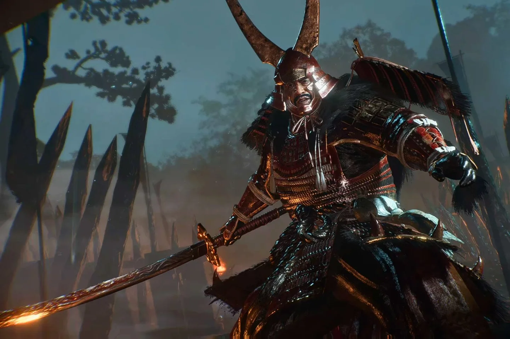

**Điểm mạnh**

-   Tầm với rất dài, đòn chém quét rộng phía trước, vài nhát là về Shrine.
    
-   Kháng gần như mọi trạng thái nguyên tố đơn lẻ, chỉ dính **Confusion** (phải chồng từ hai nguyên tố).
    
-   Hết nửa máu thì hung hơn hẳn, ra đòn đỏ dày đặc. Sau khi bị tóm (grapple) hắn hay phản bằng một đòn **không đỡ được**.
    

**Điểm yếu**

-   Ra đòn rõ ràng, chủ yếu đánh thẳng phía trước, và **hồi chiêu rất lâu** sau mỗi nhát vung.
    
-   Trận này không có Yokai Realm, nên chẳng cần Ki Pulse của Samurai.
    

**Cách hạ gục**

1.  Trước khi vào lều, cày quái quanh Shrine gần đó để lên vài cấp và gom đủ **4 Elixir**. Gọi thêm NPC ở Benevolent Grave (tốn 1 Ochoko Cup) cho có người chia aggro.
    
2.  Dùng **Ninja**: né ngang hoặc lướt ra sau lưng mỗi khi hắn vung, đâm 2–3 nhát rồi rút. Đầu trận cứ chơi phản đòn, đừng chủ động lao vào khi Ki hắn còn đầy.
    
3.  Thấy hắn **xoay người** là sắp tới đòn đỏ, canh bấm **Burst Break** (R2/RT). Không chắc nhịp thì né cũng được.
    
4.  Tóm được hắn xong thì **lùi ra ngay** để tránh đòn phản không đỡ được.
    
5.  Khi máu hắn đã thấp, bật **Living Artifact** để kết thúc.
    

### Jakotsu-baba

Jakotsu-baba là "bà già rắn" trong tranh yêu quái cổ của Nhật, một mụ già canh giữ rắn, tay nào cũng cầm một con. Trong Nioh 3, mụ là boss của **Crucible đầu tiên**, chiếm cứ khu thị trấn quanh thành Hamamatsu. Hạ xong mụ, anh em nhận Guardian Spirit **Enko** và mở khoá Spirit Vein.

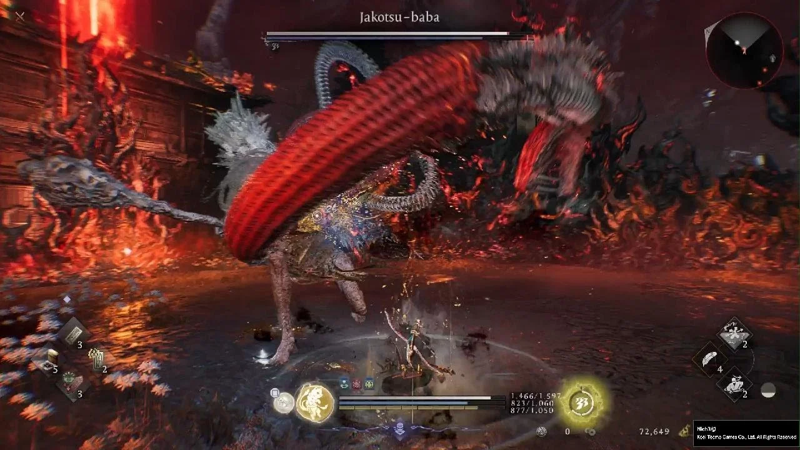

**Điểm mạnh**

-   Đánh nhanh, **quét rộng** bằng chuỳ và hai đầu rắn, né rất dễ dính.
    
-   Đứng xa thì mụ dùng **đòn tóm không đỡ được**.
    
-   Có tới **bốn đòn đỏ**: Crush (giơ chuỳ bằng hai tay), Snake Slam (kéo đầu rắn trái ra sau), Ice Shards (đầu rắn phải bắn băng), Lunge (vươn đầu lao tới).
    

**Điểm yếu**

-   Yếu **sét** và **gió**, kháng lửa, nước, độc.
    
-   Vào Dark Realm, trên đầu mụ mọc **tinh thể Amrita**. Đập vỡ là rút một mảng Ki cực lớn.
    
-   Các đòn đỏ đều vung lâu, rất dễ canh Burst Break.
    

**Cách hạ gục**

1.  Chơi **Samurai ở Mid Stance** và **giữ đỡ**: đòn quét rộng của mụ đỡ an toàn hơn né, Mid Stance vẫn hồi Ki khi đỡ, lại xoá được Yokai Realm bằng Ki Pulse.
    
2.  Mang sét hoặc gió: **Uncanny Bolt** hay bùa Thunder Shot. Nekomata cũng là con sét.
    
3.  Canh bốn đòn đỏ để **Style Shift / Burst Break**. Ice Shards thì phản ngay sau khi băng bắn ra, ba đòn kia phản ngay trước khi trúng.
    
4.  Vào Dark Realm, đánh tinh thể trên đầu lúc mụ cúi đầu xuống. Với không tới thì dùng đòn High Stance, kunai hoặc đòn nhảy.
    
5.  Thấy mụ lùi xa và vươn người là sắp tóm, né ngang là xong.
    

### Baba Nobuharu

Một trong những lão tướng nổi danh nhà Takeda, được đồn là đánh mấy chục trận chưa từng bị thương, biệt danh "Quỷ xứ Mino". Phần thưởng sau trận trong game cũng tên là *Demon of Mino's Charm*. Hắn trấn giữ **thành Futamata**, nơi quân Takeda vây đánh quân Tokugawa năm 1572.

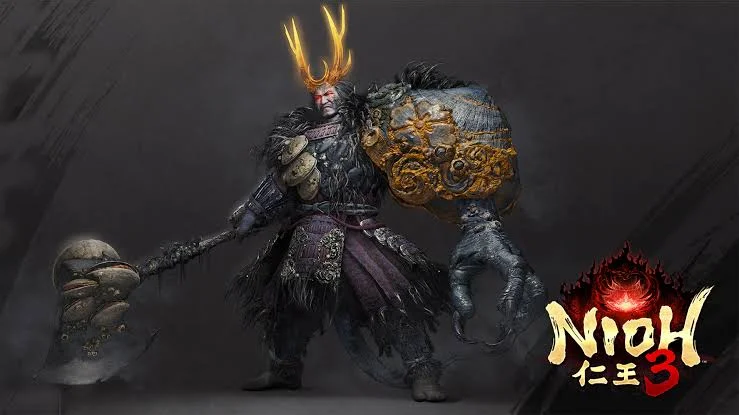

**Điểm mạnh**

-   **Tạo ảo ảnh để đánh giả**, khiến đòn đỏ và đòn tóm cực kỳ khó canh.
    
-   Đuôi quật xong nối luôn một nhát rìu, ai tham đánh từ sau là ăn trọn.
    
-   Trong Dark Realm dùng thêm **phép nước**.
    

**Điểm yếu**

-   Yếu **sét** và **gió**, kháng lửa, nước.
    
-   Sau mỗi đòn hắn hở **lưng** khá lâu.
    

**Cách hạ gục**

1.  Đầu trận đứng xa ném Ninjutsu sét (**Uncanny Bolt**, bùa **Thunderstorm Shot**) để vừa gọt máu vừa quan sát nhịp đánh.
    
2.  Lướt xuyên đòn ra sau lưng mà đánh, đánh ít thôi rồi rút, coi chừng combo đuôi quật cộng rìu.
    
3.  **Đừng Burst Break hay né quá sớm** vì hắn hay đánh giả. Không chắc thì cứ đỡ, trừ đòn tóm.
    
4.  Vào Dark Realm, chỉ đánh khi hắn đã cạn Ki, còn lại thì giữ khoảng cách và ném Ninjutsu.
    
5.  Có Soul Core **Bloodedge Demon** thì gọi nó ra, đi cùng Guardian Spirit hệ sét như Nekomata là con triệu hồi đánh ra sét.
    

### Yamagata Masakage (Yokai)

Gặp lại người quen. Ở trận **Mikatagahara**, Yamagata Masakage quay lại trong lốt yêu quái sau khi bị **Crucinite**, thứ chất đen tối rải rác khắp các thời đại, làm biến chất. Trận này cho Smithing Text bộ giáp **Crimson General**.

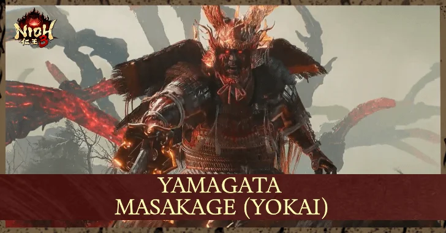

**Điểm mạnh**

-   Di chuyển liên tục, đuổi theo là chỉ tốn Ki.
    
-   Ra đòn đỏ thường xuyên, vào Dark Realm thì phun **sóng lửa**.
    
-   Kháng lửa, sét, gió, độc, tê liệt.
    

**Điểm yếu**

-   Yếu **nước**.
    
-   Đòn đỏ chém thẳng từ trên xuống, vung lâu, rất dễ đoán.
    
-   Gần như chỉ có hai đòn đánh được ra sau lưng: sóng lửa khi vào Dark Realm và cú quét vòng tròn, cả hai đều báo trước rõ.
    

**Cách hạ gục**

1.  Đừng đuổi. Đứng **Mid Stance giữ đỡ**, nhử hắn tới đánh, đỡ xong đánh trả vài đòn nhanh.
    
2.  Dán **Water Familiar Talisman** lên vũ khí cho thêm sát thương nước.
    
3.  Đòn đỏ nào cũng canh Burst Break, rồi vòng ra sau lưng mà dập.
    
4.  Mang **Firestop Talisman** để kháng lửa trong Dark Realm.
    

### Takeda Shingen

"Hổ xứ Kai", lãnh chúa đáng gờm nhất thời Chiến Quốc. Trận **Mikatagahara** năm 1572 ngoài đời là lần Tokugawa Ieyasu thua đậm nhất cuộc đời. Trong game, Shingen đánh cùng Guardian Spirit của riêng mình, dùng cả lửa lẫn gió. Hạ được hắn là có giáo **Potsticker Spear** và song đao **Basket Blade & Boar Cutter**.

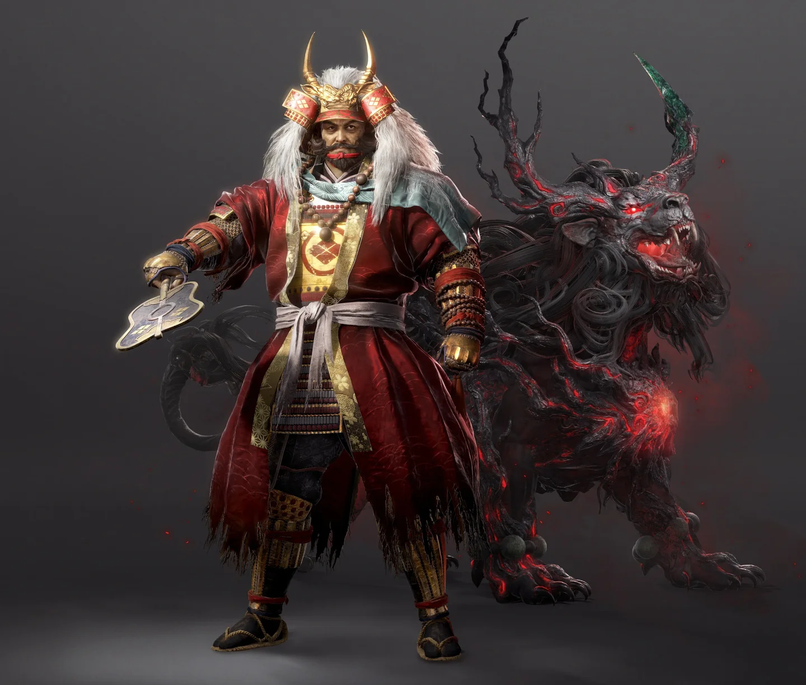

**Điểm mạnh**

-   Đòn quét rộng, tầm dài, có thể **tóm từ xa**.
    
-   **Cắm giáo xuống đất là gọi Guardian Spirit**, hai thầy trò cùng đánh thì đỡ là cạn Ki.
    
-   Kháng lửa, gió và cả Confusion.
    

**Điểm yếu**

-   Yếu **độc**.
    
-   Hồi chiêu rất lâu sau mỗi đòn, giống Yamagata lần đầu.
    
-   Đòn đỏ đâm thẳng phía trước, rất dễ đoán.
    

**Cách hạ gục**

1.  **Mid Stance**, đỡ hoặc **Deflect** các đòn quét rồi đánh trả nhanh.
    
2.  Đòn đỏ thì Burst Break, trúng là rút cả Ki lẫn máu.
    
3.  Đòn tóm báo trước rất lâu, né ngang rồi đánh vài nhát. Nhớ là hắn tóm được từ xa.
    
4.  Thấy hắn **cắm giáo xuống đất** là chuẩn bị né, đừng giơ vũ khí lên đỡ.
    
5.  Mang **Firestop Talisman**, vì đòn của hắn chủ yếu là lửa.
    

### Takeda Shingen (Yokai)

Sau thất bại ở Mikatagahara, Shingen bị Crucinite nuốt trọn và hoá yêu. Anh em đối đầu với hắn ở **Saigagake**, nơi khép lại chương Warring States. Hạ hắn xong được Guardian Spirit **Kongojishi**, con dùng để phá những bức tường đánh dấu vàng.

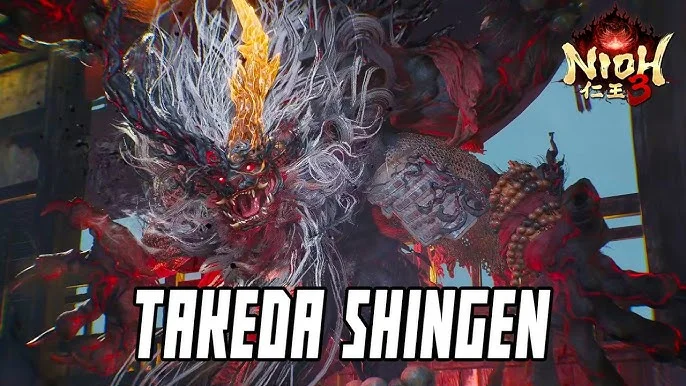

**Điểm mạnh**

-   Combo dài và dồn dập, **đỡ là cạn Ki** rất nhanh.
    
-   Đòn gió có **độ trễ** trước khi trúng, né sớm là dính.
    
-   Hầu hết đòn mang lửa.
    

**Điểm yếu**

-   Yếu **nước**, **sét** và **độc**, chỉ kháng lửa và gió.
    
-   Trong Dark Realm, **cái sừng** của hắn thành điểm yếu, bẻ được là rút một mảng Ki.
    
-   Đòn tóm vung lâu, hồi chiêu cũng lâu.
    

**Cách hạ gục**

1.  **Né thay vì đỡ**, né về phía sau lưng hắn rồi đánh vài đòn nhanh, đừng tham.
    
2.  Khi Ki hắn cạn thì dập hết sức, hắn sẽ khựng liên tục. Hồi Ki xong thì lùi lại.
    
3.  Vào Dark Realm, ném kunai, shuriken hoặc dùng đòn High Stance, đòn nhảy để **bẻ sừng**.
    
4.  Thấy tay hắn **loé xanh** là đòn gió, chờ một nhịp rồi mới né.
    
5.  Hai đòn đỏ: **Claw Swipe** thì đứng xa chờ hắn tới rồi phản, **Ground Slam** thì hắn đứng yên vung, Burst Break ngay trước khi trúng.
    

### Đừng rời Warring States khi chưa làm

-   **Kamaitachi** ở **Maisaka**: field boss cho Soul Core gió cực hữu dụng.
    
-   **Bloodedge Demon** ở Hamamatsu / sông Tenryu: lần theo vệt **Revenant Malice** sau khi hạ Revenant. Hạ càng nhiều Revenant nó càng mạnh nhưng rơi đồ càng ngon. Cực hung, chỉ nên đánh khi đủ cấp.
    
-   Chuỗi nhiệm vụ của **Ii Naotora**: *Fated Land* (boss **Ryomen Sukuna**) → *Headaches* (Soul Core **Nuppeppo**) → *The Great Shogun of the Heian Era* (**Onryoki**, rơi Quaking Tonfa).
    
-   Chuỗi của **Honda Tadakatsu**: *Abundant Evil* (**Hino-Enma**) → *Becoming the Champion of the East*.
    
-   **Hattori Hanzo**: gặp trên mái nhà ở làng Tealeaf, làm *Searching for a Spy* → *The Demon's Regimen* để lấy Smithing Text bộ giáp **Iga Jonin**.
    
-   Ở Eternal Rift, làm ba Battle Scroll **The Way of Onmyo / Ninja / Warrior: Novice** (gặp Saito Fuku, Hattori Hanzo, Yagyu Munenori). Way of Onmyo: Novice mở kỹ năng **Awakening**.
    

## Heian 1190: băng tuyết và yêu quái

Takechiyo tới Kyoto năm 1190, giữa lúc anh em nhà Minamoto trở mặt: **Minamoto no Yoritomo** gọi cả một Crucible trùm lên kinh đô để giành ngôi Shogun, còn em trai **Yoshitsune** đứng về phía Takechiyo. Xong Saigagake là mở được **clan** (gặp **Matsunaga Hisahide** ở quán trà Eternal Rift) và ba Battle Scroll bậc **Adept**. Làm ngay **The Way of Onmyo: Adept** để mở nâng cấp Guardian Spirit.

| # | Màn | Boss | Cấp gợi ý | Điểm yếu |
|---|---|---|---|---|
| 7 | The Age of Clans Begins | **Great Tengu** | 53 | Lửa |
| 8 | Heian Befouled – Black Feather Sanctuary | **Otoroshi** | 69 | Lửa |
| 8 | Heian Befouled – The Oni of Rajomon | **Ibaraki Doji** | 80 | Nước |
| 8 | Heian Befouled – Subterfuge at the Abandoned Shrine | **Kajiwara Kagetoki** | 83 | Không có |
| 9 | A Cause Too Great | **Minamoto no Yoritomo** | 86 | Lửa, Nước |

### Great Tengu

Tengu là yêu quái mũi dài, cánh chim của núi rừng Nhật Bản. Đại Tengu ở **núi Kurama** nổi tiếng nhất vì truyền thuyết kể chính ông dạy kiếm cho Yoshitsune thuở nhỏ. Trong game, Takechiyo đánh Great Tengu trên núi Kurama với sự giúp sức của Yoshitsune. Hạ xong được Guardian Spirit **Kurama Tengu**.

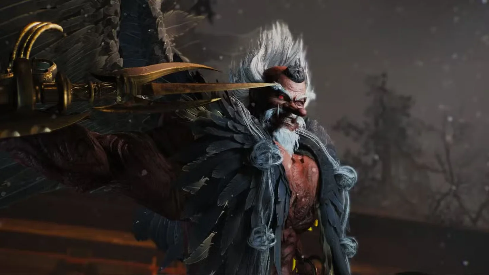

**Điểm mạnh**

-   Nhiều đòn diện rộng mang **gió và sét**, đỡ rồi vẫn ăn sát thương dồn (trừ khi Deflect).
    
-   Bay lên cao rồi bổ nhào xuống để ra đòn đỏ và đòn tóm.
    
-   Thả Yokai Realm làm chậm hồi Ki.
    
-   Kháng nước, sét, gió, độc, tê liệt.
    

**Điểm yếu**

-   Chỉ yếu **lửa**, nhưng yếu rất rõ.
    
-   Mỗi lần hạ cánh là một khoảng hở để vào đánh.
    

**Cách hạ gục**

1.  Chơi **Ninja** cho cơ động, lắp **Yokai Banisher** và **Evil-Dispelling Evade** để xoá Yokai Realm.
    
2.  Ném lửa liên tục: **Uncanny Flame**, **Shrapnel Bomb**, bùa **Fire Shot**. Guardian Spirit Enko cũng hệ lửa.
    
3.  Hắn bay lên thì **lùi ra xa** để có thêm thời gian canh Burst Break hoặc né ngang, đừng đứng ngay bên dưới.
    
4.  Thấy hắn **cắm gậy xuống đất** là lùi ra, sét sắp nổ quanh người hắn. Đòn này gần như luôn xuất hiện khi chuyển sang Dark Realm.
    
5.  Hắn vừa hạ cánh thì lao vào đánh vài đòn.
    

### Otoroshi

Otoroshi là yêu quái lông lá khổng lồ trong truyền thuyết Nhật, hay ngồi chồm hỗm trên cổng torii của đền chùa, chực vồ những kẻ bất kính. Trong game, nó là boss nhiệm vụ **Black Feather Sanctuary** ở Sagano.

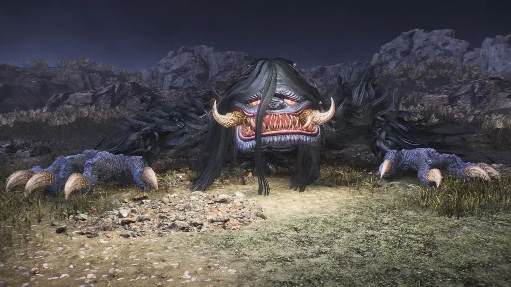

**Điểm mạnh**

-   To xác, hai tay quét rộng phía trước.
    
-   Có hai đòn đánh được cả khi bạn đứng sau lưng: **mảnh băng** và cú **xoay hai cây băng** trong Dark Realm.
    
-   Trong Dark Realm phóng **chim** ra làm đạn.
    
-   Kháng nước, sét, độc, tê liệt.
    

**Điểm yếu**

-   Yếu **lửa**.
    
-   Đòn chủ yếu đánh phía trước, sau lưng là chỗ an toàn.
    
-   Khi phóng chim, nó **hở ngực** để lộ mấy quả **trứng**. Đánh vỡ là rút một mảng Ki lớn.
    
-   Đòn đỏ vung lâu, dễ phản.
    

**Cách hạ gục**

1.  **Ninja**, lướt qua các đòn quét ra sau lưng mà đánh, ăn thêm sát thương đánh lén.
    
2.  Coi chừng mảnh băng và cú xoay băng, hai đòn này vẫn quét ra sau.
    
3.  Vào Dark Realm, khi nó phóng chim thì ném **kunai, shuriken** vào **trứng trên ngực**.
    
4.  Đòn đỏ nào cũng Burst Break. Mang Ninjutsu lửa để chồng Scorched.
    

### Ibaraki Doji

Ibaraki Doji là con quỷ (oni) khét tiếng thời Heian, cánh tay phải của quỷ vương Shuten-doji. Truyền thuyết kể ở **cổng Rashomon**, võ sĩ Watanabe no Tsuna chém đứt một cánh tay của Ibaraki. Nioh 3 tái hiện đúng tích này trong nhiệm vụ **The Oni of Rajomon**, với một Ibaraki Doji mang **bàn tay khổng lồ** và đầy sét.

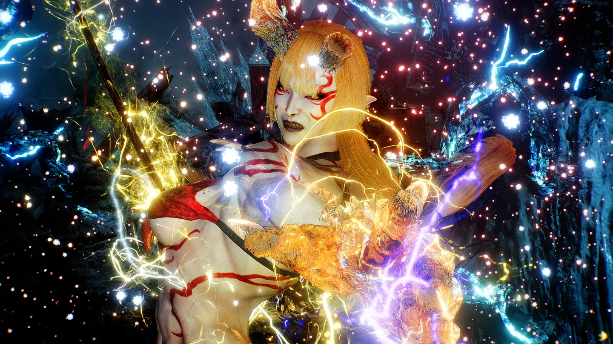

**Điểm mạnh**

-   Đánh nhanh, **tầm xa bất ngờ** nhờ phép sét.
    
-   Thỉnh thoảng phủ sét lên kiếm, chém ra cả **đạn sét** tầm xa.
    
-   Đập bàn tay khổng lồ xuống đất tạo **vòng sét** lan ra, có độ trễ.
    
-   Vào Dark Realm thì hung hơn, phép sét dày hơn.
    
-   Kháng sét, gió, tê liệt.
    

**Điểm yếu**

-   Yếu **nước**.
    
-   Hồi chiêu rất lâu, nhất là sau phép sét.
    
-   Cạn Ki là bị khựng liên tục, mỗi đòn đánh trúng đều ngắt được đòn của mụ.
    

**Cách hạ gục**

1.  **Ninja**, lắp kỹ năng xoá Yokai Realm.
    
2.  Ném **Uncanny Bubble** (nước) và **Shrapnel Bomb** từ xa, nhất là khi bị dồn vào góc.
    
3.  Né ra sau lưng mỗi khi mụ vừa ra đòn hoặc vừa dùng phép, đánh vài nhát nhanh.
    
4.  Thấy mụ **đập tay xuống đất** là chuẩn bị **nhảy** qua vòng sét.
    
5.  Mụ ít đòn đỏ, nên cửa sát thương chính là khi **cạn Ki**. Lúc đó dồn hết sức. Trong Dark Realm thì ưu tiên sống, né là chính.
    

### Kajiwara Kagetoki

Kajiwara Kagetoki là gia thần thân tín của Minamoto no Yoritomo, nổi tiếng trong sử Nhật vì đã gièm pha Yoshitsune trước mặt Yoritomo, góp phần đẩy người anh hùng này tới cái chết. Trớ trêu thay, trong Nioh 3 anh em đánh hắn **cùng với chính Yoshitsune**. Game8 xếp hắn vào nhóm boss khó nhất game, mức 5/5. Hạ xong được Smithing Text bộ giáp **Heizo**.

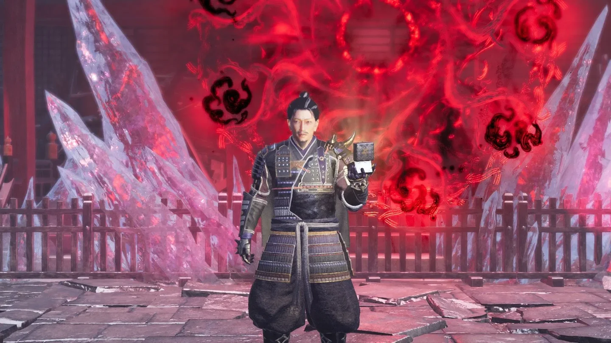

**Điểm mạnh**

-   **Hyper armor** và lượng Ki rất cao, gần như không khoá đòn được.
    
-   **Ném rìu** như boomerang, trúng cả lúc bay đi lẫn lúc bay về, nguy hiểm ở mọi khoảng cách.
    
-   Liên tục dùng **Summoning Seal** gọi yêu quái ra quấy. Gần nửa máu thì gọi thêm một con **Mezuki**.
    
-   Không yếu nguyên tố nào, kháng lửa, nước, sét, gió.
    

**Điểm yếu**

-   Có **Yoshitsune** kéo aggro giúp.
    
-   Phiên bản đòn đỏ của cú ném rìu để hở người rất lâu.
    

**Cách hạ gục**

1.  Đứng lùi lại, **chỉ đánh khi Yoshitsune đang giữ aggro**.
    
2.  Hắn **quay sang mình** là tín hiệu né ngang, rìu sắp bay tới. Coi chừng rìu bay về từ sau lưng.
    
3.  Khi hắn gọi yêu quái, đi vòng quanh hắn và né ngang.
    
4.  Dùng luôn **Summoning Seal** của mình để dồn Ki hắn.
    
5.  Cú ném rìu đỏ thì phản bằng **skill Guardian Spirit** hoặc Style Shift, lúc rìu bay đi hay bay về đều được.
    
6.  Mezuki xuất hiện thì **chạy lùi bỏ xa**, đừng đứng đỡ.
    

### Minamoto no Yoritomo

Người sáng lập Mạc phủ Kamakura, Shogun đầu tiên của Nhật Bản. Trong Nioh 3, khát vọng làm Shogun khiến Yoritomo gọi cả một Crucible trùm lên Kyoto và **đốt cây Thần Thụ** (Spirit Tree). Hắn là trùm cuối thời Heian, có cánh và có gió. Hạ xong được Guardian Spirit **Oh**, con gần như là đích đến của mọi build Samurai.

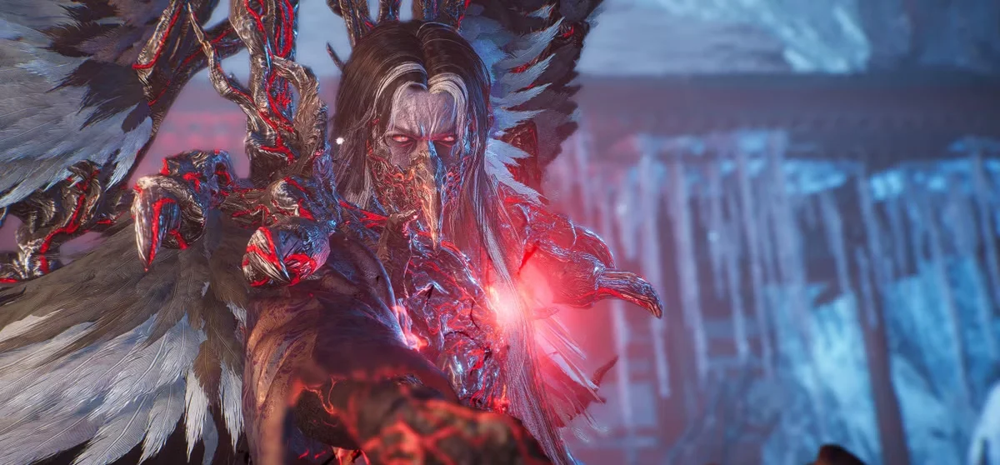

**Điểm mạnh**

-   Combo dài, phủ cả khu vực quanh người, tầm với xa nhờ **phép gió**.
    
-   Đòn nguy hiểm nhất: **năm lưỡi gió** nối thẳng vào một cú **xẻ đất**, sơ sẩy là chết ngay.
    
-   Đòn đỏ dưới đất **đánh hai lần**.
    
-   Vào Dark Realm hung hơn hẳn. Kháng sét, gió, độc, tê liệt.
    

**Điểm yếu**

-   Yếu **lửa** và **nước**, dễ kích Confusion.
    
-   Lúc không bay hay đánh, hắn **chậm rãi đi bộ** tới, đúng lúc để ném Ninjutsu.
    
-   Đáp đất sau đòn gió trên không thì hồi chiêu lâu.
    

**Cách hạ gục**

1.  **Ninja**, đánh rồi rút.
    
2.  Hắn đi bộ tới thì ném **Shrapnel Bomb**, **Uncanny Flame**, **Uncanny Bubble** để chồng lửa và nước.
    
3.  Thấy năm lưỡi gió thì **né ngang** liên tục, nhớ cú xẻ đất ngay sau.
    
4.  Đòn đỏ dưới đất: lỡ nhịp nhát đầu thì Burst Break vào nhát thứ hai.
    
5.  Hắn **nhảy lên** là sắp tóm, lùi lại rồi né và phản đòn. Trong Dark Realm, khi hắn dùng gió trên không thì lao về phía hắn, phạt cú đáp đất.
    
6.  Máu thấp thì bật **Living Artifact** để chốt.
    

**Đừng bỏ lỡ ở Heian:** **Mount Kurama** là vùng đầu tiên, khá tuyến tính, **không có Exploration Level** để đánh dấu đồ còn sót, nhưng có Kodama, suối nước nóng, Nurikabe. Thiếu Kodama cuối game thì quay lại đây đầu tiên. Field boss bí mật **Demon of Envy** ở Hachijo (yếu **nước**).

## Antiquity 247 và trở lại Edo

Takechiyo lùi về tận năm 247, thời nữ vương **Himiko** của xứ Yamatai, để tìm cội nguồn của Crucinite. Đó là em trai của chính Himiko, **Hiruko**. Sau đó Takechiyo quay về đúng ngày lễ nhậm chức ở Edo để đối mặt với Kunimatsu.

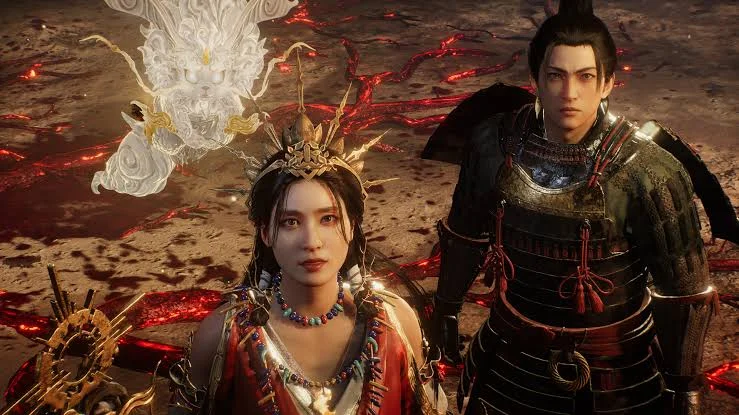

| # | Màn | Boss | Cấp gợi ý | Điểm yếu |
|---|---|---|---|---|
| 10 | Calamity's Seed | **Kusanagi** | 89 | Có vẻ yếu gió (game không ghi) |
| 11 | Ill Omen | **Hiruko** | 93 | Không có |
| 12 | To the Beginning | **Tokugawa Kunimatsu** | 97 | Không có |

### Kusanagi

Kusanagi vốn là tên thanh thần kiếm trong thần thoại Nhật, thanh kiếm thần Susanoo tìm thấy trong đuôi rắn tám đầu Yamata no Orochi, một trong ba báu vật hoàng gia. Trong Nioh 3, Kusanagi cũng là tên Guardian Spirit đồng hành cùng Takechiyo từ đầu game. Thế nên tới màn **Calamity's Seed** ở thời cổ đại, phải đối đầu với một Kusanagi khổng lồ là chuyện khá trớ trêu. Đi kèm nó còn có một **nữ pháp sư** bắn phép từ xa.

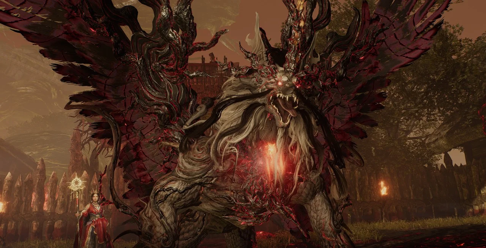

**Điểm mạnh**

-   Thân hình đồ sộ, dùng **lửa và nước**.
    
-   **Đuôi quật lửa** theo hình nón rộng, đứng sau lưng vẫn dính.
    
-   Nữ pháp sư liên tục bắn phép từ xa. Đánh ngã thì một lúc sau cô ta lại đứng dậy.
    

**Điểm yếu**

-   Game không ghi điểm yếu, nhưng Game8 ghi nhận Kusanagi **ăn sát thương gió khá đau**. Lửa và nước thì nhiều khả năng nó kháng.
    
-   Phần lớn đòn đánh thẳng phía trước.
    
-   Đòn đỏ phải **bay lên** lấy đà, báo trước rất rõ.
    

**Cách hạ gục**

1.  **Ninja** và **di chuyển liên tục**, đừng đứng một chỗ lâu vì phải né cả hai kẻ địch.
    
2.  **Bỏ qua nữ pháp sư**, đánh cô ta là phí công. Chỉ cần luôn giữ cô ta trong tầm mắt để né phép.
    
3.  Vòng ra **sau lưng** Kusanagi mà đánh, nhớ coi chừng cú quật đuôi.
    
4.  Nó bay lên là sắp ra đòn đỏ, lùi ra xa để có thời gian phản.
    
5.  Tới đây anh em đã có **hai ô Summoning Seal**, cứ gọi yêu quái ra phụ, nhất là lúc Kusanagi sắp hết máu.
    

### Hiruko (lần đầu)

Trong thần thoại Nhật, Hiruko là đứa con đầu lòng của hai vị thần sáng thế Izanagi và Izanami. Vì sinh ra dị dạng, Hiruko bị thả trôi trên một chiếc thuyền lau. Nioh 3 biến Hiruko thành **em trai của Himiko** và là **kẻ đứng sau Crucinite**, thứ đã gây hoạ suốt các thời đại. Đây là phản diện lớn nhất của game, và lần chạm trán đầu tiên ở màn **Ill Omen** đã đủ để hành anh em ra bã.

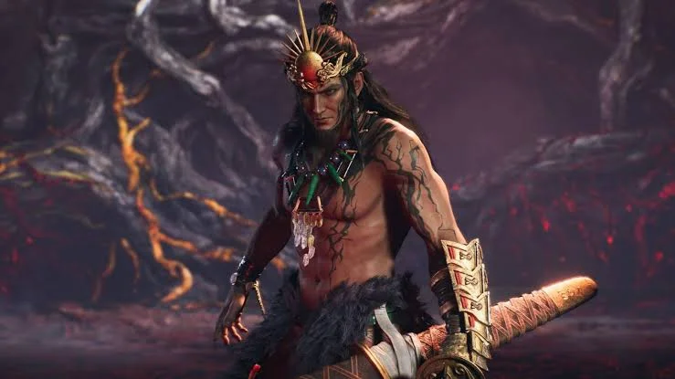

**Điểm mạnh**

-   **Hai giai đoạn**: sang giai đoạn hai là hồi đầy máu và hung hơn hẳn.
    
-   Phép **băng** có thể đóng băng bạn, bị đóng băng gần như là chết.
    
-   **Mưa máu** làm giảm máu tối đa. Sàn đầy bẫy nguyên tố khiến khó vòng ra sau.
    
-   **Tia Crucible** bắn hai lần. Không yếu nguyên tố nào, kháng lửa, nước, sét, gió.
    

**Điểm yếu**

-   Cỡ người, đòn chủ yếu đánh thẳng phía trước.
    
-   Sau cú quật đuôi, hắn mất khá lâu để quay lại.
    

**Cách hạ gục**

1.  **Ninja**, lướt xuyên đòn ra sau lưng mà đánh để ăn thêm sát thương đánh lén.
    
2.  Giai đoạn một cố **ăn ít đòn nhất có thể**, để dành Elixir cho giai đoạn hai.
    
3.  Thấy hắn **khom người về trước** là sắp quật đuôi. Né hoặc đỡ xong thì đánh tiếp trong lúc hắn quay lại.
    
4.  Giai đoạn hai tránh xa vùng **mưa máu** và các mảng băng.
    
5.  Tia Crucible: **né ngang** tia đầu, **tiến lên** trong tia thứ hai để áp sát.
    
6.  Dùng cả hai Summoning Seal.
    

### Tokugawa Kunimatsu

Ngoài đời, Kunimatsu chính là Tokugawa Tadanaga, em trai của Iemitsu, người từng được cha mẹ yêu chiều hơn anh và có thời được nhắm làm người kế vị. Trong Nioh 3, sự căm hận ấy biến Kunimatsu thành kẻ bị Guardian Spirit **Murakumo** của Hiruko chiếm lấy, cũng chính là kẻ đã tàn sát thành Edo ở màn mở đầu. Trận tái đấu ở màn **To the Beginning** được cộng đồng coi là **boss khó nhất game**.

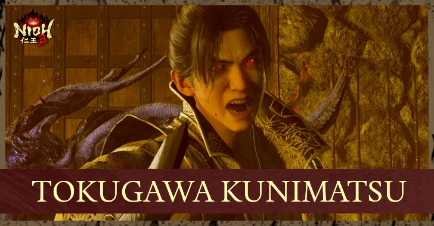

**Điểm mạnh**

-   **Hyper armor**, không khoá đòn được, hắn cứ thế đánh xuyên qua combo của bạn.
    
-   Song kiếm cực nhanh, dùng cả **sét** lẫn **gió**, máu rất dày.
    
-   Cú rút kiếm lao qua người để lại **vệt gió** gây sát thương sau một nhịp. **Chém gió vòng tròn** quanh người sát thương rất cao.
    
-   Giai đoạn hai có đòn đỏ **biến mất rồi rơi từ trên xuống**, bị lốc xoáy che khuất.
    

**Điểm yếu**

-   Không yếu nguyên tố nào, nhưng vẫn dính **nước** và **lửa**. Chỉ kháng sét và gió.
    
-   Là boss cỡ người nên **rất dễ bị đánh lén từ sau**.
    

**Cách hạ gục**

1.  **Ninja** (Samurai cũng được, nhưng Ninja tốn ít Ki nên dễ thở hơn), đánh rồi rút, gọt máu từ từ.
    
2.  Nghe tiếng **sét nổ** là lao vào đánh ngay, không cần chờ hiệu ứng tan hết.
    
3.  Hắn rút kiếm lao qua người thì **đừng đuổi theo ngay sau lưng** vì vệt gió sẽ nổ. Tiếp cận từ bên hông rồi phản.
    
4.  Hắn chém gió vòng tròn thì **rút ra xa**, nhân lúc đó hồi máu, buff lại hoặc ném Ninjutsu.
    
5.  Đòn đỏ rơi từ trên xuống: ngắt bằng **skill Guardian Spirit** trước khi hắn nhảy (skill tầm xa vẫn dùng được khi hắn đang trên không). Không kịp thì chạy ra khỏi vùng ảnh hưởng.
    
6.  Dùng cả hai Summoning Seal, giữ **Living Artifact** để chốt.
    

## Bakumatsu 1864 và trận cuối

Để tìm "tia sáng hy vọng ở cuối thời gian", Takechiyo tới năm 1864, những ngày cuối của Mạc phủ, và sát cánh cùng nhà ái quốc Takasugi Shinsaku. Cây Thần Thụ Takechiyo trồng từ thời Heian giờ đã lớn, trả lại toàn bộ sức mạnh cho Kusanagi.

| # | Màn | Boss | Cấp gợi ý | Điểm yếu |
|---|---|---|---|---|
| 13 | A New Era | **Takasugi Shinsaku** | 100 | Không có |
| 14 | Those Left Behind | **Enenra**, **Nuribotoke** | 108 | Nước, Gió / Nước |
| 15 | Final Hope | **Okita Soji**, **Tokugawa Yoshinobu** | 131 | Không có / Sét |
| 16 | What Makes a Shogun | **Death Veil**, **Hiruko** (boss cuối) | 134 | Không có |

### Takasugi Shinsaku

Takasugi Shinsaku là chí sĩ phiên Choshu, người lập ra đội quân Kiheitai trong phong trào lật đổ Mạc phủ, và nổi tiếng mê đàn shamisen. Ở Nioh 3, anh em phải đánh nhau với hắn ở **Shimabara** trước khi hai bên thành đồng minh. Guardian Spirit của hắn là một mỹ nhân **gảy shamisen**. Hạ xong anh em nhận luôn con này, tên **Shami-choro**.

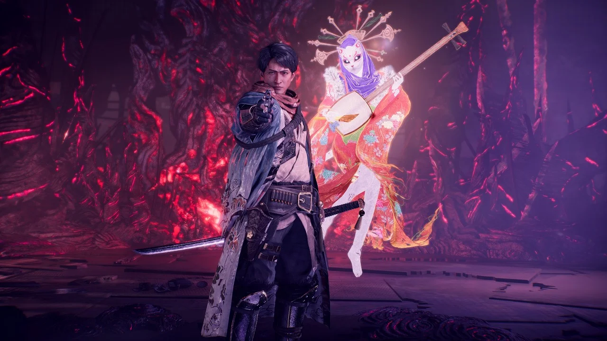

**Điểm mạnh**

-   Guardian Spirit được gọi ra **gần như tức thì**, đánh vào điểm mù của bạn.
    
-   Hắn **lướt khắp sân**, hai thầy trò đỡ là cạn Ki.
    
-   Đòn tóm vung lâu nhưng khi ra thì **cực nhanh**, né ngang rất khó kịp.
    
-   Không yếu nguyên tố nào, kháng lửa, nước, sét, gió.
    

**Điểm yếu**

-   Guardian Spirit báo trước bằng **tiếng đàn shamisen**.
    
-   Từ nửa máu, Guardian Spirit **ngừng tấn công** và chuyển sang buff cả sân: tăng hồi Ki và chống khựng, **buff này áp dụng cho cả bạn**.
    

**Cách hạ gục**

1.  **Né thay vì đỡ**, né về phía sau lưng hắn để đánh vài đòn sạch trước khi hắn kịp thủ.
    
2.  **Nghe tiếng đàn là né ngay**.
    
3.  Thấy hắn lấy đà tóm thì **nhảy** lên thay vì né ngang.
    
4.  Từ nửa máu, tận dụng buff của sân để **dồn ép** cho xong trận.
    

### Enenra và Nuribotoke

Màn **Those Left Behind** có hai boss yêu quái liên tiếp. **Enenra** là yêu quái sinh ra từ khói lửa trại, truyền thuyết nói chỉ người có tâm trong sạch mới nhìn thấy nó. **Nuribotoke** là xác chết sơn đen như tượng Phật, hay chui ra từ bàn thờ Phật trong nhà. Cả hai đều yếu nước.

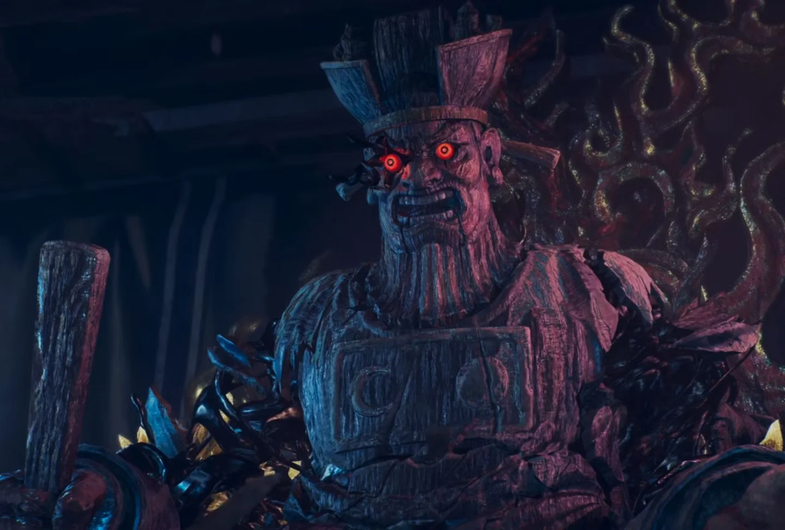

**Enenra: điểm mạnh và điểm yếu**

-   Chuỗi cào và đá **trộn nhịp** để đánh lừa, phạt sớm là dính. Cú **nhảy giậm hai chân** và **vòng lửa** quanh người vẫn trúng khi bạn ở sau lưng.
    
-   Cạn Ki hoặc bị tóm xong thì hắn cuộn mình trong **lốc xoáy** xoay tròn.
    
-   Yếu **nước** và **gió**, kháng lửa, sét, độc, tê liệt. Đứng sau lưng thì né được hầu hết đòn cào và đá. Đòn đỏ **lốc xoáy** đi rất chậm, dễ phản.
    

**Nuribotoke: điểm mạnh và điểm yếu**

-   Nhiều đòn **tầm xa**. **Cầu lửa** nổ xong để lại lửa trên sàn, phá vị trí đứng của bạn.
    
-   Đòn tóm quét rộng, né ngang thường vẫn dính. Có **vòng lửa** lan ra và đòn đỏ **đánh giả** trong Dark Realm.
    
-   Yếu **nước**, kháng lửa, sét, Confusion, độc. Di chuyển chậm, **hồi chiêu rất lâu**. Trong Dark Realm, trên người mọc **tinh thể Amrita**, đập vỡ là nó ngã.
    

**Cách hạ gục**

1.  **Enenra**: đi vòng quanh, luôn đứng sau lưng mà phản đòn. Chờ hắn **đánh hết chuỗi** rồi mới vào. Cạn Ki hay vừa tóm xong thì **lùi ngay** tránh lốc xoáy. Đòn đỏ lốc xoáy thì Style Shift hoặc ngắt bằng skill Guardian Spirit.
    
2.  **Nuribotoke**: né đòn rồi đánh trong lúc nó hồi chiêu, đừng tham vì nó chậm. **Dắt cầu lửa ra xa** boss rồi mới để nổ. Đòn tóm thì **né về phía trước**. Thấy nó giơ tay phải bốc lửa là **nhảy** qua vòng lửa.
    
3.  Trong Dark Realm, đập tinh thể trên người Nuribotoke. Đòn đỏ đánh giả thì ngắt bằng skill Guardian Spirit cho chắc.
    
4.  Dán bùa nước cho cả hai trận.
    

### Okita Soji

Đội trưởng đội 1 của **Shinsengumi**, thiên tài kiếm thuật trẻ tuổi nhất nhóm, ngoài đời mất sớm vì bệnh lao. Nioh 3 giữ cả chi tiết này: hắn **ho sặc sụa** giữa trận. Thanh kiếm anh em nhận được sau trận, **Kashu Kiyomitsu**, cũng đúng là thanh kiếm gắn liền với tên tuổi Okita ngoài đời.

**Điểm mạnh**

-   Chuỗi đòn rất dài, có cả đòn tóm.
    
-   **Hyper armor ngay khi đang ra đòn**: đánh vào lúc hắn ra chiêu là hắn không khựng.
    
-   Không yếu nguyên tố nào, kháng lửa, nước, sét, gió.
    

**Điểm yếu**

-   Đòn của hắn **thiếu tầm theo chiều dọc**, nhảy qua được gần hết.
    
-   Sau chuỗi đòn dài hắn hay **lên cơn ho**, đứng yên một lúc.
    

**Cách hạ gục**

1.  **Đánh hắn trong Myth "Solitary Blade"** (xem khung bên dưới).
    
2.  **Nhảy** qua chuỗi đòn và đòn tóm thay vì đỡ hay né, tiết kiệm Ki để vòng ra sau đánh.
    
3.  Hắn **ho** là cửa sát thương: dập, hồi máu hoặc buff lại.
    
4.  Hắn bắt đầu ra đòn phản là **rút ngay**, đừng cố đánh thêm vì hắn có hyper armor.
    

<strong>Cực kỳ quan trọng: làm Myth "Solitary Blade" trước khi vào Crucible Hoàng cung Kyoto.</strong> Trong nhiệm vụ phụ này, Okita Soji đánh một mình. Hạ hắn ở đây thì hắn <strong>không xuất hiện</strong> trước Tokugawa Yoshinobu nữa. Bỏ qua thì mỗi lần thua Yoshinobu là phải đánh lại Okita từ đầu, hai boss liên tiếp, rất mệt.

### Tokugawa Yoshinobu

Vị Shogun thứ 15 và cũng là Shogun cuối cùng của nhà Tokugawa, người trao trả quyền lực cho Thiên hoàng năm 1867, khép lại hơn 260 năm Mạc phủ. Một hậu duệ của chính dòng họ Takechiyo. Trong game, Yoshinobu là boss của **Crucible Hoàng cung Kyoto** ở màn **Final Hope**. Hạ xong được Guardian Spirit **Golden Shachi**.

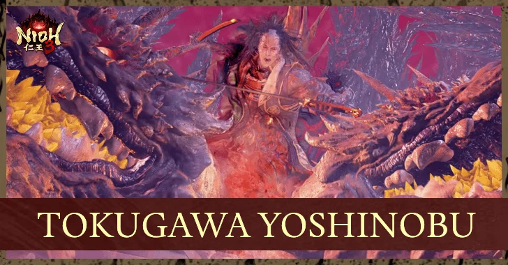

**Điểm mạnh**

-   Đòn **quét rộng**, rất dễ bắt người tham đánh.
    
-   Vào Dark Realm hung hơn hẳn.
    
-   Kháng lửa, nước, gió, độc.
    

**Điểm yếu**

-   Yếu **sét**.
    
-   Có những lúc lấy đà để lộ sơ hở cho Burst Break.
    

**Cách hạ gục**

1.  Hạ Okita trước trong Solitary Blade để trận này chỉ còn một boss.
    
2.  Mang sét: Uncanny Bolt, bùa Lightning, Guardian Spirit hệ sét.
    
3.  Đánh rồi rút, **luôn chừa đủ Ki** để thoát khi hắn bắt đầu lấy đà.
    
4.  Trong Dark Realm, ưu tiên **né hoặc Deflect**. Có thể chơi thủ chờ hết giai đoạn này, hoặc canh một cú Burst Break để mở cửa.
    

### Death Veil và Hiruko (trận cuối)

Trở về Edo năm 1622, Takechiyo thấy thành Edo đã biến dạng kinh hoàng. Trận cuối ở màn **What Makes a Shogun** gồm **Death Veil** rồi tới **Hiruko**, kẻ đã hợp nhất với Kunimatsu. Đây là trận khép lại hành trình để Takechiyo trở thành **Tokugawa Iemitsu**, Shogun đời thứ ba.

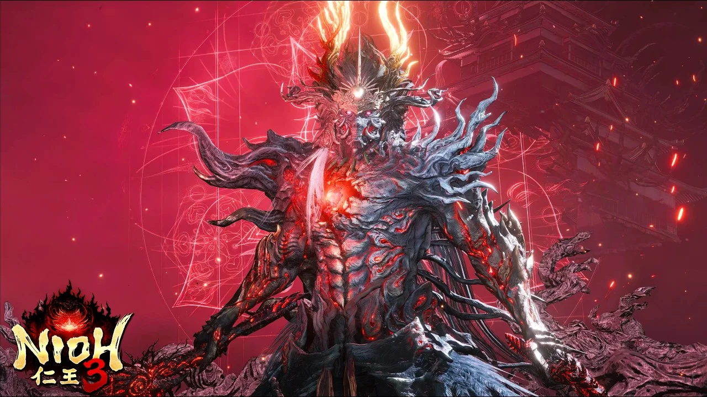

**Điểm mạnh**

-   Đòn của Hiruko **dồn sát thương ngay cả khi đỡ** và **gây hiệu ứng**, trừ khi Deflect chuẩn.
    
-   Dark Realm làm hồi Ki rất chậm.
    
-   Kháng **mọi** nguyên tố và trạng thái: lửa, nước, sét, gió, độc, tê liệt.
    

**Điểm yếu**

-   Phần lớn đòn kiếm của Hiruko **đánh thẳng phía trước**, lướt qua là ra được sau lưng.
    
-   Đòn đỏ có báo trước rõ: hắn **nhảy lên và ném một tràng đạn hình quạt** rồi mới ra đòn đỏ.
    

**Cách hạ gục**

1.  Với Death Veil, né là chính và tận dụng vật cản trong sân để tránh đòn.
    
2.  Với Hiruko, **né thay vì đỡ**. Lướt qua người hắn để đánh từ sau, luôn chừa Ki để rút.
    
3.  Hắn nhảy lên ném đạn quạt thì **lùi ra**, chuẩn bị Burst Break đòn đỏ ngay sau đó.
    
4.  Trong Dark Realm, đánh rồi rút, tuyệt đối không tham.
    
5.  Dùng hết Summoning Seal, giữ **Living Artifact** cho đoạn cuối.
    

**Đừng bỏ lỡ ở Bakumatsu:** field boss bí mật **Demon of Obsession** ở thành Nijo (yếu **nước**). Battle Scroll **Nobunaga's Blade** cho Guardian Spirit **Tengen Kujaku**.

## Boss ẩn: ba con quỷ mang tên Kunimatsu

Ngoài 20 boss cốt truyện, Nioh 3 giấu ba **boss bí mật** trên bản đồ mở: **Demon of Pride** (Kiêu ngạo), **Demon of Envy** (Đố kỵ) và **Demon of Obsession** (Ám ảnh). Hạ hai con đầu nhận trophy *Kunimatsu's Pride* và *Kunimatsu's Envy*, còn đường tới con thứ ba thì phải đi theo **cái bóng của Kunimatsu**. Ba con quỷ này nhiều khả năng là ba tâm ma của người em trai Takechiyo. Cả ba đều **khó hơn hẳn** boss cốt truyện cùng giai đoạn, nhưng phần thưởng là Soul Core cho dòng bùa "Hell" mà các build Onmyo cuối game rất cần.

| Boss ẩn | Ở đâu | Mở khi nào | Cấp nên đánh | Điểm yếu |
|---|---|---|---|---|
| **Demon of Pride** | Thác nước phía đông Iinoya (Warring States) | Sau khi có Kurama Tengu (hạ Great Tengu) | 100 (80 vẫn được nếu đồ tốt) | Sét |
| **Demon of Envy** | Dưới lòng đất chùa Anneibo, Hachijo (Heian) | Khi tới chùa Anneibo | 100+ (90 vẫn được nếu đồ tốt) | Nước |
| **Demon of Obsession** | Abandoned Temple Outskirts, phía tây thành Nijo (Bakumatsu) | Khi tới khu thành Nijo | 130+ | Nước |

### Demon of Pride

Con quỷ đầu tiên và là cú sốc độ khó lớn nhất game. Hắn nằm sau một **Spirit Vein** ở thác nước phía đông Iinoya, mà Spirit Vein này chỉ mở được bằng **Kurama Tengu**. Nghĩa là anh em phải lên tới thời Heian rồi mới quay về Warring States tìm hắn. Hạ xong nhận trophy *Kunimatsu's Pride*, Soul Core cho **Hellstream Talisman** (bong bóng nước nổ gây sát thương) và Transformed Art *Death from Above Water* cho rìu ném.

**Điểm mạnh**

-   Combo dài, nguy hiểm ở mọi khoảng cách.
    
-   Đứng xa là hắn tung **phép nước** chí mạng: đạn nước và bom nước khó né.
    
-   Đòn đỏ **vung cực lâu**, Style Shift canh sai một nhịp là chết.
    
-   Nửa sau trận hung hơn hẳn. Kháng nước và cả Confusion.
    

**Điểm yếu**

-   Yếu **sét**.
    
-   Đòn cận chiến dễ xử lý hơn phép nước nhiều.
    

**Cách hạ gục**

1.  Đủ khoảng **cấp 100** rồi hãy vào. Cấp 80 vẫn đánh được nếu đồ tốt.
    
2.  Mang sét: vũ khí hoặc Martial Arts phủ sét, **Uncanny Bolt**, bùa **Lightning Familiar / Lightning Shot**, hoặc Summoning Seal từ Soul Core **Ibaraki Doji**.
    
3.  **Bám sát hắn**: đứng gần thì hắn ít dùng phép nước. Coi chừng cú giậm chân và bom nước.
    
4.  Đòn đỏ thì **ngắt bằng skill Guardian Spirit** trong lúc hắn lấy đà, đừng mạo hiểm Style Shift. Luôn giữ sẵn Spirit Force.
    
5.  Mặc đồ có **kháng nước** nhưng đừng hy sinh phòng thủ gốc. Đánh rồi rút, luôn chừa Ki để né.
    
6.  Giữ **Living Artifact** cho nửa sau trận.
    

### Demon of Envy

Nữ quỷ Đố kỵ ẩn dưới lòng đất **chùa Anneibo** ở Hachijo thời Heian: leo xuống các thang rồi đi thẳng là gặp. Anh em có thể đụng mụ ngay khi tới chùa (khu vực cấp gợi ý 73), nhưng mụ mạnh hơn khu đó rất nhiều. Hạ xong nhận trophy *Kunimatsu's Envy*, Soul Core cho **Hellfire Talisman** (đốt cháy cả một vùng) và Transformed Art *Arc of Chaos Fire* cho Switchglaive.

**Điểm mạnh**

-   Toàn đòn **lửa**: vòng lửa lan ra, vệt lửa chạy trên mặt đất.
    
-   Cạn Ki thì mụ **phun lửa quanh người** rồi kéo bạn vào Dark Realm.
    
-   Có đòn tóm và đòn bổ nhào từ trên cao. Kháng lửa và độc.
    

**Điểm yếu**

-   Yếu **nước**.
    
-   Đòn tóm né được chỉ bằng cách **đi lùi**, không tốn Ki.
    
-   Đòn bổ nhào báo trước rất rõ (mụ nhảy lên cao), né hay Deflect trúng là có một khoảng dài để phản.
    

**Cách hạ gục**

1.  Khoảng **cấp 100+** là thoải mái, cấp 90 nếu đồ tốt.
    
2.  Mang nước: vũ khí phủ nước, **Uncanny Bubble**, bùa **Water Familiar / Water Shot**, Summoning Seal từ Soul Core **Demon of Pride**.
    
3.  Vừa làm cạn Ki mụ thì **lùi lại ngay** để tránh vòng lửa trước khi vào Dark Realm.
    
4.  **Nhảy qua** vòng lửa và vệt lửa trên đất.
    
5.  Chờ mụ bổ nhào, né hoặc Deflect, rồi dồn đòn trong khoảng hở dài.
    
6.  Mặc đồ kháng nước, giữ Living Artifact cho nửa sau trận.
    

### Demon of Obsession

Con quỷ thứ ba nằm ở **Abandoned Temple Outskirts**, phía tây khu thành Nijo thời Bakumatsu. Đường đi: từ Shrine **Horikawa Market**, dọn Lesser Crucible để vào khu Mibu, tìm **cái bóng của Kunimatsu** cạnh bậc thang bên kia rừng tre, rồi đi theo nó tới nơi. Trên đường mở thêm được hai Shrine. Hạ xong nhận Soul Core cho **Hellgust Talisman** và Transformed Art *Kurama Sword Dance Wind*.

**Điểm mạnh**

-   Đòn **tóm không đỡ được**.
    
-   Tạo **vũng độc** trên sàn, đứng vào là mất máu dần.
    
-   Cú **xoay người tiến tới** và cú **đấm đất gây nổ** vẫn trúng khi đứng sau lưng.
    
-   Dùng nhiều đòn gió. Kháng sét, gió, độc.
    

**Điểm yếu**

-   Yếu **nước**.
    
-   Đòn **chậm và báo trước rất rõ**, Samurai đỡ và Deflect thoải mái.
    
-   Phần lớn đòn đánh thẳng phía trước, Ninja đánh lén sau lưng rất ngon.
    

**Cách hạ gục**

1.  Nên lên **cấp 130+**.
    
2.  Chơi phong cách nào cũng được: Samurai đỡ và Deflect, Ninja vòng ra sau đánh lén. Ninja nhớ coi chừng cú xoay và cú đấm đất.
    
3.  Chồng **nước** bằng Uncanny Bubble, bùa nước hoặc Summoning Seal Demon of Pride.
    
4.  Đi vòng hoặc nhảy qua vũng độc, mang sẵn **Antidote**.
    
5.  Mặc đồ **kháng gió**, dùng cả hai Summoning Seal, giữ Living Artifact cho nửa sau trận.
    

## Boss phụ đáng đánh

Boss phụ nằm trong nhiệm vụ phụ (Myth), Battle Scroll hoặc đứng sẵn trên bản đồ (Formidable Enemy). Không bắt buộc, nhưng nhiều con rơi Soul Core và đồ cực đáng giá cho build.

### Bloodedge Demon

Con quỷ "lang thang" của Nioh 3. Nó không có chỗ đứng cố định: mỗi khi anh em hạ **Revenant** ở mộ đỏ, sẽ có vệt **Revenant Malice** dẫn đường, mũi tên đỏ trên bản đồ chỉ khu vực nó xuất hiện (lần đầu ở Hamamatsu / sông Tenryu). Hạ càng nhiều Revenant trước khi đánh, nó **càng mạnh nhưng rơi đồ càng ngon**. Game8 xếp nó vào nhóm boss khó nhất game, mức 4/5. Soul Core của nó là món chủ lực: ô Yang gọi nó ra đánh theo nguyên tố Guardian Spirit của bạn, ô Yin cho **Carnage Talisman**.

**Điểm mạnh:** cực hung, đòn nhanh, nhiều đòn nguyên tố diện rộng và đổi nguyên tố liên tục. Đỡ vẫn ăn sát thương dồn và rất tốn Ki. Không yếu nguyên tố nào, kháng gần hết trạng thái.

**Điểm yếu:** hồi chiêu sau đòn đủ để đánh vài nhát. Lúc ra đòn đỏ nó **đứng yên**, vừa dễ Burst Break vừa là lúc hồi máu, buff lại. Cạn Ki thì khựng theo từng đòn.

**Cách hạ gục:** đánh rồi rút, ưu tiên **né thay vì đỡ**. Ném bom, kunai, shuriken gọt máu từ xa. Đòn đỏ thì Burst Break. Mang **bùa kháng nguyên tố** (Firestop, Windstop...) cho từng nguyên tố nó đổi. Khó quá thì đi lên cấp, kiếm đồ rồi quay lại.

### Ryomen Sukuna

Trong sử Nhật, Ryomen Sukuna là một nhân vật hai mặt bốn tay ở xứ Hida, triều đình coi là quỷ phản loạn còn dân địa phương thờ như thần. Trong game, Sukuna là boss nhiệm vụ phụ **Fated Land** ở **chùa Ryotan, Iinoya**, đánh cùng **Ii Naotora**. Hạ xong rơi cả bộ **kiếm, rìu và cung của Ryomen Sukuna** cùng Samurai's Locks.

**Điểm mạnh:** đánh được cả **phía trước lẫn phía sau**. Đòn đỏ để lại **vũng nước** gây Saturated, ăn thêm sát thương. Dùng cung bắn xuống những vùng **đánh dấu xanh** trên đất, trong Dark Realm còn làm ngập cả khu xung quanh.

**Điểm yếu:** có **Ii Naotora** kéo aggro giúp. Hai bên sườn là chỗ an toàn nhất.

**Cách hạ gục:** chơi **Ninja**, lắp kỹ năng xoá Yokai Realm, đánh vào **hai bên sườn** chứ đừng đứng trước hay sau. Đánh khi Naotora đang giữ aggro. Burst Break đòn đỏ thì tránh đứng trong vũng nước. Thấy vạch xanh dưới chân là thoát ra ngay.

### Hino-Enma

Hinoenma là nữ yêu quái quyến rũ trong tranh yêu quái cổ, tên gắn với mê tín về phụ nữ sinh năm Bính Ngọ. Fan Nioh cũ sẽ nhận ra ngay bà chị chuyên **làm tê liệt** này. Mụ là boss nhiệm vụ phụ **Abundant Evil** ở **Maisaka** (Haunting Caves), nhận từ Honda Tadakatsu. Hạ xong rơi giáo **Tombokiri**, mũ **Warrior of the East** và Soul Core Hino-Enma.

**Điểm mạnh:** đòn gây **Paralysis**. Đỡ vẫn bị tích tê liệt. Bắn đạn từ xa. Kháng gió, Confusion, tê liệt, độc.

**Điểm yếu:** yếu **sét**. Đạn của mụ bay chậm, dễ né. Đứng xa thì mụ hay ra **đòn đỏ**, rất dễ Burst Break.

**Cách hạ gục:** chơi **Ninja** để né tê liệt. Đứng xa ném **Uncanny Bolt**, Shrapnel Bomb, kunai, chờ đòn đỏ để Burst Break rồi vào combo. Đánh cận chiến trong lúc mụ hồi chiêu để nạp lại Ninjutsu. Lỡ bị tê liệt thì **dùng skill Guardian Spirit để gỡ ngay**, hoặc dùng Antiparalytic Needle.

### Kamaitachi

Kamaitachi là "chồn liềm" trong dân gian Nhật, cưỡi gió lốc và để lại những vết cắt không rõ từ đâu ra. Game có hai con: một ở **Maisaka** (cạnh Shrine Maisaka Junction, chỗ mấy cái cây cạnh một Sudama) thời Warring States, một trong **Lesser Crucible ở Rokuhara** thời Heian. Con nào cũng rơi **Soul Core Kamaitachi**, nguồn **Wind Familiar Talisman** cho rất nhiều build. Con ở Maisaka cho thêm Transformed Art *Pollard Combo*, con ở Rokuhara cho *Swallow Slash Jump*.

**Điểm mạnh:** nhanh, nhảy liên tục, quét rộng, **phép gió xuyên qua thế đỡ**. Combo 3 đòn bằng vuốt và đuôi. Không yếu nguyên tố nào, kháng sét, gió, độc.

**Điểm yếu:** đòn đỏ dưới đất dễ phản. Combo 3 đòn và đòn tóm đều đánh từ **bên phải của nó** (bên trái của bạn).

**Cách hạ gục:** **Ninja**. Luôn né và di chuyển **về bên phải của mình**, đứng sát thì cú quất đuôi trong combo không trúng. Cứ coi như nó luôn đánh đủ 3 đòn. Đòn đỏ dưới đất thì Burst Break hoặc ngắt bằng skill Guardian Spirit, đòn đỏ trên không thì né ngang cho chắc. Phá được Ki là dồn combo tới khi nó gục.

### Honda Tadakatsu

Một trong "Tứ Thiên Vương" của Tokugawa Ieyasu, tương truyền đánh hơn 50 trận chưa từng bị thương, cầm cây giáo huyền thoại **Tonbokiri** ("giáo chém chuồn chuồn"). Trong game, ông là đồng minh suốt thời Warring States, và nhiệm vụ phụ **Becoming the Champion of the East** (mở sau Abundant Evil) là một trận **đấu tay đôi** ở cổng Otemon thành Hamamatsu. Thắng được giáo **Tombokiri** cùng Smithing Text của nó.

**Điểm mạnh:** giáo dài, tầm với rất rộng, đòn mang **sét**.

**Điểm yếu:** là đấu tay đôi, không có quái phụ hay Yokai Realm quấy rối.

**Cách hạ gục:** giữ khoảng cách vừa phải, né ngang khỏi những đường đâm thẳng của giáo, đánh khi ông vừa vung xong. Mang đồ hoặc bùa kháng sét. Có thể nhận thách đấu ngay hoặc để sau, nên cứ lên thêm vài cấp rồi quay lại.

### Hattori Hanzo

Hattori Hanzo đời thứ hai, Masanari, nổi danh là "Quỷ Hanzo" và cũng là tay giáo cừ khôi. Trong Nioh 3, ông là người dẫn dắt phe Ninja ở Eternal Rift. Chuỗi nhiệm vụ của ông: **Searching for a Spy** (gặp ông trên mái nhà ở làng Tealeaf, Futamata, đánh **Kyokotsu**) rồi **The Demon's Regimen**: theo con Scampuss **Hayatemaru**, qua hai trận phục kích của đệ tử Hanzo, rồi đấu chính ông. Thắng được **Smithing Text bộ giáp Iga Jonin** và giáo **Hanzo the Demon's Spear**, hai món cực đáng cho phe Ninja.

**Cách hạ gục:** hai trận phục kích trước có cả **cung thủ**, xử con bắn cung trước. Với Hanzo, chơi đánh rồi rút như với mọi boss người: né ra sau lưng sau mỗi đòn của ông, Burst Break đòn đỏ.

### Nuppeppo

Nuppeppo là yêu quái dạng một khối thịt nhũn nhão, bốc mùi, hay lảng vảng quanh đền chùa ban đêm. Trong game, nó là mục tiêu nhiệm vụ phụ **Headaches** (mở sau Fated Land): gặp Ieyasu ở thành Hamamatsu, điều tra ngôi làng phía nam đường Futamata, rồi đuổi Nuppeppo trong khuôn viên thành (đi từ Shrine Hamamatsu Castle - East Gate về phía tây). Đây là nguồn **Soul Core Nuppeppo**: +100 máu, hồi máu mỗi lần hút Amrita, linh hồn của build Thương "bất tử" bên bài build của Cenix.

**Cách hạ gục:** nó **lăn đi** khi bị đánh, mà lúc đang lăn thì **đòn cận chiến bị bật ra**. Dùng **Ninjutsu** gọt máu từ xa trong lúc đuổi theo. Dồn được nó vào góc thì nó quay lại đánh, lúc đó mới vào cận chiến. Nó rơi **Yokai Gallstone**, đem về Blacksmith rèn thành Ghostly Gall rồi giao cho Ieyasu để xong nhiệm vụ.

### Onryoki

Gương mặt quen của fan Nioh đời đầu. Onryoki là con quỷ khổng lồ chờ sẵn trước điện thờ cạnh **hồ Sanaru**, trong nhiệm vụ phụ **The Great Shogun of the Heian Era** (mở sau Headaches). Hạ được nó là có Soul Core Onryoki, nó cũng là nguồn rơi **Quaking Tonfa**, cây Tonfa nền của nhánh Ninja Onmyo trong bài build Tonfa.

**Cách hạ gục:** nó to xác nhưng **di chuyển bằng những cú nhảy rất nhanh**, đừng đứng thẳng hướng nó vừa lấy đà. Né về hai bên rồi đánh khi nó tiếp đất. Xong trận, vào điện, nhảy xuống hố, đi qua Spirit Vein tới phòng thờ trống để dâng Candle Dish của Ieyasu.

### Những boss phụ còn lại

| Boss | Ở đâu | Phần thưởng đáng chú ý |
|---|---|---|
| **Ninja Yoki** | Myth *Those Who Live in the Shadows*, Iinoya (đi ngang đường gần Shrine Omomiji Junction để mở) | Soul Core Ninja Yoki. Nhiệm vụ cho thêm **Fuma Chief's Talons** và **Fuma Chief's Greaves** |
| **Kyokotsu** | Myth *Searching for a Spy*, Futamata | Giáo Hanzo the Demon's Spear (thưởng nhiệm vụ) |
| **Aggrieved Warrior** (Revenant) | Myth *Ii's Memento*, ngôi chùa trên đồi Hamamatsu | Sincere Buddha's Gauntlets, Samurai's Locks |
| **Yoki** | Myth *A Drop of Hope*, gần Hamamatsu Post | 2 Omamori (bản Samurai và Ninja) |
| **Otazu no Kata** | Battle Scroll *Princess Tsubaki*, Hamamatsu | Kamari Hakama, Samurai's Locks |
| **Mezuki** | Field boss ở Tokaido | Soul Core Mezuki |
| **Green Shadow's Blade** | Field boss ở Tokaido | Transformed Art *Swift Step Heavy* cho katana |
| **Blood-Spurting Ogin** | Field boss ở Mikatagahara | Transformed Art *Flying Buck Stomp* |
| **Naito Masatoyo** | Field boss trên đường Futamata | Transformed Art *Resounding Lunge Extend* |
| **Anayama Nobutada** | Field boss ở Futamata | Handbook *Punish the Proud* |

## Checklist những thứ dễ lỡ nhất

-   **Ba boss bí mật** Demon of Pride, Demon of Envy, Demon of Obsession: xem mục **Boss ẩn** ở trên. Mỗi con một trophy và một Soul Core xịn.
    
-   **Exploration Level 4** ở mỗi vùng sẽ đánh dấu đồ còn sót. Tới mốc là quay lại vét Skill Text, Kodama, tượng Jizo.
    
-   **Spirit Vein bị khoá**: có Guardian Spirit mới (Enko, Kongojishi, Kurama Tengu, Oh) là quay lại mở. Quái bên trong scale theo cấp lúc bạn mở khoá nên không lo quá dễ.
    
-   **Soul Core Sudama**: mua sạch hàng của một thương nhân Sudama bằng Yokai Teardrop để nhận, All Things How cảnh báo **có thể lỡ**.
    
-   **Titles**: mở menu Titles thường xuyên để tiêu điểm vào buff.
    
-   **Sau cốt truyện**: Battle Scroll **A Sinister End** rơi phụ kiện **Yasakani Magatama** (giảm 1 mảnh yêu cầu set bonus, cốt lõi của gần như mọi build endgame). New Game+ có tên **Shogun's Journey**. DLC **Hell Rising** (ra **19/8/2026**) mở thời **Keian**, Edo năm **1651**, thêm vũ khí Hoko & Shield và độ khó *The Enlightened One's Journey*.

Đủ đồ nghề rồi đó, giờ chỉ còn việc cầm tay cầm lên. Anh em đang kẹt ở boss nào, và con nào hành mấy ông nhiều nhất: Kunimatsu, Kajiwara hay ngay từ ông Yamagata đầu game? Điểm danh dưới phần bình luận, đông người kẹt con nào thì Cenix viết riêng bài cho con đó.

*Nguồn tham khảo: [Game8 - Main Missions](https://game8.co/games/Nioh-3/archives/576150), [Game8 - All Bosses](https://game8.co/games/Nioh-3/archives/576146) và trang hướng dẫn từng boss, [Game8 - Side Quests & Myths](https://game8.co/games/Nioh-3/archives/576461), [Game8 - Best Clans](https://game8.co/games/Nioh-3/archives/579768), [Game8 - Game Length](https://game8.co/games/Nioh-3/archives/578777), [VGC - 10 Nioh 3 tips](https://www.videogameschronicle.com/guide/nioh-3-tips-tricks-10-things-before-starting/), [All Things How](https://allthings.how/elemental-ninja-build-dominates-nioh-3-setup-and-mechanics/), [RPG Site - Hell Rising](https://www.rpgsite.net/news/20966-nioh-3-hell-rising-dlc-announced-set-to-release-on-august-19), [Wikipedia - Nioh 3](https://en.wikipedia.org/wiki/Nioh_3), [GamingBolt - Nioh 3 Bosses](https://gamingbolt.com/nioh-3-guide-all-81-bosses-and-how-to-beat-them)*
