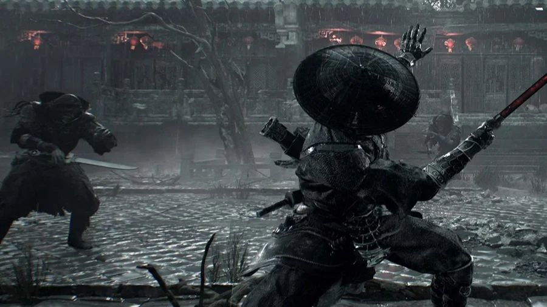

Nếu có một trận boss khiến Phantom Blade Zero nổi đình nổi đám trước ngày ra mắt, thì đó là **Chief Disciple of the Seven Stars** (tạm gọi là **Đại Đệ Tử Thất Tinh**) trong màn **Seven-Star Sword Formation** (Thất Tinh Kiếm Trận). Trận này xuất hiện ở **IGN Live 2024**, **Gamescom 2025** và bản demo dài **22 phút** tại sự kiện **S-PARTY 2025**.

Bài này gom lại những gì đã được xác nhận về trận đấu, cộng với cách AI đánh theo đội hình mà anh em sẽ gặp suốt game. Bản chính thức có thể khác demo, nên Cenix tách rõ phần chắc chắn và phần còn bỏ ngỏ.

<strong>Cảnh báo spoil nhẹ:</strong> bài có mô tả diễn biến hai phase của trận boss. Nội dung lấy từ các bản demo công khai, không phải từ bản chính thức.

## Địch trong Phantom Blade Zero không đánh lẻ

Trước khi vào boss, phải hiểu triết lý AI của game. S-GAME thiết kế kẻ địch theo **đội hình phối hợp**, lấy cảm hứng từ những pha đánh hội đồng được biên đạo trong phim võ hiệp. Một nhóm địch không phải mấy đứa tình cờ đứng gần nhau, mà là một khối có chung nhịp:

-   Lúc thì từng đứa ra đòn riêng, lúc thì **cả nhóm đồng loạt tấn công**.
-   Nhóm có thể **tách ra rồi tập hợp lại** giữa trận.
-   Nhiều khi đòn "cả đám lao vào" thực chất là **một chiêu duy nhất trải ra trên nhiều cơ thể**. Nhìn vậy thì chỉ cần một cách đáp trả.
-   Đội hình cũng tạo ra sơ hở, nhưng sơ hở do chính vị trí của chúng, anh em phải tự đọc.

### Quy tắc đánh hội đồng

1.  **Đừng combo dài vào một đứa.** Mải chém một con là ăn đòn sau lưng từ con khác.
2.  **Giữ sát khí dự phòng.** Đổ hết Sha-Chi vào một mục tiêu thì lúc đứa khác ra đòn xanh, anh em không còn gì để parry.
3.  **Đọc màu cả nhóm.** Tín hiệu xanh – đỏ áp dụng cho mọi kẻ địch, không chỉ đứa đang khoá mục tiêu.
4.  **Sau Ghostep, nhìn quanh.** Ra sau lưng một đứa không có nghĩa là thoát khỏi cả nhóm.

*Một chọi nhiều là chuyện thường ngày ở võ lâm. Mắt phải nhìn cả đám, tay chỉ lo một đứa.*

## Phase 1: Thất Tinh Kiếm Trận

Đại Đệ Tử dẫn theo **sáu đệ tử** áo trùm đầu, tổng cộng bảy người. Điều quan trọng nhất đã được các bài chơi thử xác nhận: **mỗi người có thanh máu riêng**, kể cả tên cầm đầu. Một số hướng dẫn trên mạng nói cả bảy dùng chung một thanh máu, cái đó sai.

Ba kiểu hành vi chính của trận đồ:

-   **Gây áp lực riêng lẻ:** vài người tấn công, số còn lại giữ vị trí. Đây là lúc rút máu từng người một.
-   **Hội tụ đồng loạt:** cả nhóm lao vào từ nhiều hướng. Coi nó như **một đòn duy nhất**, xử lý bằng né chứ đừng cố đỡ.
-   **Hồi sinh:** khi Đại Đệ Tử gục, các đệ tử **hy sinh bản thân** để hồi sinh hắn, mở sang phase 2.

### Cách đánh phase 1

1.  Chọn mục tiêu đang tách khỏi nhóm, rút máu nhanh rồi lùi.
2.  Thấy cả nhóm xoay vòng chuẩn bị hội tụ: chuẩn bị né, đừng tham thêm nhát.
3.  Đòn xanh của từng người: parry để rút sát khí. Đòn đỏ: né lao vào, Ghostep ra khỏi vòng vây.
4.  Tích **Power Surge** trước khi hạ được Đại Đệ Tử, vì phase 2 tới ngay sau đó.

## Phase 2: Hy vọng sụp đổ của Đại Đệ Tử

S-GAME đặt tên phase này là **"Chief Disciple's Fallen Hope"**. Các đệ tử buộc dây vào tay chân của thủ lĩnh, nhấc hắn lên một mạng lưới như mạng nhện và điều khiển hắn bằng thứ năng lượng bị tha hoá. Đại Đệ Tử giờ là **con rối** bị giật dây.

-   Chuyển động **giật cục, phi tự nhiên**, có những cú lắc như quả lắc trên không.
-   Nhịp né vì thế khác hẳn phase 1, phải canh lại từ đầu.
-   Các cơ chế chi tiết hơn của phase này chưa được S-GAME công bố.

Wes Fenlon của PC Gamer kể ở bản demo GDC 2025 rằng anh chết rất nhiều trước một con boss **treo lơ lửng trên ba sợi dây đỏ**, và theo S-GAME thì người chơi chỉ gặp nó sau khoảng **10 tiếng** chơi. Cùng motif con rối giật dây, rất có thể đây là trận anh em sẽ phải chuẩn bị kỹ nhất ở nửa đầu game.

### Cách đánh phase 2

-   **Đừng đoán nhịp theo cơ thể**, hãy nhìn màu chớp. Tư thế con rối đánh lừa mắt nhưng tín hiệu xanh – đỏ vẫn đúng.
-   Giữ khoảng cách trung bình để có chỗ né những cú lắc rộng.
-   Xả Power Surge ngay đầu phase khi đã tích sẵn, trước khi hắn kịp vào guồng.

## Những boss khác đã lộ diện

| Boss | Ghi chú |
|---|---|
| **Wan Jun "Coppermaul"** | Hạ xong rơi **Bashpole**, búa chiến phá được sàn gỗ mở lối mới |
| **Red Wraith** | Xuất hiện cùng demo S-PARTY 2025 |
| **Flame, Lão Sư Múa Lân Đeo Mặt Nạ** | Đốt lửa chặn đường trong đấu trường, phase 2 nhanh và thiên về võ thuật hơn |
| Boss quăng xích tạ | Gặp ở Gamescom 2024, đòn đỏ phải né chuẩn kẻo bị giật xích về |

<strong>Còn bỏ ngỏ:</strong> tên và vũ khí của sáu đệ tử, ngưỡng máu chuyển phase, sát thương cụ thể, và Thất Tinh có bị chỉnh lại ở Hellwalker hay không. Cenix sẽ cập nhật khi game chính thức ra mắt.

Anh em đã xem đoạn demo Thất Tinh chưa, thấy phase con rối rợn hay đẹp? Theo mấy ông, nên hạ đệ tử trước hay dồn hết vào tên cầm đầu? Comment chiến thuật của anh em cho Cenix học hỏi với.

*Nguồn tham khảo: [PC Gamer - Relearn how swords work](https://www.pcgamer.com/games/action/chinese-action-game-phantom-blade-zero-didnt-click-for-me-until-i-realized-its-deep-commitment-to-wuxia-film-authenticity-meant-i-had-to-relearn-how-swords-work/), [PC Gamer - Less like Sekiro, more like Wo Long](https://www.pcgamer.com/games/action/phantom-blade-zero-plays-less-like-sekiro-more-like-wo-long-fallen-dynasty-and-i-couldn-t-be-happier/), [GamesRadar+ - After 3 hours](https://www.gamesradar.com/games/action-rpg/after-3-hours-phantom-blade-zero-is-a-wuxia-flavored-rewarding-action-rpg-with-a-fresh-soulslike-twist/), [Phantom Blade Zero Guide - Seven Stars boss](https://phantombladezero-guide.com/seven-judgments-boss-guide/), [Phantom Blade Zero Guide - Enemy AI](https://phantombladezero-guide.com/phantom-blade-zero-enemy-ai/)*
