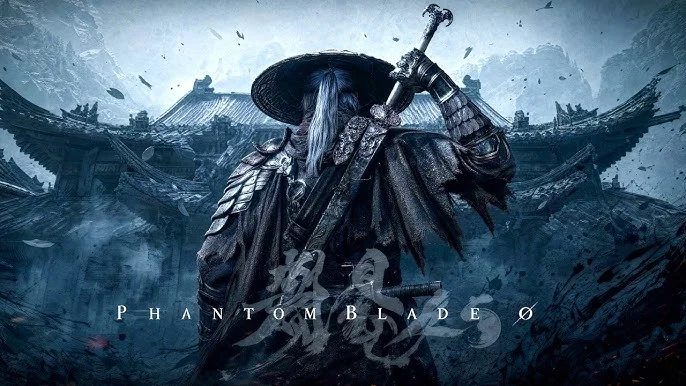

Để Cenix kể cho nghe. Từ ngày ra trailer đầu tiên, Phantom Blade Zero tự gắn cho mình một cái nhãn lạ hoắc: **Kungfupunk**. Nghe như chữ đặt cho kêu, nhưng càng tìm hiểu càng thấy S-GAME làm thật, từ cách dựng thế giới tới từng nhát kiếm được ghi hình.

Bài này chia làm hai nửa: nửa đầu giải thích Kungfupunk là gì, nửa sau kể về võ thuật thật đứng sau hệ thống chiến đấu.

<strong>Một câu cho dễ nhớ:</strong> Kungfupunk = <strong>võ hiệp</strong> + <strong>kung fu</strong> + chút <strong>steampunk</strong> và <strong>cyberpunk</strong>, đặt trên nền <strong>Trung Hoa thời Minh</strong>, nêm thêm <strong>kinh dị dân gian</strong>.

## Kungfupunk: khi võ lâm gặp máy hơi nước

Thuật ngữ do chính giám đốc **Soulframe Liang** (tên thật **Lương Kỳ Vĩ**, 梁其伟) đặt ra. Trong các phỏng vấn tiếng Trung, ông dùng lẫn lộn hai chữ "võ hiệp punk" và "kung fu punk", rồi chọn **Kungfupunk** khi giới thiệu ra quốc tế.

Ý tưởng cốt lõi là đưa máy móc vào một xã hội chưa biết xử lý nó ra sao. Sắt thép, khói và cơ khí đặt cạnh những quy tắc giang hồ cổ xưa. Trong State of Play, anh em đã thấy một **tháp sắt chạy hơi nước** dựng lên cho một thí nghiệm đen tối, ngay giữa thế giới kiếm khách nón lá.

*Mái cong, thư pháp, kiếm khách tóc bạc giữa cơn gió. Phần "kung fu" của Kungfupunk là thế này, phần "punk" thì nằm trong những thứ máy móc anh em sẽ gặp trong game.*

### Giang hồ và hiệp khách

Phần "võ hiệp" không chỉ là múa kiếm. Bối cảnh là **giang hồ**, nơi người thường sống ngoài quyền lực triều đình, có trật tự, nợ nần và công lý riêng. Điều đó giải thích vì sao kẻ thù là hội kín, phản bội là chuyện thường, và chẳng có quan quân nào nhảy vào can.

Soul là hình mẫu **hiệp khách** kinh điển: có nguyên tắc riêng, sống dưới một hạn chót (66 ngày), làm việc phải làm. Liang từng gọi anh là một "người hùng phương Đông rất điển hình", và cho rằng game có thể tạo ra một dòng riêng: **game hành động võ hiệp**.

### Văn hoá dân gian ở khắp nơi

S-GAME đưa vào game rất nhiều chất liệu dân gian Trung Hoa, gồm:

-   Nghi lễ từ đường miền Nam.
-   **Múa lân Quảng Đông**, mà boss **Flame, Lão Sư Múa Lân Đeo Mặt Nạ** là ví dụ rõ nhất.
-   **Rối Chiết Giang**, khớp với nhà kho treo đầy rối gỗ và phase con rối của boss Thất Tinh.
-   Rước thần Phúc Kiến, **mặt nạ Na** Giang Tây, **biến diện** Tứ Xuyên và **Kinh kịch**.

Phần kiến trúc thì được **quét 3D từ đền chùa, nhà dân và di tích thật** ở Quảng Đông, Phúc Kiến, Chiết Giang và Hà Bắc. Bản đồ dẫn đường trong game là **8 tấm thuỷ mặc vẽ tay**.

### Âm nhạc: đàn nhị không để khóc

Nhà soạn nhạc **Bo Caisheng** trộn nhạc cụ dân tộc với âm hưởng điện tử hoài cổ. Đàn nhị, vốn hay gắn với nỗi buồn, ở đây được dùng để diễn tả **tự do và sát khí**. Nhạc của Pang Town còn viết theo **nhịp 7**, xen kẽ 4+3 và 3+4, nghe chông chênh y như cái thị trấn mưa không bao giờ tạnh.

## Võ thật đứng sau từng nhát kiếm

### Đội của Chân Tử Đan

Ngay từ bài giới thiệu năm 2023 trên PlayStation Blog, Soulframe Liang đã nêu tên **Kenji Tanigaki** (Cốc Viên Kiện Trị) là **chỉ đạo hành động**. Theo PC Gamer, Tanigaki đã ở trong đội đóng thế của **Chân Tử Đan** khoảng **30 năm** và làm cùng anh ít nhất một tá dự án.

Tới tháng 8/2026, S-GAME mới tiết lộ bí mật lớn: **bản thân Chân Tử Đan** đã tham gia từ năm 2023 với vai trò **cố vấn sáng tạo** cho phần võ thuật, đồng thời đóng vai **Mó Yuan** bằng khuôn mặt và chuyển động của mình.

### Ghi hình đúng tốc độ, rồi vẽ tay lại

Quy trình của S-GAME khá công phu:

1.  Đội thiết kế ra một chiêu.
2.  Tanigaki **tự diễn** chiêu đó, ghi lại bằng hệ thống nhiều camera.
3.  Video gửi cho hoạ sĩ hoạt hình làm **tư liệu tham khảo**.
4.  Hoạ sĩ **dựng tay** từng khung hình, không dùng thẳng dữ liệu motion capture.

Liang cho rằng motion capture thuần tuý không làm nổi những chiêu này. Các buổi ghi hình đều diễn ở **đúng tốc độ thật**, không quay chậm rồi tua nhanh, vì studio cho rằng chỉnh tốc độ hậu kỳ là thứ làm chuyển động trông giả. Kỹ thuật treo dây kiểu phim Hồng Kông cũng được dùng cho các pha trên không.

### Thiếu Lâm, Nga Mi và kiếm rèn thật

Trong quá trình nghiên cứu, đội ngũ đi khắp nơi tập cùng **cao thủ Thiếu Lâm**, **người luyện võ ở Nga Mi** và **các đoàn múa lân Quảng Đông**. Vũ khí trong game được phát triển từ binh khí truyền thống, và S-GAME còn đặt **thợ rèn làm bản sao thật** để đội ngũ cầm lên, cảm nhận trọng lượng và độ dài ảnh hưởng tới chuyển động ra sao.

### Vì sao chỉ có một thanh Sha-Chi?

Theo Liang, võ thuật Trung Hoa coi **công và thủ là một động tác liền mạch**. Đó là lý do game dùng một thanh **Sha-Chi** duy nhất, thay vì tách thể lực và thế đứng như Sekiro. Wes Fenlon của PC Gamer cũng phải "học lại cách kiếm vận hành" mới thấm: trong phim võ hiệp như Ngoạ Hổ Tàng Long hay Tiếu Ngạo Giang Hồ II, đòn đỡ trông y như đòn chém, kiếm dội vào kiếm liên tục chứ không có nhịp đánh – đỡ rạch ròi.

Đánh hội đồng cũng vậy: địch được thiết kế thành **đội hình phối hợp**, mô phỏng những cảnh quần chiến được biên đạo trong phim võ thuật.

<strong>Bài tập về nhà kiểu Cenix:</strong> trước ngày 29/10, xem lại một phim võ hiệp kinh điển. PC Gamer gợi ý <strong>A Touch of Zen</strong> (Hiệp Nữ, 1971). Mắt quen nhịp kiếm dội kiếm rồi thì vào game parry sẽ "thấm" nhanh hơn hẳn.

Anh em thấy Kungfupunk là hướng đi mới mẻ hay chỉ là cái nhãn marketing? Và nếu được chọn một phim võ hiệp để "ôn bài" trước khi chơi, anh em chọn phim nào? Comment cho Cenix xin list phim cuối tuần với.

*Nguồn tham khảo: [PlayStation Blog - A New Beginning in a Long Journey (2023)](https://blog.playstation.com/2023/05/24/phantom-blade-zero-a-new-beginning-in-a-long-journey/), [PC Gamer - Donnie Yen](https://www.pcgamer.com/games/action/phantom-blade-zero-just-dropped-a-huge-secret-hong-kong-legend-donnie-yen-has-been-guiding-its-kungfupunk-stunts-since-2023/), [PC Gamer - Relearn how swords work](https://www.pcgamer.com/games/action/chinese-action-game-phantom-blade-zero-didnt-click-for-me-until-i-realized-its-deep-commitment-to-wuxia-film-authenticity-meant-i-had-to-relearn-how-swords-work/), [PC Gamer - 8 bản đồ thuỷ mặc](https://www.pcgamer.com/games/action/phantom-blade-zero-finally-shows-off-its-interconnected-game-world-with-exploration-guided-by-8-authentic-hand-painted-chinese-ink-wash-maps/), [Phantom Blade Zero Guide - What Is Kungfupunk](https://phantombladezero-guide.com/what-is-kungfupunk/), [Phantom Blade Zero Guide - Real Martial Arts](https://phantombladezero-guide.com/phantom-blade-zero-martial-arts/)*
