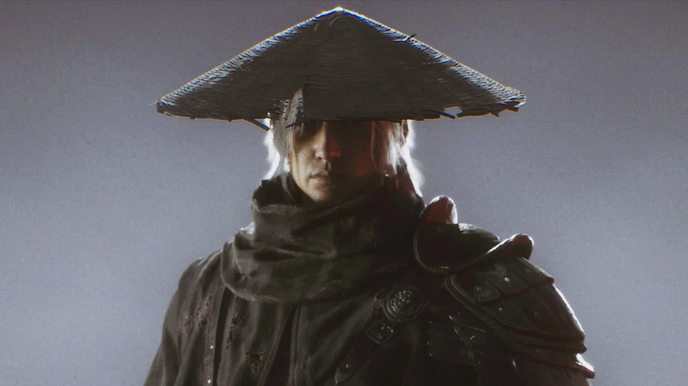
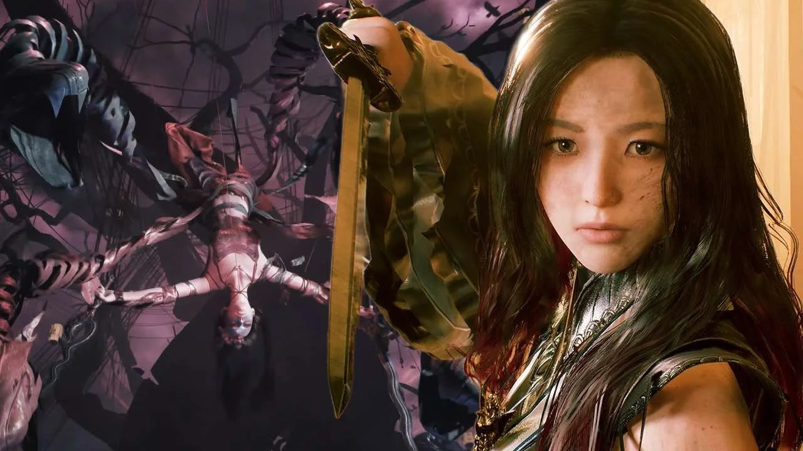

Trời ơi hot quá nè mấy pa! Còn ba ngày nữa là Phantom Blade Zero ra mắt, và cái làm Cenix tò mò nhất không chỉ là combat, mà là câu chuyện. Một sát thủ bị chính tổ chức của mình truy sát, sống bằng thời gian vay mượn, và đứng giữa một âm mưu mà anh không biết ai là bạn ai là thù.

Bài này giới thiệu nhân vật chính, tổ chức The Order và những gương mặt đã lộ diện qua tư liệu chính thức. S-GAME giữ kín khá nhiều, nên những gì chưa xác nhận Cenix sẽ ghi rõ.

<strong>Không spoil:</strong> bài chỉ dùng thông tin S-GAME và PlayStation đã công bố trước ngày ra mắt, cộng phần tiểu sử từ các phần Phantom Blade cũ. Không có nội dung từ bản chính thức.

## Soul: sát thủ còn 66 ngày để sống

*Nón lá che nửa mặt, tóc bạc lơ thơ, áo giáp chắp vá. Soul không cần nói nhiều, nhìn là biết đã đi qua bao nhiêu trận.*

**Soul** là nhân vật chính, một sát thủ tinh nhuệ phục vụ tổ chức bí mật **The Order**. Câu chuyện bắt đầu khi anh bị **gài tội sát hại người đứng đầu tổ chức**. Từ người trong nhà, Soul thành kẻ bị cả đám đồng môn cũ truy lùng.

Trong cuộc truy sát đó, Soul bị **trọng thương ở tim**. Một thầy thuốc bí ẩn cứu anh bằng một phương pháp chỉ tạm thời: trái tim ấy chỉ giữ anh sống được **66 ngày**. Trong khoảng thời gian vay mượn này, Soul phải lần ra ai đã gài mình, và vì sao.

Giám đốc **Soulframe Liang** từng mô tả Soul là một "người hùng phương Đông rất điển hình": ít lời, có nguyên tắc riêng, làm điều đúng dù không ai nhìn thấy. Cái tên Soul cũng không mới với fan lâu năm: anh là nhân vật xuyên suốt loạt game của S-GAME từ thời **Rainblood** trên nền Flash.

### 66 ngày: cốt truyện hay đồng hồ đếm ngược?

Đây là câu hỏi nhiều người lo nhất. Những gì đã chắc:

-   **66 ngày là tiền đề cốt truyện**, được xác nhận trên trang Steam và tư liệu chính thức.
-   Có một chế độ chơi tên **Sixty-Six Days**. Theo review của GamesRadar+, đó là chế độ hardcore **xoá tiến trình sau 66 lần chết**.

Những gì **chưa có nguồn xác nhận**: chế độ thường có đồng hồ đếm ngược thật hay không, có hiển thị bộ đếm ngày không, 66 ngày có tương đương 66 giờ chơi không. Các bài chơi thử và review tới giờ không nhắc tới đồng hồ nào gây áp lực trong chế độ thường, nên anh em cứ yên tâm đi khám phá.

Con số 66 còn được S-GAME chơi chữ khi công bố ngày phát hành ban đầu là **9/9/2026** tại The Game Awards, trước khi dời sang 29/10.

## The Order: tổ chức sát thủ trong bóng tối

**The Order** là hội kín của những sát thủ tinh nhuệ, hoạt động khắp Phantom World. Hệ thống cấp bậc theo các phần Phantom Blade trước:

-   **Instrument** (Khí): tầng thấp, những con tốt có thể hy sinh.
-   **Will** (Ý): tầng lãnh đạo cấp cao, người ra quyết định.

Đây là tổ chức Soul từng phục vụ và giờ đang săn lùng anh. Cái hay của tiền đề là mọi kẻ thù đều từng là người quen, nên mỗi trận đánh với đồng môn cũ đều có chút nặng lòng.

## Những gương mặt quanh Soul

### Mó Yuan – vai diễn của Chân Tử Đan

Đây là tin gây sốt nhất mùa hè. Trong State of Play tháng 8/2026, PlayStation xác nhận **Chân Tử Đan (Donnie Yen)** đóng vai **Mó Yuan** qua ghi hình khuôn mặt và chuyển động, đồng thời là **cố vấn sáng tạo** cho phần võ thuật. Theo PC Gamer, Mó Yuan là **cha của Soul**. Gematsu dẫn lời PlayStation rằng những lần chạm trán ông sẽ khiến người chơi "luôn phải dè chừng".

Chân Tử Đan tham gia dự án từ **năm 2023**, nhưng S-GAME giữ kín tới tận trailer tháng 8/2026 mới công bố.

### Mu Xiaokui

Con gái của người sáng lập The Order. Theo tư liệu cộng đồng, cô là một chiến binh giỏi, vẫn còn dè dặt khi chuẩn bị gánh vác vai trò lãnh đạo. Phần ghi hình khuôn mặt cho các đoạn phim được thực hiện bởi nữ diễn viên **Trương Cận Chi** (Zhang Jinzhi). Vai trò cụ thể của cô trong Zero chưa được tiết lộ.

*Một nữ kiếm khách xuất hiện trong tư liệu quảng bá của game. S-GAME chưa ghi tên kèm ảnh, nên Cenix chưa dám chốt là ai. Anh em nào biết thì comment nha.*

### Zuo Shang (Tả Thương)

Một **Will** của The Order và là bậc **quân sư**. Theo tiểu sử từ các phần trước, anh được cho là trẻ mồ côi được người sáng lập tổ chức nhận nuôi, và đang âm thầm điều tra về thân thế của chính mình. Hướng điều tra ấy rất có thể dính tới âm mưu đẩy Soul vào đường cùng. Chưa có hình ảnh Zero nào của nhân vật này được công bố.

### Leidang (Lôi Đương)

Xuất hiện cùng Soul trong tranh minh hoạ chính thức của Zero. Ở các phần Phantom Blade trước, Leidang là một thành viên cấp cao của The Order. Vai trò trong Zero chưa được tiết lộ.

## Những kẻ thù đã lộ mặt

Theo Gematsu, trên hành trình Soul sẽ đối đầu với **sát thủ**, **những kẻ đã sa vào bóng tối** và **các võ sư âm mưu chống lại anh**. Một số boss đã xuất hiện qua demo:

| Boss | Ghi chú |
|---|---|
| **Đại Đệ Tử Thất Tinh** | Bảy người, bảy thanh máu, phase hai thành con rối. Xem bài [Thất Tinh Kiếm Trận](/huong-dan/phantom-blade-zero-boss-that-tinh-kiem-tran/) |
| **Wan Jun "Coppermaul"** | Rơi búa chiến Bashpole |
| **Red Wraith** | Xuất hiện trong demo S-PARTY 2025 |
| **Flame, Lão Sư Múa Lân Đeo Mặt Nạ** | Boss lửa trong bản preview tháng 10/2026 |

## Có cần chơi các phần trước không?

**Không cần.** Phantom Blade Zero là câu chuyện độc lập, S-GAME làm để người mới vào thẳng. Nhưng nếu tò mò thì loạt game có lịch sử dài: bắt đầu từ **Rainblood** trên nền Flash với Pang Town mưa dầm, sau đó là các phần Phantom Blade trên di động và **Phantom Blade: Executioners**. Biết trước tên mấy nhân vật thì xem phim cắt cảnh sẽ thấy nhiều "easter egg" hơn thôi.

Anh em đoán ai là kẻ đã gài Soul? Cenix thì đang nghi tên quân sư lắm mưu, nhưng mấy game kiểu này hay đánh lừa người chơi lắm. Comment giả thuyết của anh em đi, ra game rồi mình đối chiếu xem ai đoán trúng.

*Nguồn tham khảo: [PlayStation Blog - State of Play 17/8/2026](https://blog.playstation.com/2026/08/17/phantom-blade-zero-state-of-play-dives-deep-into-combat-and-the-wulin-world/), [PC Gamer - Donnie Yen](https://www.pcgamer.com/games/action/phantom-blade-zero-just-dropped-a-huge-secret-hong-kong-legend-donnie-yen-has-been-guiding-its-kungfupunk-stunts-since-2023/), [Gematsu - State of Play deep dive](https://www.gematsu.com/2026/08/phantom-blade-zero-state-of-play-deep-dives-into-gameplay-and-story), [GamesRadar+ - Phantom Blade Zero review](https://www.gamesradar.com/games/action-rpg/phantom-blade-zero-review/), [Phantom Blade Zero Guide - World & Lore](https://phantombladezero-guide.com/world/), [Phantom Blade Zero Guide - 66 Days](https://phantombladezero-guide.com/phantom-blade-zero-66-days/)*
