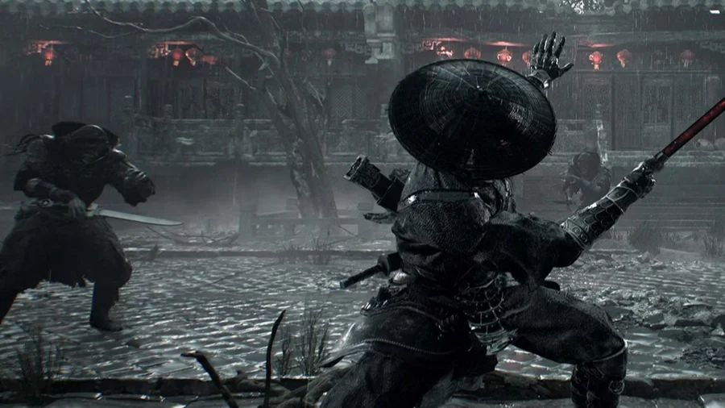

Mấy ông xem trailer Phantom Blade Zero chắc đều có chung một thắc mắc: sao Soul cứ "biến" ra sau lưng địch hoài vậy? Câu trả lời nằm trong ba khái niệm mà ai chơi cũng phải thuộc: **Sha-Chi**, **luật xanh – đỏ** và **Ghostep**.

Bài này Cenix tổng hợp từ bài đăng State of Play của PlayStation Blog, các bài chơi thử của PC Gamer, GamesRadar+ và tài liệu cộng đồng, gom lại thành một vòng lặp dễ nhớ để anh em vào game là dùng được liền.

<strong>Tóm tắt một dòng:</strong> tích sát khí bằng combo và parry → <strong>parry đòn xanh</strong> để rút cạn sát khí địch → <strong>né xuyên đòn đỏ</strong> để Ghostep ra sau lưng → địch vỡ thế thì xả <strong>Power Surge</strong> → lặp lại.

## Sha-Chi là gì mà quan trọng dữ vậy?

Sha-Chi (杀气, sát khí) là thanh tài nguyên **dùng chung cho tấn công mạnh và phòng thủ**. Đỡ đòn rút sát khí, tung chiêu nặng cũng rút sát khí. Hết sát khí mà còn cố đỡ là bị phá thủ, đứng hứng nguyên combo.

Chuyện một thanh gánh hai việc không phải ngẫu nhiên. Giám đốc S-GAME **Soulframe Liang** từng giải thích rằng trong võ thuật Trung Hoa, công và thủ là một động tác liền mạch, nên game không tách thể lực và thế đứng ra như Sekiro. Hệ quả là mỗi lần anh em bấm nút đều phải cân: chém thêm một nhát hay giữ lại sát khí để đỡ.

### Cách hồi và cách tiêu

| Hồi sát khí | Tiêu sát khí |
|---|---|
| Đánh trúng combo thường | Giữ nút đỡ đòn |
| **Parry** đòn xanh (hồi nhiều nhất, kèm thưởng) | Đỡ đòn xanh thay vì parry (mất rất nhiều) |
| Né xuyên đòn đỏ đúng lúc | Các chiêu nặng, chiêu đặc biệt |
| Hạ địch | Parry hụt, né hụt |
| **Đổi vũ khí** giữa combo (theo review GamesRadar+) | |

Bản chơi thử cho thấy vũ khí nhanh như song đao, kiếm thường hồi sát khí nhanh hơn đồ nặng như đại đao. Cầm đồ nặng thì càng phải parry chuẩn để bù.

### Địch cũng có Sha-Chi

Đây là chỗ nhiều người mới chưa nhận ra. Wes Fenlon của PC Gamer kể rằng anh chết lên chết xuống ở bản demo GDC 2025 cho tới khi hiểu: **kẻ địch cứ vung kiếm liên tục cho tới khi cạn sát khí**. Trong phim võ hiệp, đòn đỡ nhìn y hệt đòn chém, kiếm dội vào kiếm chứ không có nhịp "anh đánh, tôi đỡ" kiểu kiếm thuật châu Âu. Muốn địch dừng tay thì phải **rút cạn sát khí của nó**, và cách nhanh nhất là parry.

## Luật xanh – đỏ: nhìn màu mà phản xạ

Mọi đòn quan trọng của địch đều có tín hiệu màu chớp lên ngay trước khi chạm.

### Chớp xanh – Brutal Move

-   **Cách xử lý:** parry, tức là **nhấp** nút đỡ (L1 trên PS5) đúng khoảnh khắc đòn chạm.
-   **Kết quả:** rút một mảng lớn sát khí của địch, hồi sát khí cho mình, có thể kích hoạt Ghostep và mở cửa sổ phản công.
-   **Đừng:** giữ nút đỡ. Đỡ cứng đòn xanh tốn sát khí cực nặng mà địch chẳng mất gì.

### Chớp đỏ – Killer Move

-   **Cách xử lý:** **né lao thẳng vào đòn** (R1). Không đỡ được, không parry được.
-   **Kết quả:** Ghostep vòng ra sau lưng địch, có ngay một nhịp để chém.
-   **Đừng:** né lùi ra xa. Né lùi thì sống nhưng mất luôn phần thưởng.

PC Gamer chơi thử ở Gamescom 2024 còn gặp một boss quăng xích có tạ, chớp đỏ là phải né chuẩn, đứng sai vị trí là nó giật xích về quật tiếp. Nghĩa là "né vào đòn" phải tính cả hướng, không phải cứ lăn bừa.

### Đòn không chớp

Đòn thường thì đỡ, giãn khoảng cách hoặc né đều được. Cố parry mấy đòn này là phí sát khí và dễ trật nhịp với đòn xanh tiếp theo.

*Sân lát đá ướt mưa, đèn lồng đỏ, hai thanh kiếm chờ nhau sơ hở. Đây là lúc mắt phải dán vào màu chớp.*

## Ghostep: cú "biến" làm nên thương hiệu

Ghostep là pha dịch chuyển ra sau lưng đối thủ, kích hoạt khi anh em **parry trúng đòn xanh** hoặc **né xuyên đòn đỏ** đúng lúc. Nó vừa là phòng thủ, vừa là tấn công: thoát khỏi đòn và đứng ngay chỗ địch không phòng bị.

Có hai lưu ý khi đánh đông người:

-   Ghostep ra sau lưng một đứa không có nghĩa là thoát khỏi cả đám. Địch trong Phantom Blade Zero đi theo **đội hình**, đứa khác vẫn chém được anh em.
-   Sau mỗi Ghostep, liếc nhanh xung quanh trước khi lao vào combo dài.

## Power Surge: dồn sát khí, xả một phát

Mỗi vũ khí chính có một **Power Surge**, tức tuyệt kỹ riêng, nạp bằng phần tinh hoa sát khí tích từ parry, Ghostep và combo. PC Gamer mô tả từ bản chơi thử 2024 rằng parry đúng lúc làm vỡ thế đứng của địch, và đó chính là lúc nên xả Power Surge.

Mẹo dùng cho hiệu quả:

1.  **Để dành** cho lúc địch vỡ thế hoặc boss vừa chuyển phase.
2.  **Đừng xả** khi địch còn đầy sát khí, nó đỡ được và anh em phí cả thanh.
3.  Với boss, tích sẵn trước khi máu boss xuống ngưỡng chuyển phase, chuyển phase xong là dập liền.

<strong>Bài tập 15 phút:</strong> chọn một con địch, parry sạch <strong>10 đòn xanh liên tiếp</strong>. Xong thì thêm Ghostep với đòn đỏ. Thuần rồi thì kéo thêm con thứ hai vào, trước mỗi đòn hô to trong đầu "xanh" hay "đỏ". Đoán mò là dừng, nghỉ một chút rồi tập lại.

## Vòng lặp chuẩn để nhớ

1.  **Mở màn:** combo thường để tích sát khí.
2.  **Phòng thủ:** thấy xanh thì parry, thấy đỏ thì né lao vào.
3.  **Rút cạn:** mỗi lần parry là một mảng sát khí của địch biến mất.
4.  **Vỡ thế:** địch hết sát khí thì đứng hớ, chém chuỗi nặng.
5.  **Kết liễu:** xả Power Surge, rồi quay lại bước 1.

Nghe thì đơn giản, nhưng vào trận với ba đứa vây quanh mà vẫn giữ được nhịp này thì mới là cao thủ. Cách canh nhịp parry chi tiết, Cenix viết riêng ở bài [Parry chuẩn từng nhịp](/huong-dan/phantom-blade-zero-parry-chuan-tung-nhip/).

Anh em thấy hệ thống này giống Sekiro hay giống Wo Long hơn? Ai đã chơi demo rồi thì kể Cenix nghe lần đầu Ghostep thành công cảm giác ra sao, comment bên dưới nha.

*Nguồn tham khảo: [PlayStation Blog - State of Play 17/8/2026](https://blog.playstation.com/2026/08/17/phantom-blade-zero-state-of-play-dives-deep-into-combat-and-the-wulin-world/), [PC Gamer - Relearn how swords work](https://www.pcgamer.com/games/action/chinese-action-game-phantom-blade-zero-didnt-click-for-me-until-i-realized-its-deep-commitment-to-wuxia-film-authenticity-meant-i-had-to-relearn-how-swords-work/), [PC Gamer - Less like Sekiro, more like Wo Long](https://www.pcgamer.com/games/action/phantom-blade-zero-plays-less-like-sekiro-more-like-wo-long-fallen-dynasty-and-i-couldn-t-be-happier/), [GamesRadar+ - Phantom Blade Zero review](https://www.gamesradar.com/games/action-rpg/phantom-blade-zero-review/), [Phantom Blade Zero Guide - Sha-Chi Combat System](https://phantombladezero-guide.com/sha-chi-combat-system-explained/)*
